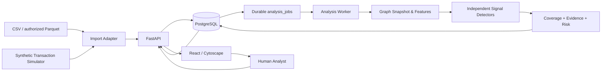
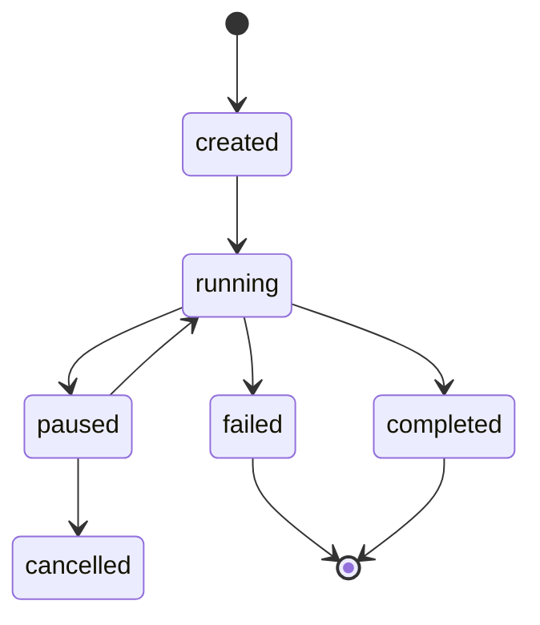
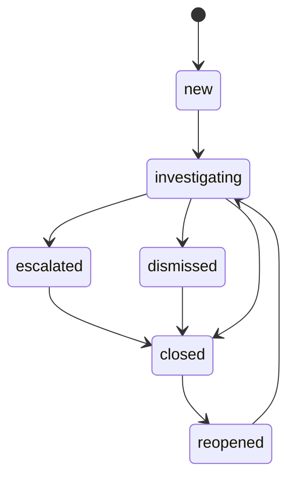
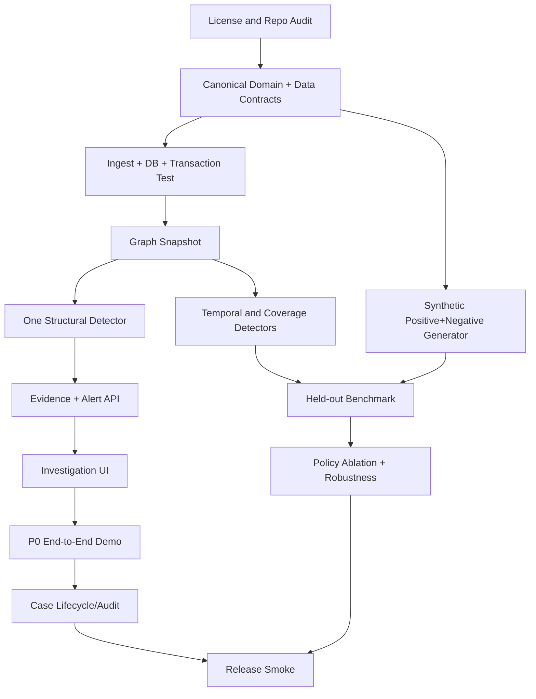

# NEXORA AI — MASTER ENGINEERING SPECIFICATION + CLAUDE CODE EXECUTION PLAYBOOK

**Team:** SYNAPTIC LABS  
**Repository name supplied by team:** `SYNAPTIC-LABS` (the full repository URL has not yet been supplied)  
**Product:** NEXORA AI  
**Target:** ITU Hackathon 2026 × Bank CenterCredit — Banking Innovation & Cybersecurity  
**Document version:** 2.0 · 17 November 2026  
**Delivery language:** Russian for pitch/product UI; English for technical contracts, code, identifiers and the Claude execution prompt.  
**Status:** Engineering design and execution instructions, **not** evidence that any NEXORA code has been implemented or tested.

> **ONE-SENTENCE THESIS:** NEXORA AI transforms transaction records into **time-consistent, evidence-backed, coverage-aware fraud-network investigations** and helps a human analyst prioritize, verify, and act on cases—without pretending that a graph anomaly proves a crime.

---

## DOCUMENT NAVIGATION

1. Product mandate and winning strategy
2. Source repository audit and reuse policy
3. Product scope, fraud-vs-AML distinction, operational narratives
4. Architectural principles and decisions
5. System context, runtime topology, event lifecycle
6. Repo layout, modules, dependency rules
7. Canonical data contracts, storage schema and money/time semantics
8. Importers, deduplication, streaming replay, consistency
9. Graph foundation, snapshots, feature computation
10. Network formation detection and practical algorithms
11. Temporal proof, amount-constrained flow and ambiguity
12. Peer-normalized anomalies and statistical controls
13. Coverage/abstention and next-best-data logic
14. Evidence, reason codes, provenance and auditability
15. Fraud priority and cross-family corroboration
16. Case lifecycle and human-in-the-loop governance
17. APIs, asynchronous workers, concurrency and failures
18. Frontend/UX and demo choreography
19. Synthetic fraud lab, negative controls, evaluation and robustness
20. Security, reliability, observability and deployment
21. Engineering quality gates and traceable acceptance tests
22. Execution schedule, dependency DAG and ownership
23. Risk register, concessions, cut lines and architectural ADRs
24. Jury-oriented evidence package, pitch and adversarial Q&A
25. **VERY DETAILED MASTER PROMPT FOR CLAUDE CODE**
26. Phase-by-phase Claude commands, handoffs and completion protocol
27. Operational checklists, command examples and final definition of done
28. Source URLs and claims/limitations ledger

This document is intentionally comprehensive. **Treat the P0 gates as binding and the P2 features as optional.** Engineering depth is not measured by code volume.

---

# 1. PRODUCT MANDATE AND WINNING STRATEGY

## 1.1 Competition reality and timing

The ITU Hackathon public announcement published 12 November 2026 describes a BCC-provided banking case, 1–5 people per team, a total prize pool of 1,000,000 KZT, registration/project submission during **6–20 November**, online selection **21–26 November**, mentoring **27 November–3 December**, and a final on **4 December 2026**. A different social repost reports **11 December**. Treat the final date as **unresolved until organizers reconfirm it**. Do not place an unverified date or an invented scoring rubric on slides.

Official announcement: https://beta.egov.kz/org/zhambyl-talas/press/news/details/1328207?lang=kk

**Immediate priority:** submit a credible application by the earlier confirmed application deadline, do not postpone registration because the project is still evolving. Verify reuse rules and exact case rubric with organizers. The judge scorecard below is an **internal heuristic**, not published official ITU judging criteria.

## 1.2 Core business problem

A bank may produce many transaction-level rule alerts, while coordinated money movement happens through several accounts, time windows and transfers. Investigators need to understand the **network and the chain of evidence**, not a black-box number that labels an individual account guilty.

Business-user questions:

- Which **groups**, not merely individual transactions, deserve review?
- What exact transactions and chronological constraints support the group-level hypothesis?
- Which signals are independent, and which are two views of the same structural anomaly?
- What is not observed because the dataset is partial or boundary-limited?
- What evidence should the bank request next?
- How does an analyst record and justify the next step?
- How many false alerts can the system avoid at a fixed investigator review budget?

## 1.3 Product positioning

**NEXORA AI — Explainable Financial Fraud Network Intelligence.**

The MVP is a **bank analyst decision-support product**, not a production transaction authorization service and not proof of financial crime. The product supports fraud and AML pattern investigation; whether a specific scenario qualifies as fraud, laundering, misuse or innocent activity requires context and review.

The new project's *original contribution* should be demonstrably different from the six HackAlem AML source projects:

1. Event-time-aware ingestion + reproducible transaction replay.
2. Canonical, typed evidence chain across detector families.
3. Coverage-aware *abstention*, not automatic certainty for truncated graphs.
4. Cross-family corroboration with safeguards against double-counting correlated signals.
5. Counterexamples and negative-control scenarios, not only planted suspicious structures.
6. Persisted bank-analyst case lifecycle and immutable audit history.
7. A measured end-to-end demo from incoming transfer to inspected evidence and human decision.

## 1.4 Internal judge scorecard (NOT an organizer rubric)

Use each category as a team check, not as a claim about ITU's official criteria:

| Category | Weight for internal prioritization | Proof to bring |
|---|---:|---|
| Problem fit and realistic bank workflow | 20 | Analyst journey, scoped threat scenario, no false integration claims |
| Novel analytics and hard technical decisions | 25 | Working temporal+graph+coverage examples, architecture ADRs |
| Working product, reliability and UI | 20 | Clean-clone startup, live demo, mobile checks |
| Measured quality vs reasonable baselines | 20 | Reproducible held-out synthetic tests, false positives, ablation |
| Business potential and persuasive explanation | 15 | Buyer persona, deployment integration outline, pitch Q&A |

Reject decorative features if they damage the reliability of the top four categories. Do not fit metrics or demos to this invented scorecard.

## 1.5 P0/P1/P2 contract

- **P0 = mandatory submission-grade vertical slice:** ingest → store → directed graph → two real detector families → evidence → alert → analyst case → React UI → synthetic positive+negative cases → tests → reproducible startup.
- **P1 = high-value distinction:** time-compatible amount flow, boundary-aware abstention, deduplicated cross-family risk, held-out benchmark, ablation, persistent replay worker, audit trail, polished UX.
- **P2 = only if P0/P1 verified:** counterfactual network simulation, advanced sensitivity diagnostics, next-best-data ranking, optional LLM narrator, visual flourishes, English/Kazakh localization.

Never allow P2 to become a precondition for P0 working.

## 1.6 Product claims policy

Words allowed with real evidence: *detected graph formation*, *matched compatible transfer route*, *flagged unusual relative to peer group*, *generated an analyst review candidate*, *identified a boundary-limited observation*, *achieved X on the named synthetic test suite*.

Words disallowed without independent real-world validation: *prevents actual fraud*, *guarantees protection*, *production-grade real-time bank integration*, *detects 99% of fraud*, *proved criminal network*, *eliminated monetary losses*, *regulator-certified*, *BCC-integrated*.

---

# 2. VERIFIED REFERENCE REPOSITORIES AND REUSE POLICY

The following paths and components were inspected in GitHub repositories on 17 November 2026. Their existing algorithms are **design references**, not a pre-approved redistribution grant. Their historical demo dataset is the same HackAlem/Freedom graph family; a dataset with known suspicious seed accounts is not automatically a ground-truth-labeled fraud dataset.

## 2.1 Source inventory

| Source | Files / code surfaces actually inspected | Strength | Weakness relative to NEXORA | Use disposition |
|---|---|---|---|---|
| [Vantage AI](https://github.com/BAITC-Hacks/hack-7bb3c2d4-vantage-ai) | `src/moneygraph/formations.py`, `completeness.py`, `flows.py`, `priority.py`, `dataio.py`, `README.md`; `tests/test_outputs.py` exists | Five formation types, breaking-point and data-completeness reasoning | Batch historical AML graph, not continuous API-based bank fraud monitoring | **Primary algorithmic reference**, independent adapters/reimplementation unless licensed |
| [Jigas](https://github.com/BAITC-Hacks/hack-e3bf6094-jigas) | `hackalem/graph.py`, `report.py`; `frontend/src/components/GraphView.jsx`; `test_contract.py` | Exact integer IDs and minor units; strict JSON; React/Cytoscape; Docker/QA | Generates a static `report.json` without operational case DB or live API | **Primary UI/contract reference**, use typed API not static JSON as source of truth |
| [UNRU AI](https://github.com/BAITC-Hacks/hack-c41412b2-unru-ai) | `moneygraph/patterns.py`, `stability.py`, `evidence.py` | Date-compatible flow, repeated episodes, perturbation/sensitivity, evidence availability | Another independently designed score/system; multiple limitations of day-level data | **Temporal + robustness reference**, do not combine score formulas |
| [Natural Intelligence](https://github.com/BAITC-Hacks/hack-0ace0672-natural-intelligence) | `src/motifs.py`, `anomaly.py`, `validate_injection.py` | Time-respecting motifs, IQR peer anomalies, planted-pattern evaluation | Synthetic injection is not external truth; some thresholds tied to source data | **Statistical and evaluation reference**, add legitimate negatives and held-out split |
| [Synex](https://github.com/BAITC-Hacks/hack-173e8652-synex) | `services/agentic_loop.py`, `ai_decision_support.py`, `repository/models.py`, `verification.py` | SQLAlchemy case/monitoring/audit entities, human approval, LLM fail-closed | Heavier workflow and LLM capabilities than needed for a stable first slice | **Workflow/governance reference**, keep core analysis LLM-free |
| [Moggers](https://github.com/BAITC-Hacks/hack-082c1388-moggers) | `frontend/src/GraphCanvas.tsx`, `src/moneygraph/api.py` (path identified), React/TS frontend inventory | Typed Cytoscape component and graph controls | Duplicate frontend solution; integration adds churn | **Secondary design reference**, don't merge two React apps |

### Verified individual details

**Vantage** `formations.py` defines `RULES`, `WEIGHTS`, five types (`funnel`, `chain`, `reciprocal_loop`, `fan_out`, `bridge`), `_breaking_point`, formation membership and evidence. `completeness.py` defines crawl-depth limitations, knowledge states, confidence caps and `next_data_request`. These calculations describe observed graph structures, **not legal culpability or counterfactual intervention efficacy**. `priority.py` is a separate heuristic score, unsuitable for direct addition to Jigas/UNRU scores.

**Jigas** uses React + Cytoscape for graph exploration. `report.py` contains `_exact_int` and `_json_safe`; keep account IDs as strings over HTTP/JS, retain monetary arithmetic in integer tiyn. Its original runtime is a batch pipeline + static report; NEXORA needs persistent application state and API. `test_contract.py` is a notably strong reference for edge-case and artifact checking, including IDs beyond JavaScript safe integer precision.

**UNRU** `patterns.py` exposes `compatible_flow`, `repeated_episodes`, `short_cycles`; its capacity logic is a useful reference for avoiding the naïve double assignment of amounts. `stability.py` runs perturbed score weights/thresholds and randomly dropped edges. Treat these as **sensitivity experiments**, not a learned confidence probability.

**Natural Intelligence** `motifs.py` includes time-respecting cycles, pass-through matching and shared-receiver analysis; `anomaly.py` uses peer-relative robust thresholding; `validate_injection.py` injects synthetic fan-in, fan-out, chain and cycle examples. Its positive-only injection approach must be complemented with hard benign lookalikes and **separate frozen test scenarios**.

**Synex** has persisted `PipelineRun`, `Investigation`, `InvestigationNote`, `AuditEvent`, `MonitoringAlert`, `AgenticAction` ORM models; `AgenticLoopService` contains proposal and approval logic; AI decision support validates or falls back to deterministic rules. Adapt concepts, not its entire agentic stack.

**Moggers** uses TypeScript/Cytoscape `GraphCanvas.tsx` with imperative zoom/fit/center controls; it is an alternative implementation reference, not a reason to fork a second product.

## 2.2 Permission and provenance gate (BLOCKING)

In the top-level file inventories of these six repositories, no standard root `LICENSE` file was visible. This **does not conclusively establish license status**; inspect repository metadata, nested copyright notices, commit history, contributor permissions and possibly separately attached terms. **Public source is not automatically open-source for redistribution.**

Before copying any code/data:

1. Confirm the repository license applicable to exact files and external assets.
2. If no valid grant, obtain explicit permission from the relevant copyright holders or independently implement the *ideas*, not their code.
3. Verify the ITU competition allows pre-existing code and requires attribution/novel work disclosure; ask organizers directly.
4. Check dataset redistribution rights separately. A right to read a dataset for one competition does not imply a right to publish/reuse it for another.
5. Maintain `docs/PROVENANCE.md` containing source repo URL, source SHA, copied/adapted files, permission/license basis, attributions, and what SYNAPTIC LABS built new.
6. Do not transplant stock UI art, datasets, brand assets, screenshots or source components when rights are unconfirmed.

A clean-room-like implementation from documented **behavioral requirements** is the default until code reuse is authorized. Never conceal the origin of code or pretend a fork is an independent invention.

## 2.3 Integration decision matrix

| Concern | Canonical owner in NEXORA | Inspiration, not a dependency | Explicit anti-pattern |
|---|---|---|---|
| Data parsing | `ingest/adapters` | Vantage `dataio`, Jigas `validation` | Reuse multiple incompatible DataFrame schemas |
| Graph construction | `graph/snapshot_builder` | Jigas `graph`, Vantage `dataio` | Build separate graph versions per detector |
| Formation detection | `detectors/structural` | Vantage `formations` | Treat graph bridge as proof of illegal conduct |
| Temporal proof | `detectors/temporal` | UNRU `patterns`, Natural `motifs` | Infer hours from day-only records |
| Coverage | `coverage/policy` | Vantage `completeness`, UNRU `evidence` | Treat unknown as negative/zero |
| Peer anomaly | `detectors/peer` | Natural `anomaly` | Global thresholds across incomparable accounts |
| Evidence | `evidence/registry` | UNRU `evidence`, Jigas `report` | Free-text-only model-generated evidence |
| Risk | `risk/policy` | Compare all source heuristics | Add several ranking scores directly |
| Persistent cases | `cases/service` | Synex repository/loop | Give an AI service permission to freeze accounts |
| Frontend | **One** React/TS app | Jigas primary, Moggers reference | Merge two frontend repositories wholesale |
| QA | `tests` + contract fixtures | Jigas, UNRU, Synex tests | Cite others' test count as NEXORA's tests |

---

# 3. SYSTEM BOUNDARIES, OPERATIONAL NARRATIVES AND NON-GOALS

## 3.1 Threat and scenario taxonomy

| Scenario | Observation | Legitimate lookalike | Required corroboration |
|---|---|---|---|
| Coordinated collection/mule funnel | Many sources → shared accounts → forwarding | Marketplaces, crowdfunding, merchant settlement | Temporal movement and distinct network context |
| Rapid pass-through | Incoming amount followed by related outgoing amount | Treasury settlement, family transfer, automated sweeping | Amount-feasible flow + usable timestamp precision |
| Layering chains | Multi-hop transfers and unusual role transitions | Supplier/payment processor network | Time-respecting paths and negative comparisons |
| Repeated loops | A→B→C→A or opposite-direction money movements | Mutual reimbursements, legitimate circulation | Repetition, uncommonness, nontrivial values |
| Distribution | Common account sends to many recipients | Payroll, benefits, rebates | Independent signals, not just out-degree |
| Bridge/coordinator | A small set of nodes connects otherwise separate groups | Payment processor, legitimate shared intermediary | Evidence-rich connectivity, not guilt attribution |

**AML investigation ≠ predictive transaction-level fraud control.** NEXORA can support both analytic contexts, but must not promise pre-authorization real-time fraud blocking. The demonstration is simulation replay and investigation assistance.

## 3.2 Actor/use-case matrix

- **Fraud analyst:** triage cases, inspect exact transfers, accept/reject hypotheses, record decisions.
- **Fraud operations lead:** monitor queue quality, review throughput, assign cases.
- **Evaluation engineer:** run synthetic benchmarks, inspect false positives, compare baselines.
- **Demo operator:** deterministic scenario replay, offline fallback, reproducibility controls.
- **Administrator (future):** policy versioning and access control; not full banking SSO in MVP.

## 3.3 What is explicitly NOT built for MVP

No BCC account access, no live BCC API, no banking credentials, no account freezing, no automatic adverse customer decisions, no SSO claim, no Kafka/Neo4j/K8s, no GNN unless a small labeled baseline justifies it. No real customer data unless specifically authorized with an appropriate security process.

---

# 4. ARCHITECTURAL DECISIONS AND DOMAIN BOUNDARIES

## 4.1 Architecture style

**Modular monolith + durable background worker + PostgreSQL + one React/TypeScript frontend.**

Reasoning: a small hackathon team needs correctness, visibility and repeatable deployment more than distributed systems. PostgreSQL can store transactions, jobs, alert state, evidence metadata, audit events and graph snapshot references. NetworkX is suitable for the initial graph size; expensive algorithms must be bounded. If a database-backed worker queue is used, implement its correctness deliberately rather than pretending it is Kafka.

Runtime diagram:



No arrow in this diagram implies a real-time production bank connection.

## 4.2 Unidirectional module dependency rules

`domain` is pure and imports no framework/db libraries. `analytics` imports domain contracts, not API or ORM. `application` orchestrates analytics and persistence interfaces. `infrastructure` implements database and job adapters. `api` maps transport DTO ↔ domain and calls application services. `web` calls versioned API only.

Forbidden imports: `analytics → FastAPI`, `analytics → SQLAlchemy`, `domain → web`, `worker → React`, `detector → ORM model`, `risk → LLM-generated prose`.

## 4.3 Decision records (ADR starting set)

- ADR-001: modular monolith over microservices.
- ADR-002: Postgres ledger is system of record; graph is a reproducible derived snapshot.
- ADR-003: money always integer minor units; account IDs always strings across transport.
- ADR-004: detector family independence and typed evidence objects.
- ADR-005: triage priority is not calibrated probability.
- ADR-006: temporal compatibility must respect source time precision.
- ADR-007: missing/partial observation propagates into interpretation and abstention.
- ADR-008: immutable source records and versioned analysis runs; no silent history rewriting.
- ADR-009: synthetic labels never accessible to runtime detector code.
- ADR-010: human decisions only; no autonomous enforcement.
- ADR-011: static bulk graph analysis vs debounced snapshots; do not recompute costly centrality per event.
- ADR-012: one UI framework, one canonical contract, no wholesale merge of reference apps.
- ADR-013: all external code subject to license/provenance verification.
- ADR-014: no LLM dependency for the core fraud evidence pipeline.

For each ADR include context, options, decision, consequence, exit criteria and rollback plan.

---

# 5. REPOSITORY ARCHITECTURE AND WORKSPACE OWNERSHIP

```text
SYNAPTIC-LABS/
├── README.md
├── CLAUDE.md                           # concise permanent agent rules
├── pyproject.toml                      # pinned Python/tooling conventions
├── uv.lock                             # or equivalent reproducible lock
├── docker-compose.yml
├── .env.example                        # no secrets
├── .github/workflows/ci.yml
├── apps/
│   ├── api/
│   │   └── nexora_api/
│   │       ├── main.py
│   │       ├── deps.py
│   │       ├── errors.py
│   │       ├── routes/{datasets,transactions,analysis,alerts,graphs,cases,replay,benchmarks}.py
│   │       └── schemas/
│   └── web/
│       ├── src/
│       │   ├── app/{router,providers}.tsx
│       │   ├── features/{command-center,alerts,network,cases,fraud-lab,evaluation}/
│       │   ├── components/{layout,ui,graph,charts}/
│       │   ├── lib/{client,format,errors,types}.ts
│       │   ├── styles/
│       │   └── tests/
│       └── package-lock.json
├── packages/
│   ├── domain/
│   │   ├── contracts.py
│   │   ├── money.py
│   │   ├── transactions.py
│   │   ├── graph.py
│   │   ├── formations.py
│   │   ├── evidence.py
│   │   ├── alerts.py
│   │   └── cases.py
│   ├── ingest/
│   │   ├── csv_adapter.py
│   │   ├── parquet_adapter.py
│   │   ├── source_manifest.py
│   │   ├── validation.py
│   │   └── dedup.py
│   ├── analytics/
│   │   ├── graph_builder.py
│   │   ├── windowing.py
│   │   ├── features.py
│   │   ├── structural/{funnel,fanout,chain,loop,bridge}.py
│   │   ├── temporal/{ordering,flow_matching,episodes}.py
│   │   ├── statistical/{peer_groups,robust_anomaly,null_models}.py
│   │   ├── coverage/{classification,next_data_request}.py
│   │   ├── evidence/{registry,explain,validate}.py
│   │   ├── risk/{policy,corroboration,ranking}.py
│   │   ├── simulation/{graph_intervention}.py
│   │   └── orchestration.py
│   ├── application/{ingest_service,analysis_service,replay_service,case_service,benchmark_service}.py
│   ├── persistence/{db,orm,repositories,migrations}/
│   └── evaluation/{generator,baselines,metrics,ablation,robustness,splits}.py
├── workers/{runner,claim,heartbeat,reconcile}.py
├── configs/{detectors,risk_policy,benchmarks}.yaml
├── scripts/{bootstrap,seed_demo,run_benchmark,validate_release}.py
├── data/synthetic/                     # only generated or licensed data
├── tests/{unit,contract,integration,property,regression,e2e}/
└── docs/
    ├── ARCHITECTURE.md
    ├── ADR/
    ├── REFERENCE_AUDIT.md
    ├── PROVENANCE.md
    ├── DETECTION_SPEC.md
    ├── DATA_CONTRACTS.md
    ├── BENCHMARK.md
    ├── SECURITY.md
    ├── LIMITATIONS.md
    ├── API.md
    ├── DEMO.md
    ├── PITCH.md
    └── RELEASE_CHECKLIST.md
```

**This is a target architecture, not an instruction to manufacture every file on day one.** Create files only when implemented behavior requires them. If existing conventions already solve the concern, prefer consistency over mechanical restructuring.

## 5.1 Team workstream ownership

| Workstream | Primary ownership | Contract handoff | Can run in parallel with |
|---|---|---|---|
| Core & data | domain, ingest, persistence | Canonical models and database migrations | UI design; benchmark scenario planning |
| Detection | analytics graph/temporal/stats | Detector Protocol and evidence types | UI against approved sample API |
| Evaluation | evaluation, benchmark fixtures | Frozen scenario IDs, metric definitions | Case UI; core services |
| Product | API, cases, frontend | OpenAPI / generated client | Synthetic generator after contracts frozen |
| QA & release | tests, CI, Docker, demo scripts | Gate report and known limitations | Every other stream |

No parallel agents edit the same migration file or shared types simultaneously without explicit ownership. Worktree/branch merge conflicts must be reconciled with runtime tests, not settled by deleting a competing implementation.

## 5.2 Suggested branches/commits

- `main`: stays demoable.
- `feat/domain-and-ingest`
- `feat/graph-detectors`
- `feat/evidence-risk`
- `feat/cases-api`
- `feat/fraud-lab`
- `feat/investigation-ui`
- `test/integration-contracts`
- `release/itu-demo`

Commit by passing vertical milestone rather than arbitrary file count. Never claim a commit exists until `git log` confirms it.

---
# 6. CANONICAL DATA MODEL: SOURCE OF TRUTH AND TRANSPORT CONTRACTS

## 6.1 Identity, money, time: mandatory invariants

1. **Account IDs and transaction IDs are opaque strings** at the HTTP/JSON/TypeScript boundary; never `Number(accountId)`. IDs may exceed 2^53−1. The graph adapter may map them to internal integer indices, but must maintain a reversible exact mapping.
2. **Money** is `amount_minor: int64` or decimal-safe integer string in JSON when exceeding JS safe precision, with explicit `currency`. For KZT, minor unit is tiyn. Do not use IEEE-754 floats for persisted monetary equality or aggregation. Use checked integer arithmetic and database `BIGINT`/`NUMERIC(38,0)` as appropriate to expected range.
3. **Time precision** is retained: `occurred_at` is null when the source has only a date; `observed_date` stores the day and `time_precision='day'`. A synthesized timestamp is never relabeled as source truth.
4. **Data source** is always explicit. Every record belongs to a dataset/import batch and has provenance.
5. **Ingestion time** and **event time** are different. Late arrival must not overwrite previously computed scores without snapshot/version changes.
6. Every amount's direction has one sender and one receiver. A self-transfer may be accepted and marked separately; do not silently discard it.
7. Input labels (fraud scenario ground truth) are stored in a **separate evaluation-only database schema/file** and never join the production detector input.
8. A `null` measurement means **unknown/unavailable**, not zero. A zero is an observed/derived numerical value only when collection semantics support it.

## 6.2 Domain entities and fields

### `Dataset`
`id`, `name`, `source_kind`, `description`, `time_precision`, `coverage_contract`, `authorized_use_note`, `raw_manifest_sha256`, `created_at`, `status`.

### `ImportBatch`
`id`, `dataset_id`, `file_name`, `content_sha256`, `accepted`, `duplicate`, `quarantined`, `rejected`, `reason_summary`, `created_at`, `completed_at`, `status`.

### `Transaction`
`id`, `dataset_id`, `source_id`, `source_transaction_id`, `sender_account_id`, `receiver_account_id`, `amount_minor`, `currency`, `occurred_at?`, `observed_date`, `time_precision`, `status`, `reversal_of?`, `is_synthetic`, `raw_record_hash`, `ingested_at`.

### `Account`
`dataset_id`, `account_id`, `is_seed?`, `observed_depth?`, `first_observed_date`, `last_observed_date`, `coverage_tags[]`, optional allowed metadata.

### `AnalysisJob`
`id`, `dataset_id`, `kind`, `status`, `idempotency_key`, `requested_by`, `attempt_count`, `lease_owner?`, `lease_until?`, `error_code?`, `error_summary?`, `created_at`, `updated_at`.

### `GraphSnapshot`
`id`, `dataset_id`, `window_start`, `window_end`, `watermark`, `graph_version`, `input_manifest_sha256`, `config_sha256`, `nodes_count`, `edges_count`, `computed_at`, `is_partial`, `derived_artifact_path?`.

### `GraphFormation`
`id`, `snapshot_id`, `kind`, `member_ids[]`, `entry_id?`, `exit_ids[]`, `evidence_ids[]`, `observed_span`, `features`, `limitations`, `detector_version`.

### `FraudSignal`
`id`, `snapshot_id`, `subject_type`, `subject_id`, `detector_id`, `detector_version`, `family`, `strength?`, `status`, `evidence_ids[]`, `limitations[]`, `created_at`.

### `Evidence`
`id`, `snapshot_id`, `kind`, `subject_id`, `transaction_ids[]`, `account_ids[]`, `observations`, `thresholds`, `reason_code`, `limitations`, `detector_version`, `provenance_hash`.

### `RiskAssessment`
`id`, `snapshot_id`, `subject_id`, `policy_version`, `priority?`, `risk_band`, `signal_ids[]`, `coverage_state`, `reason_codes[]`, `created_at`.

### `Alert`
`id`, `dataset_id`, `snapshot_id`, `subject_id`, `fingerprint`, `risk_assessment_id`, `status`, `first_seen`, `last_seen`, `case_id?`.

### `Case`
`id`, `alert_id`, `title`, `status`, `assigned_to?`, `opened_at`, `closed_at?`, `decision?`, `decision_reason?`, `case_version`.

### `CaseNote`
`id`, `case_id`, `author`, `body`, `created_at`, `redacted`.

### `AuditEvent`
`id`, `actor`, `action`, `entity_type`, `entity_id`, `before_json`, `after_json`, `reason`, `request_id`, `created_at`.

### `ReplayRun`
`id`, `scenario_suite`, `seed`, `dataset_id`, `status`, `speed`, `cursor`, `started_at`, `ended_at`, `last_error`.

### `BenchmarkRun`
`id`, `suite_version`, `scenario_split`, `detector_config_hash`, `code_commit`, `seed`, `metrics_json`, `artifact_sha256`, `started_at`, `completed_at`, `status`.

## 6.3 Postgres first migration design

Use Alembic migrations; ORM declarations and DB constraints must agree. Avoid inventing columns from unavailable source files. Illustrative DDL fragment:

```sql
CREATE TABLE datasets (
  id UUID PRIMARY KEY,
  name TEXT NOT NULL,
  source_kind TEXT NOT NULL,
  time_precision TEXT NOT NULL CHECK (time_precision IN ('day','timestamp','mixed')),
  coverage_contract JSONB NOT NULL DEFAULT '{}'::jsonb,
  raw_manifest_sha256 CHAR(64),
  created_at TIMESTAMPTZ NOT NULL DEFAULT now()
);

CREATE TABLE transactions (
  id UUID PRIMARY KEY,
  dataset_id UUID NOT NULL REFERENCES datasets(id),
  source_id TEXT NOT NULL,
  source_transaction_id TEXT NOT NULL,
  sender_account_id TEXT NOT NULL,
  receiver_account_id TEXT NOT NULL,
  amount_minor NUMERIC(38,0) NOT NULL CHECK (amount_minor > 0),
  currency CHAR(3) NOT NULL,
  occurred_at TIMESTAMPTZ,
  observed_date DATE NOT NULL,
  time_precision TEXT NOT NULL CHECK (time_precision IN ('day','timestamp')),
  status TEXT NOT NULL CHECK (status IN ('posted','reversed','cancelled')),
  is_synthetic BOOLEAN NOT NULL DEFAULT FALSE,
  raw_record_hash CHAR(64) NOT NULL,
  ingested_at TIMESTAMPTZ NOT NULL DEFAULT now(),
  UNIQUE(dataset_id, source_id, source_transaction_id),
  CHECK ((time_precision = 'timestamp' AND occurred_at IS NOT NULL)
      OR (time_precision = 'day' AND occurred_at IS NULL))
);
CREATE INDEX transactions_dataset_day_idx ON transactions(dataset_id, observed_date);
CREATE INDEX transactions_sender_idx ON transactions(dataset_id, sender_account_id);
CREATE INDEX transactions_receiver_idx ON transactions(dataset_id, receiver_account_id);

CREATE TABLE analysis_jobs (
  id UUID PRIMARY KEY,
  dataset_id UUID NOT NULL REFERENCES datasets(id),
  kind TEXT NOT NULL,
  status TEXT NOT NULL CHECK (status IN ('queued','running','succeeded','failed','cancelled')),
  idempotency_key TEXT NOT NULL UNIQUE,
  attempt_count INTEGER NOT NULL DEFAULT 0 CHECK (attempt_count >= 0),
  lease_owner TEXT,
  lease_until TIMESTAMPTZ,
  error_code TEXT,
  error_summary TEXT,
  created_at TIMESTAMPTZ NOT NULL DEFAULT now(),
  updated_at TIMESTAMPTZ NOT NULL DEFAULT now()
);
CREATE INDEX analysis_jobs_claim_idx ON analysis_jobs(status, created_at);
```

Additional tables: `accounts`, `import_batches`, `graph_snapshots`, `formations`, `evidence`, `fraud_signals`, `risk_assessments`, `alerts`, `cases`, `case_notes`, `audit_events`, `replay_runs`, `benchmark_runs`. Implement them **incrementally as each vertical slice requires**. Every FK, index, unique key and delete policy must be intentional.

### Practical alert identity and deduplication

Construct an `alert_fingerprint` from `(dataset_id, subject_kind, canonical_subject_members, detection_family_group, window_bucket, detector_signature)` using stable, ordered serialization. An unchanged rerun should update `last_seen`/snapshot reference if necessary, not emit duplicate cases. **Evidence changing materially** can create a new alert revision while preserving the existing case history. Detectors must not use random IDs as their sole dedup key.

### Immutable versus mutable objects

- Immutable: original posted transaction records, import manifests, analysis outputs, evidence references, audit events, benchmark results.
- Mutable with version/optimistic concurrency: case assignments and statuses, job leases, replay cursor.
- Derivable: graph layouts, aggregate metrics, indices and cached views. These may be regenerated from immutable input and pinned configuration.

## 6.4 JSON transport example

This example is **illustrative**, not actual banking evidence:

```json
{
  "transaction_id": "synthetic-tx-0000142",
  "sender_account_id": "9007199254741021",
  "receiver_account_id": "A-0072",
  "amount_minor": "12500000",
  "currency": "KZT",
  "occurred_at": null,
  "observed_date": "2026-07-08",
  "time_precision": "day",
  "is_synthetic": true,
  "source_id": "synthetic-suite-v1"
}
```

Use **decimal-string `amount_minor` in JSON** for all responses for consistency; coerce to checked integer/Decimal in Python and keep it as a `bigint` or decimal string in TS. Never call `parseFloat` to compute monetary totals. A separate formatted value (e.g., `125 000 ₸`) is display only.

## 6.5 Domain protocol examples

```python
from dataclasses import dataclass
from datetime import date, datetime
from typing import Literal, Protocol

@dataclass(frozen=True)
class ObservedTransfer:
    transaction_id: str
    sender: str
    receiver: str
    amount_minor: int
    currency: str
    observed_date: date
    occurred_at: datetime | None
    precision: Literal['day', 'timestamp']

@dataclass(frozen=True)
class DetectorContext:
    dataset_id: str
    snapshot_id: str
    detector_config_hash: str
    max_nodes: int
    max_paths: int

@dataclass(frozen=True)
class DetectorResult:
    detector_id: str
    family: str
    subject_id: str
    status: Literal['supported', 'ambiguous', 'unsupported', 'unavailable']
    evidence_ids: tuple[str, ...]
    strength: float | None
    limitations: tuple[str, ...]

class Detector(Protocol):
    def detect(self, context: DetectorContext, snapshot: object) -> list[DetectorResult]: ...
```

The actual API can evolve; no detector may be integrated without adhering to a **single shared result schema** and contract tests.

---

# 7. INPUT ADAPTERS, DATA QUALITY AND TRANSACTION REPLAY

## 7.1 Source adapters

Support at least:

- `SyntheticScenarioAdapter`: internally generated event/label-free runtime records.
- `CsvTransactionAdapter`: schema-mapped CSV, streaming parse with row-level errors.
- `ParquetTransactionAdapter`: source-field mapping and manifest validation if file reuse rights permit.
- `HistoricalHackAlemAdapter`: only if the relevant data usage terms allow it; transforms `nodes.parquet`, `edges.parquet`, `transactions.parquet` into canonical entities and verifies aggregated edges against raw transactions.

Never infer `transaction_id` from row number alone when reimports can reorder rows; if source IDs absent, derive stable IDs from canonical source tuple **plus explicit duplicate occurrence handling**. Do not silently discard two genuinely distinct transfers with equal amount/date/sender/receiver.

## 7.2 Validation tiers

- **Fatal:** malformed schema, unsupported source file, invalid permissions, impossible amount representation, corrupted manifest.
- **Row quarantine:** missing IDs, invalid date, unsupported status, conflicting duplicate.
- **Warning:** date-only precision, incomplete metadata, unknown observation coverage, nullable categories.
- **Information:** intentional duplicates dropped idempotently, declared dataset boundaries.

`ImportValidationReport` must contain: processed, accepted, duplicated_identical, quarantined, rejected, warning_count, error_code breakdown, source hashes and examples without sensitive raw payload leakage.

## 7.3 Referential integrity and amount conservation

Build aggregated edges **only from accepted `posted` effective transactions** according to the stated reversal policy. Ensure:

- `edge.amount_minor = sum(eligible source transactions for that exact ordered pair)`.
- `sum(edge.amount_minor)` equals the sum of eligible transaction amounts under the **same** deduplication/reversal policy.
- `edge.n_transactions` equals the eligible contributing rows.
- The pipeline does not double-count a transaction assigned to more than one aggregation bucket.

A bank transfer represented as one edge contributes to both a sender's outgoing and a receiver's incoming volume, so `sum(in_volume)+sum(out_volume)` double-counts turnover; never confuse that value with transferred funds.

Do **not** assume intermediate account balances are zero. A capacity-compatible route is only a hypothesis under incomplete balance information.

## 7.4 Replay and event lifecycle



Replay must use real recorded/generated events stored in Postgres. Controls are backed by persisted replay state, not purely frontend timers. The replay clock is separate from the actual wall clock. A deterministic seed and event order should reproduce the same final canonical transaction set and equivalent analytical output.

### Replay modes

1. Historical day-by-day (`time_precision='day'`).
2. Synthetic timestamp-level streaming (`time_precision='timestamp'`).
3. Accelerated stepping (`1x`, `5x`, `20x`, optional one-event mode).
4. Late-arriving event injection.
5. Duplicate event injection.
6. Replay with partial graph observation.
7. Legitimate lookalike replay.

### Correctness obligations

- Persist cursor atomically with ingestion batches or use a safe idempotent commit sequence.
- API restart and worker restart must not duplicate the monetary impact.
- Pause/resume are observable and testable.
- Late events produce a new snapshot or reconcile the affected window; don't overwrite a prior snapshot in place.
- Define consistency semantics: **at-least-once job processing + idempotent effects**, not a false claim of exact-once infrastructure.
- Show `last_processed_event`, `snapshot_watermark`, and `analysis_status` in UI; a new transaction may temporarily be present before the next snapshot is ready.

## 7.5 Graph snapshot lifecycle

`queued → running → validated → published` or `failed`. Publish snapshot metadata and all linked analysis outputs **atomically** after verification. Do not let the UI read half-written graphs or mix alert IDs from one snapshot with edges from another. Use immutable version references and transaction boundaries. A report's policy/source/code version should be visible.

---

# 8. GRAPH FOUNDATION AND FEATURE ENGINEERING

## 8.1 Canonical graph construction

- Directed graph `sender → receiver`.
- Node ID is canonical string; stable index mapping allowed for algorithm performance.
- One aggregate edge per ordered account pair per analysis window and currency (or explicitly multi-currency separation).
- Original transfers remain queryable for time-aware evidence.
- An isolated account is still a node, not an ingestion error.
- Self-loops receive separate handling with explicit tests.
- If boundary depth exists, retain as a **property of observation**, not a true hierarchy role.

## 8.2 Exact node metrics

- `in_degree`, `out_degree` (distinct counterparties, not transfer count).
- `incoming_minor`, `outgoing_minor`, `net_observed_minor` per currency.
- `incoming_count`, `outgoing_count`, `unique_counterparties`.
- `first_seen`, `last_seen`, `active_days`, temporal concentration.
- Incoming/outgoing counterparty concentration (HHI, if appropriate and defined).
- Seed reachability and hop distance **only when seed semantics exist**.

## 8.3 Bounded graph metrics

- PageRank: explicit convergence tolerance/max iterations; stable node ordering, deterministic config.
- Betweenness: exact only for small graphs, otherwise sampled approximation with seed and confidence limits.
- HITS: optional, justify convergence and marginal value.
- SCC: exact directed strongly connected components.
- Communities: Louvain if deterministic and appropriately versioned; note communities are descriptive clusters, not fraud classes.
- Weakly connected components for UI partitioning.
- Articulation/dominator analysis must identify directed/undirected interpretation and assumptions.

## 8.4 Scaling policy

At HackAlem-like scale (approximately 2,248 nodes, 4,840 transfers), NetworkX is acceptable. At larger scale, profile before optimization. Set explicit caps:

- Maximum graph exploration radius.
- Maximum path depth and enumeration budget.
- Maximum cycle expansions.
- Maximum nodes/edges in a single UI graph response.
- Maximum full-analysis job duration with a partial-status escape path.

Never promise million-node throughput without a benchmark. A network layout rendered in the browser is not a scalable query API; fetch a bounded neighborhood and aggregate context.

## 8.5 Snapshot-consistent feature store

All detector features must bind to `(dataset_id, snapshot_id, feature_schema_version, config_hash)`. If a feature is unavailable or computed on a different snapshot, return an explicit error/unavailable status; never silently substitute stale metrics.

---

# 9. STRUCTURAL FORMATION DETECTION: ALGORITHM CONTRACTS

**Key design:** Formations are **groups of accounts with verifiable structural behavior**. A single account may belong to several formations. Separate structural detection from temporal corroboration and risk priority to prevent circular scoring.

## 9.1 Funnel / consolidation detector

Candidate center `c` if multiple distinct incoming neighbors satisfy configured minimum incoming share, nontrivial total volume and observation window. Define sender share `share(s,c)=volume(s→c)/max(volume_out(s),epsilon)` using **same dataset/window/currency**.

`RULE_FNL_001` example eligibility:

- Distinct feeder count ≥ configured threshold (starting hypothesis 3).
- Each qualifying feeder contributes configured share (starting 0.5).
- At least one downstream question is available (retained funds, forwarding or missing observation).

Don't use feeder count alone as proof of fraud; payroll/merchant settlements are negative controls. Compute evidence: exact member IDs, exact summed tiyn, each feeder share, observed date bounds, missing edges caveat. Do not assume the center retains funds because downstream data is outside the collection window.

## 9.2 Fan-out / distribution detector

Candidate source `s` if many distinct receivers and outgoing concentration/velocity pattern. Distinguish high fan-out legitimate payroll from suspicious dispersal with temporal and context checks. Source evidence: receivers, amounts, distribution period, incoming funding when observed, signal flags and alternative explanations. Avoid measuring outgoing count using duplicate individual transfers rather than distinct receiver IDs.

## 9.3 Layering chain detector

Find candidate paths length 2–5 bounded by expansion budget. Structural prerequisites: directionality, intermediary role conditions, minimum meaningful volume, no trivial loops unless studying cycles. Return path candidates **without claiming actual funds traversed** until the temporal/capacity engine accepts the proposed route. Fail closed with `path_budget_exceeded` when expansion cap reached.

## 9.4 Circular/reciprocal detector

- Detect short directed structural cycles (cap length/expansions).
- Independently verify time-respecting transaction sequences.
- A same-day structural cycle with only day precision is `ambiguous`, not chronology-proved.
- Repeated cycles need transaction-level event references, not only aggregated edge totals.
- Deduplicate cycles with rotation-invariant canonical member order; preserve differing time episodes.

## 9.5 Bridge/coordinator detector

Use directed dominator relationships where a source root is justified; use articulation points explicitly on an undirected projection for the different interpretation. Report:

- `reachability_before` / `reachability_after` within observed graph.
- `affected_accounts` / `affected_components`.
- `algorithm` and `projection_mode`.
- `coverage_warning` when boundary truncation makes the effect suspect.

This is not proof that deactivating the account prevents that amount of fraud, and not a bank action recommendation by itself.

## 9.6 Common formation evidence result

```json
{
  "formation_id": "frm-struct-00012",
  "kind": "funnel",
  "members": ["A-10", "A-20", "A-30", "A-50"],
  "subject_account_id": "A-50",
  "observed_window": ["2026-11-01", "2026-11-07"],
  "features": {
    "unique_feeders": 3,
    "incoming_minor": "38750000",
    "currency": "KZT"
  },
  "source_transaction_ids": ["tx-101", "tx-109", "tx-123"],
  "detector_version": "funnel-v1",
  "limitations": ["structural_only", "no_owner_identity_data"]
}
```

**This is a fabricated schema example, not an achieved result.**

## 9.7 Formation acceptance tests

- Same input, any row order → identical member sets and deterministic IDs.
- Direction reversal changes appropriate detector outputs.
- Insufficient distinct counterparties do not trigger.
- Self-loops do not inflate distinct feeder/receiver counts.
- All evidence references exist.
- Cycle enumeration terminates under budget.
- Two genuinely different formation types may share members without being merged.
- Boundary-limited source propagates limitation.

---

# 10. TEMPORAL ENGINE: CHRONOLOGICAL AND CAPACITY-COMPATIBLE EVIDENCE

## 10.1 Why this is essential

A graph path A→B→C exists whenever its aggregated edges exist. It does **not** prove the money that arrived from A was sent to C: the edge events may be months apart or in reverse order, and B may have other funds. Temporal proof must be a separate criterion with explicit assumptions.

## 10.2 Timestamp precision semantics

For exact timestamp transfers:

- `A→B` must precede or equal `B→C` only if same-instant matching is allowed by a written policy (prefer strict order in MVP).
- Time lag is calculable in seconds when source timestamps are actual.

For day-only transfers:

- `day_in < day_out`: observed chronological compatibility, at **day granularity**.
- `day_in = day_out`: `ambiguous_same_day`, never a provable two-hour transfer.
- `day_in > day_out`: temporally impossible for the candidate ordering.

If source timestamps have mixed precision, use the **coarsest defensible** ordering for comparisons; propagate ambiguity.

## 10.3 Amount-constrained matching

For a candidate intermediary B with eligible incoming transfers `I` and outgoing transfers `O`, form a capacity network:

- Source→each incoming event capacity `amount_minor`.
- Incoming→outgoing edge if event time permits ordering and configured lag.
- Each outgoing event→sink capacity `amount_minor`.

Maximum flow gives a bounded compatible amount under selected windows and eligibility. Capacities prevent assigning the same incoming value to multiple outgoing flows. If only day data exists, the result describes **potential compatibility**, not provable tracking of indivisible currency units.

Options:

- For very small candidate formations: exact `networkx.maximum_flow_value` with explicit bounded node/edge counts.
- For larger groups: deterministic greedy lower-bound matching + reported upper bound and `approximate` status; never present approximation as exact.
- With partial historical balances: do not claim source-of-funds identity.

A transfer used by two different local formation hypotheses may appear in both **evidence lists**, but global conservation must not sum their matched amounts as separate new money without deduplicating the underlying transaction IDs.

## 10.4 Repeated episode detector

Count unique, non-overlapping episodes under explicit time windows: incoming → potential pass-through → distribution. Configurable lag, minimum amount, repetition and independence rules. Use event references, not daily aggregate figures alone. Overlapping episodes must be marked or consistently deduplicated.

## 10.5 Temporal output contract

Return status:

- `supported`: enough exact ordering/amount compatibility for the stated limited claim.
- `possible_ambiguous`: same-day or incomplete chronology permits, but cannot prove order.
- `contradicted`: records rule out the proposed transfer order.
- `unavailable`: not enough temporal data.

Return `amount_compatible_minor`, `candidate_path`, `supporting_transaction_ids`, `uncertain_transition_count`, `method`, `time_precision`, `limitations`.

## 10.6 Temporal test cases

1. Correct A→B→C across different days: compatible.
2. Reverse dates: rejected/contradicted.
3. Equal dates with day precision: ambiguous.
4. Incoming 100, outgoing 70+60: matched amount cannot exceed 100.
5. Duplicate transaction import: no extra capacity.
6. Two parallel incoming transfers and repeated outgoing transfers: no phantom reuse.
7. Transaction reversal: effective amount and source references consistent with reversal policy.
8. Missing intermediate transfer: unsupported chain, not invented leg.
9. Cross-currency route with no conversion metadata: unavailable.
10. Bounded graph explosion: explicit budget-exceeded status.

---
# 11. STATISTICAL CONTROLS: ANOMALY != FRAUD

## 11.1 Peer comparability

Never compare raw outgoing degree for a fully observed account with an account at a known crawl boundary as if they were equally sampled. Group accounts into meaningful comparison strata, depending on available data:

- Observed crawl depth (if defined).
- Data coverage state.
- Number of active days/window length.
- Graph role and transaction-volume band where non-leaky.
- Transaction type/customer category **only if the actual source supplies it**, not by guessing.

Small cohorts may make robust quantile estimates unstable. Define minimum cohort size, fallback to broader compatible strata with a documented status or abstain.

## 11.2 Robust univariate features

Measure, with explicit units and reference population:

- Unique senders, unique receivers.
- Incoming/outgoing minor-unit volume.
- Transfer count and event density.
- Outgoing-to-incoming ratio with zero-denominator handling.
- Concentration indices.
- Days active versus observed coverage.

Start with median, IQR, upper-fence `Q3 + k*IQR` or empirical percentile, with a documented threshold. Do not interpret an extreme value as a calibrated fraud probability. For IQR=0, use a documented percentile or exact-count threshold, not a divide-by-zero workaround.

## 11.3 Motif significance

For overlapping recipient sets or recurring motifs, use appropriate degree-preserving/null models if time allows. Preserve relevant graph properties and report model assumptions, simulation count, fixed seeds and sensitivity. An approximate `p` or z-score is useful only under its model assumptions. Avoid claims of proof or causality.

## 11.4 Anti-shortcut tests

- Increase a legitimate payroll provider's out-degree while keeping valid payroll patterns: system must not automatically accuse fraud.
- A small-scale fraudulent chain should not be ignored only because each node has modest volume.
- A 4-hop boundary account must not become an observed terminal merely due to a crawl cutoff.
- An ordinary payment processor shared by many merchants should remain explainable as a possibly benign hub.
- If a peer category is missing, flag it rather than silently comparing unlike populations.

---

# 12. COVERAGE, ABSTENTION AND NEXT-BEST-DATA ENGINE

## 12.1 Observation model

Classify dataset windows and account neighborhoods by what the data source actually guarantees. Use these states:

- `complete_for_declared_scope`: only if source contract explicitly warrants complete observation within that window and population.
- `partial_time_window`: known gaps in days/records.
- `boundary_limited`: graph stopped at a configured hop boundary.
- `upstream_unknown`: the source did not expand inbound funders.
- `timestamp_precision_limited`: dates lack intraday time.
- `missing_context`: account ownership, transfer purpose or legitimate business category absent.
- `insufficient_evidence`: available signals cannot support the intended claim.

Coverage states may co-occur; do not force them into one inaccurate mutually exclusive enum. Build a `CoverageAssessment` with an array of limitations and `claim_support` decisions.

## 12.2 Lessons from reference graph

The original HackAlem source family represents roughly 81 seeds and an outward crawl of four hops, over a July 2026 slice. In Vantage's analysis, the fourth-hop boundary and unseen upstream funding side materially constrain interpretation. A boundary node with no observed outgoing edge is **not automatically a true endpoint**, and unobserved payer information is not proof of outside criminal financing. Never port a fixed `depth=4` or `81 seeds` assumption as a global NEXORA rule; infer the property from each dataset's declared collection contract.

## 12.3 Abstention rules

At least these cases must **abstain from a high-confidence conclusion**:

1. A claim requires timestamps but source provides day-only observations at the relevant decision boundary.
2. Claimed terminal account is at the collection boundary.
3. The graph feature depends on an absent population denominator or peer cohort.
4. Data includes an unhandled currency mix.
5. Detector's required transactions are unavailable or contradicted.
6. Expensive algorithm aborts under budget and produces a partial result.
7. Evidence references fail an integrity check.

Abstention is not a negative fraud class. It is an explicit `unresolved` status.

## 12.4 Confidence semantics

Avoid a bare user-visible `confidence: 0.92` unless it is carefully defined and validated. Separate:

- `evidence_status`: supported, ambiguous, contradicted, unavailable.
- `coverage_level`: full declared scope, partial, unknown.
- `stability_summary`: how much the result changes under documented perturbations.
- `triage_priority`: heuristic operational ranking.

These represent different concepts. Do not multiply them together as if they were independent calibrated probabilities.

## 12.5 Next Best Data Request (NBDR)

For each unresolved significant case, rank possible requests by **which specific uncertainty would be removed**, with explicit operational feasibility and privacy constraint. Examples:

- Additional upstream transfer history from a bounded period.
- Outgoing transactions beyond the known graph boundary.
- Original exact timestamps when source contains only daily aggregation.
- A longer observation window for repeat-pattern validation.

Define `DataRequestSuggestion {type, subject_ids, proposed_window, missing_dependency, expected_resolution, caveats, priority_heuristic}`. Do not request personal KYC, device geolocation or bank secrets when these aren't needed for MVP. UI must clearly label these as **data requests for authorized analysts**, not automatic acquisitions.

---

# 13. EVIDENCE ENGINE: FACTS FIRST, WORDS SECOND

## 13.1 Core invariant

Every investigator-visible alert must map to **existing, immutable evidence**, and every evidence object must link to source transaction IDs or demonstrably derived graph metrics with a snapshot/version and a reconstructible calculation.

An LLM narrative is never evidence. A pretty node graph screenshot is not an evidence chain.

## 13.2 Evidence object taxonomy

- `transaction_fact`: transfer record(s) with exact IDs, date precision, money and direction.
- `aggregate_fact`: windowed aggregate with reversible underlying transaction set.
- `graph_fact`: path, component, role or formation with graph snapshot hash.
- `temporal_fact`: time-compatible order/amount bound.
- `statistical_fact`: peer anomaly plus reference population and method.
- `coverage_fact`: source data boundary, missingness or precision limitation.
- `corroboration`: reference to **independent** supporting families, not another invented piece of data.
- `counterevidence`: observed reasons to question the hypothesis.

## 13.3 Explanation compiler

Build structured `reason_codes` and rendering templates, e.g.:

- `STRUCT_FUNNEL_FEEDERS`: “В наблюдаемом окне {count} различных счетов направляли средства одному получателю”.
- `TEMPORAL_PATH_SUPPORTED`: “Подтверждена хронологически совместимая последовательность из {hops} переводов”.
- `TEMPORAL_SAME_DAY_AMBIGUOUS`: “Для двух переводов доступна только дата; порядок внутри дня не подтверждён”.
- `COVERAGE_BOUNDARY`: “Наблюдение прекращается на заданной границе выборки; дальнейший маршрут неизвестен”.
- `PEER_OUTLIER`: “Показатель {metric} превышает порог для сопоставимой группы {cohort}”.
- `EVIDENCE_TOO_WEAK`: “Недостаточно подтверждений для высокой степени приоритета”.

Rendered text must be derived from **validated numerical fields**, not reverse-parsed from freeform explanations. Russian UI labels and English code names can coexist. Show source/fact IDs via drilldown.

## 13.4 Integrity checks

For each `Evidence`:

- Verify referenced transactions exist in same dataset/snapshot scope.
- Recompute claimed sum/count/path where feasible.
- Validate time precision.
- Validate configuration and detector version exist.
- Reject NaN/Infinity in JSON.
- Prevent HTML/script injection from metadata and notes.
- Record input/config hash to reproduce results.
- Reject or quarantine a detector result with broken evidence pointers; do not let it become a published alert.

## 13.5 Evidence graph traversal

`Alert → RiskAssessment → Signal → Formation/Evidence → Transaction / Account`.

The frontend should allow one-click navigation from the alert's statement to the underlying transfer list. A judge should be able to select **an arbitrary account**, not only a hard-coded demo ID, and receive truthful supported/unsupported explanations.

---

# 14. CORRELATION-AWARE RISK PRIORITIZATION

## 14.1 Why not copy reference scores

The six references rank AML accounts using differing features, weights and data assumptions. Directly averaging Vantage, Jigas and UNRU priorities would count related graph features repeatedly and create an unjustifiable number. NEXORA's score **prioritizes analyst work**, not a probability of guilt.

## 14.2 Signal family proposal

- `STRUCTURE`: funnel/fanout/chain/loop/bridge with family-specific evidence.
- `TEMPORAL`: chronology, compatible flow, repeated episode.
- `PEER_STATISTICS`: significant deviation within defensible peer set.
- `NETWORK_CONTEXT`: role/cluster context not already credited as independent structure.
- `COVERAGE`: a **constraint/abstention modifier**, not inherently a fraud signal.

Example initial weights (provisional; tune only on development split): structure 0.35, temporal 0.30, peer-statistics 0.20, network context 0.15. These weights are **product hypotheses**, not discovered optima. Penalizing coverage by multiplying an arbitrary probability-like value is discouraged: use explicit gating and a separate confidence/coverage display.

## 14.3 Preventing duplicate evidence credit

Create `signal_dependency_tags`, e.g. `graph.degree`, `graph.pagerank`, `graph.community`, `temporal.flow`, `peer.out_degree`. A centrality anomaly and a structural bridge relying on the same topology can be related and should not count as two independent confirmations. Require corroboration across **meaningfully different modalities**, such as structural + temporal, or structural + peer-relative statistical evidence with documented non-overlap.

## 14.4 Proposed triage algorithm

1. Validate evidence and snapshot consistency.
2. Group detections by family and underlying evidence IDs.
3. Mark support status: supported, ambiguous, unavailable or contradicted.
4. Identify corroboration eligible under policy; suppress correlated duplicate credit.
5. Check coverage gates and abstention requirements.
6. Compute a deterministic priority on supported inputs only according to a **documented missing-input policy**. Do not renormalize missing weights silently.
7. Return priority band and clear `reason_codes`. A weak/no corroboration case can remain visible as `watch/unresolved`.
8. Deduplicate against open alert fingerprints and version case evidence.

**Initial operational bands** (to be evaluated, not hard-coded business truth): `low`, `medium`, `high`, `critical`, `insufficient_evidence`. Band thresholds must live in versioned config with rationale. Never auto-freeze accounts based on band.

## 14.5 Risk function pseudocode

```python
def assess(subject, signals, coverage, policy):
    valid = validate_provenance_and_versions(signals)
    independent = select_nonoverlapping_families(valid, policy.dependencies)
    if coverage.blocks_claim(independent):
        return assessment(status="insufficient_evidence", priority=None,
                          reasons=coverage.blocking_reasons)
    if not independent:
        return assessment(status="insufficient_evidence", priority=None,
                          reasons=["NO_SUPPORTED_SIGNAL"])
    scores = aggregate_within_families(independent, policy)
    score = policy.score_with_explicit_missing_input_semantics(scores)
    return assessment(priority=clamp(score, 0, 100),
                      band=policy.band(score, corroboration=independent),
                      reasons=compile_reason_codes(independent, coverage))
```

The pseudocode specifies behavior, not an implementation present in the repo. The initial executable policy may be simpler, but cannot violate evidence/abstention invariants.

## 14.6 Analyst capacity calibration

A bank has finite investigator capacity. Evaluate `Precision@K`, recall at daily review capacity `K`, alerts per 1,000 transfers, and case duplication. A lower raw recall may be preferable to an alert flood, depending on the explicit operating point. Do not optimize only F1 while ignoring analyst workload.

---

# 15. INVESTIGATION CASE MANAGEMENT AND GOVERNANCE

## 15.1 Case states



Allowed transitions are policy-controlled; require a reason for dismissal/escalation/closure/reopen. Use optimistic concurrency (`case_version`) to avoid lost updates from two analysts. `reopened` maintains the old history; it does not silently erase earlier decisions.

## 15.2 Human approval boundaries

Allowed analyst actions:

- Review evidence, update notes.
- Assign or reprioritize case.
- Mark confirmed-for-review, dismissed, escalated.
- Request additional data (a **task**, not an unauthorized external fetch).
- Export a case review summary.

Not allowed in MVP:

- Automatic freezing of an account.
- Automatic submission to an authority.
- Autonomous adverse decision about a customer.
- System pretending to have received a real BCC officer's approval.

`Synex` is a reference for action proposals and persistent audit records, not permission to import auto-agent bank actions.

## 15.3 Audit log properties

Append-only audit events with actor, request ID, UTC time, before/after, case version, reason and source run/snapshot. Protect against modifications through application permissions; recognize Postgres without an external immutable log store is **tamper-evident only to the extent enforced by system governance**, not cryptographic immutability. For demo, write unit/integration tests that no application flow can edit or delete audit records.

## 15.4 Case export

Generate a local JSON/HTML analyst report from **actual persisted evidence**:

- Case and analyst decision metadata.
- Snapshot/input/config versions.
- Investigation hypothesis.
- Formation graph and exact source transfers.
- Counterevidence and coverage limitations.
- Actions and audit events.
- Explicit statement: "automated risk triage, not a conclusion of criminal wrongdoing".

Optional PDF export comes after core correctness and must not delay the app.

---

# 16. API DESIGN, AUTH, WORKER TRANSACTIONS AND CONCURRENCY

## 16.1 Endpoint map (versioned, typed)

| Method/path | Meaning | Required contract |
|---|---|---|
| `GET /health/live` | Process alive | No DB dependency |
| `GET /health/ready` | Dependencies ready | DB and worker readiness detail |
| `POST /api/v1/datasets/import` | Authorized CSV/Parquet ingest | File limits, report, manifest, 4xx validation |
| `GET /api/v1/datasets` | List authorized datasets | Pagination |
| `GET /api/v1/datasets/{id}` | Metadata and coverage | Exact source caveats |
| `POST /api/v1/transactions` | Single/batch ingest | Idempotency, source ID, strict error policy |
| `GET /api/v1/transactions/{id}` | Immutable observed record | Exact ID/money fields |
| `POST /api/v1/analysis/jobs` | Trigger analysis | Snapshot request, idempotency key |
| `GET /api/v1/analysis/jobs/{id}` | Job status | Stable status/error codes |
| `GET /api/v1/analysis/snapshots/{id}` | Snapshot details | Watermark/hash/version |
| `GET /api/v1/alerts` | Queue | Severity, family, status, date, pagination |
| `GET /api/v1/alerts/{id}` | Alert detail | Evidence and uncertainty references |
| `GET /api/v1/alerts/{id}/evidence` | Fact chain | Recoverable transaction references |
| `GET /api/v1/graphs/{id}/neighborhood` | Bounded node subset | Depth/max-nodes/max-edges enforced |
| `GET /api/v1/graphs/{id}/formations/{fid}` | Formation detail | Evidence and limitations |
| `POST /api/v1/cases` | Open case from alert | Idempotent transaction |
| `GET /api/v1/cases` | Case queue | Pagination and filters |
| `GET /api/v1/cases/{id}` | Case detail | Version and immutable references |
| `POST /api/v1/cases/{id}/decisions` | Human decision | Auth/authorization, expected version, audit |
| `POST /api/v1/cases/{id}/notes` | Analyst note | Validation, sanitized rendering, audit |
| `GET /api/v1/cases/{id}/audit` | Audit events | Stable ordering |
| `POST /api/v1/replay/runs` | Start synthetic replay | Seed, version, dataset |
| `POST /api/v1/replay/runs/{id}/pause` | Pause replay | State transition |
| `POST /api/v1/replay/runs/{id}/resume` | Resume replay | State transition |
| `GET /api/v1/replay/runs/{id}` | Replay progress | Real persisted cursor/status |
| `POST /api/v1/benchmarks/runs` | Launch named suite | Prevent label leakage into runtime |
| `GET /api/v1/benchmarks/runs/{id}` | Metrics and provenance | Versioned objective results |

**Implement endpoints gradually** as real services become available. An endpoint returning fake success or static demo JSON is a failure even if OpenAPI renders it. Use OpenAPI-generated TypeScript types or contract synchronization to prevent API/UI drift.

## 16.2 Error envelope

```json
{
  "error": {
    "code": "CONFLICTING_TRANSACTION_DUPLICATE",
    "message": "A transaction ID already exists with different canonical data",
    "request_id": "req-...",
    "details": {"source_id": "...", "transaction_id": "..."}
  }
}
```

Use appropriate status codes: 400/422 malformed input, 401/403 authorization, 404 missing entity, 409 version/idempotency conflicts, 413 payload too large, 429 throttling where supported, 500 unexpected internal error with sanitized message. Never leak DB credentials or tracebacks.

## 16.3 Worker implementation: lease-based Postgres queue

- A transaction claims queued/retryable job rows using `FOR UPDATE SKIP LOCKED` or equivalent safe pattern.
- Lease owner and expiration recorded.
- Worker periodically heartbeats/extends lease.
- Work is **at least once**. Completion writes are idempotent by job+input/config identity.
- On exception, job becomes retryable (bounded attempts and backoff) or terminal `failed` with visible diagnostic code.
- On crash, expired leases become eligible for reclaim/reconciliation.
- Partial artifacts written to staging are not published until validated and transactionally registered.
- A worker should not hold a database transaction open during the entire graph calculation. Claim, compute outside long lock, then atomically commit result after revalidating lease/version.

## 16.4 Transactions, optimistic concurrency and snapshots

- Every persisted case decision and its audit event commit in **the same DB transaction**.
- Import batches and raw row inserts respect unique constraints; client-side duplicate checks alone are insufficient.
- Analysis result publishing is atomic; immutable snapshot IDs prevent cross-run mixups.
- Race: two workers analyzing same dataset/snapshot config → unique run key; one publish wins, other reuses/verifies result.
- Race: replay paused while job running → persisted run status checked on each work batch.
- Race: new late event changes previously published window → new snapshot version, no mutation of old evidence.

## 16.5 Demo mode authentication

For the hackathon, a clearly labeled local `DEMO_ANALYST` identity can be configured without external SSO, but must not be called production authentication. For any public deployment, require session authentication, CSRF protection as applicable, authorization for case mutations, request rate limiting, secure cookie/tokens, CORS allowlist and sensitive-data review. Never expose real transaction data publicly just to make demo easy.

---

# 17. FRONTEND EXPERIENCE: BANK ANALYST QUALITY, NOT DECORATION

## 17.1 Visual system

Design a restrained premium fintech UI, using a coherent dark/light token system only if it remains testable. Prefer structural clarity, readable density, edge direction, confidence provenance and accessible color use over excessive glass effects. Example tokens can use slate/neutrals with one restrained primary accent, but colors are a UI decision, not analytic semantics.

Suggested layout:

- Main left navigation / compact responsive rail.
- Top context bar with dataset, active snapshot, event watermark and **SIMULATION** label.
- Cards and tables with stable typography, exact numeric formatting.
- Graph canvas that does not monopolize the UI.
- Right-side detail/evidence inspector on desktop, bottom sheet or full-screen panel on mobile.
- Persistent clear distinction between **risk priority**, **evidence status**, **coverage uncertainty** and **human decision**.

## 17.2 Required screens

### Screen A — Command Center

KPI: analyzed accounts, eligible transactions, formations found, alerts open, cases under review, last snapshot status. Time-series of alerts, detector-family coverage, ingestion/worker health. Each number has a source and clickthrough. No fake growing counters.

### Screen B — Alerts Queue

Filter by family, severity, state, date and dataset. Sort by priority, new evidence, age. Row/card includes: hypothesis summary, account count, evidence count, time precision, coverage warning, status and direct action to open case. Provide empty/loading/error states.

### Screen C — Network Explorer

Use **Cytoscape.js** with arrows and consistent edge semantics. Distinguish selected account, related accounts, participating formation, unexplored/partial boundary. Provide a bounded 1–2-hop neighborhood (configurable within caps), edge/transaction inspector, time filter and formation highlight. IDs shown exactly (no floating-point conversion). Graph search must work for arbitrary known account IDs. Do not render a giant browser graph when a scoped neighborhood is clearer.

### Screen D — Investigation Case (hero screen)

Top: case title, status, priority, evidence/coverage badges only where meaningfully different; never mix them into an ambiguous "AI confidence" meter. Sections:

1. Hypothesis in plain Russian.
2. Exact reasons (detector, thresholds, values).
3. Time-compatible transfer evidence and timeline.
4. Interactive graph with highlighted path/formation.
5. Counterevidence and missing observations.
6. Suggested next data request and its basis.
7. Notes, analyst decision and audit trail.

Allow one click from each claim to its source transaction list.

### Screen E — Fraud Lab

Scenario selector with positive cases and **legitimate lookalikes**. Reproducible controls: Start, Pause, Resume, Reset, event step, speed selector. Show events actually processed, snapshot lag, detectors triggered, cases created. When replay uses simulated times, label accordingly. **No fabricated bank events or animation that implies nonexistent API calls.**

### Screen F — Evaluation

Metrics over named benchmark split, false positives, missed detections, precision@K/recall@K, baselines, ablation, reproducibility manifest. Clearly display **SYNTHETIC BENCHMARK** when that is what was measured. Show benchmark run timestamp, code/config version, number of scenarios and confidence limits when available.

## 17.3 UX invariants

- 390px mobile and 1440px desktop smoke tests (plus intermediate widths if practical).
- No horizontal page scroll outside consciously scrollable tables.
- All primary actions keyboard accessible.
- Graph inspector alternative via list/table for screen reader and small screens.
- Reduced-motion preference respected.
- Loading skeleton, honest error, retry and permission-denied states.
- No console exceptions in full demo.
- Empty or failed analysis does not retain a previous dataset's misleading graph.
- Interactions call real API actions or are clearly disabled; never decorative pseudo-buttons.
- Preserve graph selection when switching analytical detail panel if safe.
- Sanitize user notes/metadata; do not render HTML from source transaction fields.

## 17.4 Data visualization decision rules

- Color shows category/evidence status, not unvalidated guilt.
- Edge thickness represents **a documented mapped transfer amount/count**; include legend and clamp extreme weights.
- Temporal path uses chronological arrows and visible date precision.
- Limit client-side layout costs and memoize graph transforms.
- Distinguish selected formation's members from unrelated visible neighbors.
- Display missing data explicitly; do not simply hide unknown segments.
- Use human-readable KZT formatting with calculation based on integer minor units.

---
# 18. SYNTHETIC FRAUD LAB: DESIGN TO RESIST SELF-DECEPTION

## 18.1 Why original AML datasets are insufficient

The shared HackAlem/Freedom graph family has flagged seed accounts and historically observed transfers, but lacks a validated fraud/not-fraud label for every account, transfer and network. The original reference repositories have good graph analytics, but none establishes production antifraud accuracy on a bank holdout dataset. **Do not calculate fraud F1 by treating graph anomalies as truth labels.**

NEXORA's benchmark must create a **separate, labeled, synthetic scenario universe** and measure the detection of scenario families, while clearly limiting claims to that synthetic distribution.

## 18.2 Scenario grammar

A `ScenarioSpec` defines:

- `scenario_id`, `family`, `generator_version`, `seed`.
- `account_role_graph` abstract template.
- `n_accounts_min/max`, `n_transfers_min/max`.
- `amount_distribution`, `currency`, `time_distribution`.
- `background_noise_rate` and unrelated benign transfers.
- `observation_mask` (missing edges, missing windows, partial depths).
- `confounders` (payroll-like fan-out, merchant aggregation, reimbursements).
- `label_ground_truth` outside detector payload.

Generate source IDs independent of scenario label, and randomize account IDs so simple string prefixes cannot leak fraud class. Use category-balanced dev/test splits. Keep transactions/graph labels in separate paths and separate read permissions where feasible.

## 18.3 Suspicious synthetic scenario catalogue

**S1 — Collection + redistribution:** multiple feeders → funnel → several downstream recipients within plausible temporal sequence. Variants: missing outgoing, partial funding observation, different feeder counts, weak/noisy flows.

**S2 — Multi-hop layering:** A→B→C→D with same underlying observed financial flow compatibility, variable delays and distractor unrelated transactions. Variants: reverse chronology, same-day ambiguity, interleaved legitimate transfers.

**S3 — Repeated return-flow cycles:** small directed cycles across several periods with amount variability and possible additional business background. Variants: one-off reciprocal payments, reverse chronology.

**S4 — Coordinated split:** multiple small incoming transfers distributed across coordinated accounts. Variants: ordinary legitimate cost-sharing and merchant settlement.

**S5 — Mule-network hub/bridge:** one or more intermediaries connect otherwise separated groups. Variants: benign payment processor and highly connected legitimate operational account.

**S6 — Hybrid composite:** combines S1+S2 or S2+S3, with partial observation and noisy transactions; a hard test of independent signal corroboration.

No scenario should merely trigger by crossing the exact same constant that the detector uses; vary across realistic parameter ranges and test cases near boundaries.

## 18.4 Legitimate lookalikes / hard negatives

- **N1 payroll:** employer → many employees at regular payroll dates.
- **N2 merchant settlement:** one processor ↔ many merchants/customers.
- **N3 supplier chain:** buyer → intermediary/supplier → upstream suppliers.
- **N4 personal reimbursement:** friends/family reciprocal transfers.
- **N5 marketplace clearing:** many buyers → settlement account → sellers.
- **N6 charity/crowdfunding:** multiple donors → administrator → beneficiaries.
- **N7 periodic bill collection:** monthly repeated transfers with limited temporal context.
- **N8 sparse noisy graph:** structurally suspicious but temporally contradictory paths.

These are **synthetic legitimate labels by construction**, not assertions that real-life analogues are always legitimate. An ideal benchmark checks whether the system has appropriate uncertainty, not guaranteed zero alerts on every negative.

## 18.5 Difficulty levels

| Tier | Shape | Purpose |
|---|---|---|
| Easy | Clean, obvious synthetic formation | Smoke test, not marketing metric |
| Medium | Noise, coincidental shared recipients, variable amounts | Generalization check |
| Hard | Legitimate lookalikes, partial observations, boundary effects | False-positive resilience |
| Adversarial | Delayed events, near-threshold patterns, random graph perturbations | Robustness and fault model |

Report metrics **separately** by tier and family, in addition to aggregate scores. Do not conceal poor hard-negative results behind high scores on easy planted patterns.

## 18.6 No label leakage

Split by **entire scenario family instance or independent account-network group**, not random individual transaction row. Avoid overlapping generated graph templates between frozen holdout and tuned validation where possible; declare generator overlap/limits. Freeze seeds for the test suite, but also test additional seeds to avoid accidental overfit. Store test ground truth outside the scoring engine. Never inject a metadata field such as `is_fraud=true` into the detector-visible transaction.

## 18.7 Synthetic event generation and reproducibility

For a given `(generator_version, suite_config_hash, seed)`, output exact canonical transaction rows, scenario truth labels and manifest hashes. Commit only permitted sample data and regeneration scripts. Use deterministic PRNGs with explicit libraries/versions. Compare canonical sorted content, not unstable timestamp-of-generation fields.

---

# 19. EVALUATION: WHAT TO MEASURE AND HOW TO REPORT IT

## 19.1 Evaluation targets and units

Distinguish:

1. **Formation-level detection**: whether the algorithm detects a planted structure.
2. **Case-level ranking**: whether the planted suspicious network appears in top-K human review candidates.
3. **Account-level signal quality**: more granular, can overcount one network as many hits.
4. **Transaction-level detection**: often not the target, must not claim if not measured.
5. **Engineering reliability**: reproducibility, runtime, failure recovery.
6. **Investigator usefulness**: requires separate user testing or a carefully described simulated task; cannot be inferred from high synthetic recall.

A case prediction maps to one ground-truth scenario via a documented matching rule (e.g., formation member overlap plus at least one supporting transaction); select IoU threshold *before* running the frozen test. Avoid matching the same planted scenario to unlimited duplicate alerts.

## 19.2 Baselines

- **B0 Volume:** highest observed amount / transaction count.
- **B1 Centrality:** PageRank or betweenness only, under same snapshot and budget.
- **B2 Static rule:** threshold funnel/fan-out without temporal proof.
- **B3 Graph formations:** structure-based signal only.
- **B4 Full NEXORA:** structure + temporal + coverage + independent corroboration.
- **B5 Optional:** full minus statistical component or full minus coverage.

Use exactly the same test split and evaluation unit. B0/B1 may rank accounts rather than cases; define a fair mapping and acknowledge mismatches instead of pretending comparisons are equivalent.

## 19.3 Metrics (formulas and edge conditions)

For binary case-level outcomes with matching policy defined:

- `Precision = TP / (TP + FP)` when predicted positives >0.
- `Recall = TP / (TP + FN)` when ground-truth positives >0.
- `F1 = 2PR/(P+R)` when denominators are meaningful.
- `FPR = FP / (FP + TN)` among negative cases.
- `Alert rate = generated alerts / 1000 observed transactions` (case duplicates handled consistently).
- `Precision@K`: true suspicious **distinct cases** among top K review candidates / K eligible positions.
- `Recall@K`: suspicious distinct cases found within top K / all suspicious distinct cases.
- `Time-to-detect`: simulated event time of first eligible evidence to first published alert, with separately measured processing latency.

When denominators are zero, mark metrics undefined (`null` + explanation) rather than silently reporting 0 or 100%.

## 19.4 Precision and uncertainty

Store per-scenario confusion matrix, false-positive reasons and false-negative reasons. Report confidence intervals if enough independent scenarios exist, preferably bootstrap over scenario groups, not over correlated transaction rows. For small samples, emphasize raw counts and per-family table over percentage theater.

## 19.5 Ablation and falsification

Run the same frozen suite with:

- No temporal corroboration.
- No peer-normalized anomaly.
- No coverage gating/abstention.
- No structural formations (baseline only).
- Different graph edge-dropout rates.
- Threshold weight perturbation.

**Passing** is not “full NEXORA always wins every metric.” A valid experiment can reveal regressions. Document them and fix actual causes or narrow claims. Don't optimize on the untouched test after inspecting its labels; preserve a second unseen holdout or disclose the breach.

## 19.6 Reproducibility manifest

```json
{
  "benchmark_suite": "synthetic-fraud-v1",
  "split": "heldout-test",
  "code_commit": "ACTUAL_COMMIT_SHA",
  "data_generator_commit": "ACTUAL_COMMIT_SHA",
  "scenario_count": 0,
  "config_sha256": "ACTUAL_CONFIG_SHA256",
  "data_manifest_sha256": "ACTUAL_DATA_SHA256",
  "seed": 2026,
  "cpu_info": "ACTUAL_ENVIRONMENT",
  "metrics": {},
  "notes": ["Replace placeholders with measured values; do not publish this example as a result"]
}
```

This JSON is a **schema sketch**, not a result. Only include evaluated values after execution.

## 19.7 Performance tests

At minimum test scale comparable to original projects (about 2,248 nodes and 4,840 transfers), plus larger synthetic sizes if feasible. Record graph build, temporal detectors, evidence construction, API response, database writes and frontend first useful render separately. Measure cold and warm runs separately. Include CPU/RAM, package versions, graph density and exact data generator seed.

Do not claim "real-time" unless a clearly defined latency bound has been actually measured under replay; describe "streaming simulation with periodic analysis" when that is the real architecture.

## 19.8 Quality gate targets (engineering objectives, not achieved metrics)

- Zero duplicate monetary impact on identical replay.
- Zero missing source IDs on published evidence.
- Zero time-order claims contradicted by known source chronology.
- Zero inference of hour-level transfer on day-only data.
- Zero automatic external banking enforcement actions.
- Repeatable result hashes under same frozen input/config/code environment.
- No critical failures in the complete demo E2E flow.
- No false claims about synthetic vs real-world model quality.

Set numerical precision/recall targets **after** baseline evaluation, then report honest actual results and limitations. Avoid arbitrary "95% accuracy" acceptance gates that can encourage gaming.

---

# 20. SECURITY, RELIABILITY, OBSERVABILITY AND DEPLOYMENT

## 20.1 Threat model

Attack/failure surfaces: CSV formula injection in exports, malicious metadata/HTML, oversized files, zip bombs, untrusted Parquet sources, traversal/path injection, unbounded graph path exploration, crafted huge numeric IDs, SQL injection, stale/replayed decisions, missing audit writes, leaked secrets, prompt injection from transaction descriptions, unsafe external LLM tools, browser memory exhaustion and excessive API privileges.

## 20.2 Security controls

- Strong request/row/file size caps, configurable and tested.
- Input type/schema validation with error codes.
- Uploads stored outside web root; scan/decompress bounds where applicable.
- No `eval`, arbitrary plugin execution or execution of user-provided code.
- All SQL via parameterized ORM or bound queries.
- HTML encode/sanitize transaction descriptions and investigator notes.
- Protect spreadsheet/CSV exports against formula injection by quoting/escaping unsafe leading characters where relevant; preserve underlying data separately.
- File paths derived from trusted content IDs, not arbitrary user filenames.
- All secrets from environment/secret store; ship `.env.example` without real credentials.
- Narrow DB privileges and non-root containers where practical.
- Docker services bind to localhost during demo unless explicitly deployed with auth.
- Rate-limit expensive graph queries and worker job launch.
- No unbounded API graph radius, page size or cycle enumeration.
- Never send real customer data to external AI providers by default.
- Document demo-mode auth as non-production; no fake compliance certification.

## 20.3 Reliability and fault injections

At least:

1. DB unavailable during ingestion → explicit 503/retry, no partial silent success.
2. Worker killed halfway through calculation → lease reclaim and idempotent job publish.
3. Browser refresh during replay → persisted progress restored.
4. Invalid JSON response or disconnected API → informative UI error.
5. Reimport same CSV → duplicates tracked, counts unchanged.
6. Import with one malformed row → report row quarantine without corrupting accepted records.
7. Long graph request → bounded result / explicit limit error, no worker crash.
8. Concurrent analyst case decisions → one succeeds, other gets version conflict.
9. Failed LLM request → deterministic core works unmodified.
10. Reproducibility rerun → stable analytical hashes except explicitly volatile timestamps.

## 20.4 Observability

- Structured JSON logs with `request_id`, `job_id`, `dataset_id`, `snapshot_id`, `detector_id`, `case_id` where relevant.
- Error codes and stack traces internally; sanitized messages externally.
- Counters for ingestion accepted/rejected/duplicates, jobs success/failure/retries, alerts produced/deduped, evidence validation failures.
- Timings for graph build, detectors, evidence validation, DB commit, API and UI rendering.
- Config/source hash in every analysis output.
- User-visible health panel distinguishes API alive, DB ready, worker processing, and replay/snapshot lag.

## 20.5 Docker Compose and environment

Services: `postgres`, `api`, `worker`, `web`; optional `migrate` one-shot. Use a single validated Python image/lock, Node image with `npm ci` and lockfile, container health checks, persistent DB volume, reproducible `seed-demo` command. Avoid putting raw historical HackAlem data inside distributable images.

Suggested operator flow (adjust to repo scripts; these are target commands, not claims already working):

```bash
cp .env.example .env
# edit only locally; no real bank secrets

docker compose up --build -d

docker compose exec api python -m alembic upgrade head

docker compose exec api python scripts/seed_demo.py --seed 2026

docker compose exec api python scripts/run_benchmark.py --suite synthetic-fraud-v1 --split dev

# Actual commands must be exposed in Makefile/scripts and verified before README uses them.
```

## 20.6 CI pipeline

CI should provision Postgres, pin dependency versions, run:

1. Python format/lint/type checker.
2. Python unit, property and contract tests.
3. Integration tests with migrations and DB.
4. Frontend `npm ci`, TypeScript and production build.
5. Browser smoke E2E for vertical slice where feasible.
6. Source/license/secret hygiene checks.
7. Generated client compatibility / OpenAPI schema diff.
8. Reproducibility seed test with input/output manifest comparison.

Do not mark the project production-ready because CI is green; CI only supports the tests actually run.

---

# 21. DETAILED TEST ACCEPTANCE MATRIX

A test name below is a **required target**, not a statement that it already exists.

| ID | Scenario | Expected acceptance |
|---|---|---|
| DATA-001 | Account ID > 2^53 | Exact string round-trip Python → API → TS → UI |
| DATA-002 | Integer money tiyn | No floating-point corruption; exact aggregate sums |
| DATA-003 | Same logical input reordered | Stable dataset-derived graph and detector IDs |
| DATA-004 | Same transaction imported twice | Identical duplicate recognized; no double count |
| DATA-005 | Duplicate ID conflicting payload | `409`/quarantine, no corruption |
| DATA-006 | Day-only transfer | Intraday timestamp absent; chronology ambiguity shown |
| DATA-007 | Invalid currency/money | Proper validation error and rejection report |
| DATA-008 | Unobserved boundary | No false terminal certainty |
| GRAPH-001 | Exact aggregate vs transfer ledger | Amount/count conservation under documented policy |
| GRAPH-002 | Reversed directed edges | Direction-sensitive features/detectors change |
| GRAPH-003 | Isolate | Remains in graph, no fabricated connections |
| GRAPH-004 | Huge component/cycle budget | Controlled partial/error status, no hang |
| FORM-001 | Three feeders + center | Reproducible funnel with exact evidence |
| FORM-002 | Ordinary payroll | Not automatically high-confidence fraud from fan-out alone |
| FORM-003 | Time-incompatible chain | Structural candidate but not temporal confirmation |
| FORM-004 | Same pair multiple formations | Shared nodes preserved without false global dedup |
| TEMP-001 | Time-respecting chain | Supported with correct event IDs |
| TEMP-002 | Reverse chronology | Contradicted |
| TEMP-003 | Same-day source dates | Ambiguous, no hourly claim |
| TEMP-004 | Incoming 100 vs outgoing 130 | Matched compatible amount ≤100 |
| TEMP-005 | Repeated source transaction | No duplicate compatible money |
| COVER-001 | Crawl depth boundary | Explicit limitation and abstention for true-terminal claim |
| COVER-002 | Missing upstream | No inference of true source of funds |
| COVER-003 | Unknown peer cohort | No unsupported anomaly score |
| EVID-001 | All alert evidence refs | All resolve to correct dataset/snapshot |
| EVID-002 | Alert with missing transaction | Quarantine/reject publication |
| EVID-003 | Derived count | Matches recomputation |
| RISK-001 | Correlated graph metrics | No double independent-family credit |
| RISK-002 | Required family unavailable | Explicit missing-input policy/abstain |
| RISK-003 | Different config | Changed score has distinct policy/version hash |
| RISK-004 | No corroboration | No unjustified critical alert |
| CASE-001 | Open→investigate→escalate | Legal transition, persisted audit |
| CASE-002 | Conflict on case_version | 409 conflict, no lost update |
| CASE-003 | Closed→reopen | Previous decision/audit preserved |
| JOB-001 | Kill/restart worker | Lease reclaim, no duplicate published outputs |
| JOB-002 | Simultaneous matching jobs | Exactly one canonical published result per key |
| REPLAY-001 | Pause/reload/resume | Real persisted cursor |
| REPLAY-002 | Late event | New/reconciled snapshot with watermark |
| BENCH-001 | Frozen scenario seed | Deterministic source and truth manifest |
| BENCH-002 | Label leakage check | Detector input excludes ground-truth field |
| BENCH-003 | Benign hard-negative | False alert behavior measured and visible |
| BENCH-004 | Baseline parity | Same split and clearly defined evaluation unit |
| BENCH-005 | Ablation | Comparable reproducible result artifacts |
| UI-001 | Fresh app → Fraud Lab → case | Complete actual API round trip |
| UI-002 | Arbitrary existing account lookup | Exact graph neighborhood/evidence or honest no-result |
| UI-003 | 390px mobile | No horizontal overflow; major actions accessible |
| UI-004 | Browser crash/HTTP failure | Truthful error/retry, no stale success |
| UI-005 | Demo offline | Core works without external LLM/internet dependencies after install/build |
| SEC-001 | XSS note/source metadata | Encoded/sanitized output |
| SEC-002 | Large graph radius | Backend rejects or clamps with explicit response |
| SEC-003 | API action without permission | Authorization enforced in non-demo deployment |
| RELEASE-001 | Clean environment | Installation, migrations, demo, tests reproducible |

Tests must be connected to real implementations. Failure logs and unresolved gaps belong in `docs/RELEASE_CHECKLIST.md`.

---

# 22. EXECUTION LOGISTICS, DEPENDENCY GRAPH AND TIMELINE

## 22.1 Dependency graph



**Critical path:** B → C → D → E → F → G → H. Build this before extending to P2. Evaluation generator can be built in parallel after domain contracts freeze.

## 22.2 Dated implementation plan (planning hypothesis)

The currently announced **application window ends 20 November 2026**, with selection through 26 November and final announced 4 December (subject to organizer confirmation). These are **target checkpoints**, not promises about completed work:

| Dates | Milestone | Non-negotiable output |
|---|---|---|
| 17 Nov | Repo/license audit, schema design | Reference audit, constraints, first successful local baseline |
| 18 Nov | Vertical path backend | Synthetic ingest → graph → detector → evidence → persisted alert |
| 19 Nov | Vertical path frontend + demo | Browser can inspect actual alert and exact source transaction |
| 20 Nov | Submit application | Submission artifacts and working evidence, don't delay for P2 |
| 21–23 Nov | Temporal/coverage/risk | Chronology tests, missing-data cases, corroboration |
| 24–26 Nov | Frozen benchmark + review | Positive/negative suites, baseline comparisons and honest metrics |
| 27–29 Nov | Case management and polish | Audit trail, case flow, graph explorer, E2E |
| 30 Nov–2 Dec | Robustness, perf, pitch | Clean-clone release, adversarial tests, latency report |
| 3 Dec | Freeze and rehearse | Demo-ready tag, offline fallback, backup screen recording |
| 4 Dec | Provisional final date | Confirm exact final with organizers |

If official final is later, use extra time for carefully evaluated improvements; do not inflate scope early.

## 22.3 Solo vs team (1–5 contributors)

**Solo:** one Claude agent + one Git branch/feature at a time, focus thin slice, no dual backend implementations. Prioritize P0.

**2 people:** Backend/analytics vs frontend/evaluation; agree OpenAPI and fixtures first.

**3 people:** (A) data+graph, (B) API+cases, (C) frontend+QA/evaluation; integration owner rotates only after passing test gates.

**4–5 people:** data/graph, temporal+coverage, API/persistence, frontend/UI, evaluation+DevOps; one architect controls schema versions and source/license gate. Parallelism only after interfaces frozen.

## 22.4 Agent coordination protocol

Before parallelizing work in Claude Code:

1. Write `docs/INTERFACES.md` with domain types, API contracts, ownership and migration lock.
2. Declare module owner and branches/worktrees.
3. Share fixture sample only when it is generated from contract—not manually inconsistent sample JSON.
4. Merge changes in dependency order with migrations before API, API before UI, detectors before benchmark results.
5. After each merge run cross-module tests and inspect behavior; never declare a merge complete from type check alone.
6. Never let two agents change `risk_policy.yaml` or Alembic head concurrently.
7. Preserve source attribution even when copying small pieces is later authorized.

## 22.5 Phase gates

**Gate 0 — legality/feasibility:** license and data-rights decision, source audit, baseline.

**Gate 1 — demonstrable vertical slice:** source transaction → real detector → evidence → UI case; tests running.

**Gate 2 — analytical correctness:** time/coverage invariants and negative tests.

**Gate 3 — benchmark credibility:** frozen scenario split, baselines, confusion matrix, no fake values.

**Gate 4 — operational stability:** persisted cases, replay recovery, audit.

**Gate 5 — presentation readiness:** clean-clone install, offline demo, 3-min script, adversarial Q&A.

A gate is passed only with explicit proof artifacts and actual commands/logs; a design document is not a substitute.

---

# 23. RISK REGISTER, CUT LINES AND TECHNICAL TRADEOFFS

| Risk | Probability / impact (qualitative) | Early indicator | Mitigation | Scope-cut rule |
|---|---|---|---|---|
| No license/rights for source code | High / high until verified | Root lacks grant, uncertain permission | Independent implementation + documented inspiration; seek permission | Zero code copying |
| Old AML graph mistaken for fraud truth | High / high | Synthetic metrics claimed on original unlabeled graph | Labelled simulation + honest scope notes | Remove unsupported performance claims |
| Too many detector variants | High / high | Multiple conflicting risk numbers/engines | Canonical interface and 2-family minimum first | Defer weaker detector |
| Temporal ordering misrepresented | Medium / high | Day-only data labelled minutes/hours | Precision-aware temporal contract | Mark ambiguous; no speed claims |
| Duplication of funds in paths | Medium / high | Matched outgoing sum exceeds incoming | Capacity-constrained matching and tests | Fallback to structural-only signal |
| False positives on legitimate hubs | High / high | Payroll/merchant scenario critical alert | Hard negatives, corroboration, abstention | Raise alert gate based on dev split |
| Dynamic UI disconnected from analysis | High / high | Static mock JSON/hard-coded alerts | Live API E2E from seeded transactions | Remove decorative dashboards |
| Worker state lost on restart | Medium / high | Replay progress resets | Persistent job/replay state, idempotent effects | Use synchronous bounded demo analysis if durable async not ready, disclose limitation |
| Browser graph performance | Medium / medium | UI freezes on 2k nodes | Scoped neighborhoods, capped edges, index | Render top formation only |
| PostgreSQL migration drift | Medium / high | Clean DB fails | Alembic, migration smoke, CI | Freeze schema earlier |
| Demo requires external LLM | Medium / high | API key outage breaks demo | LLM-free core + offline data | Remove optional narrator |
| Lack of tests | High / high | Strong README but missing executed commands | Gate checks + actual test log | Stop feature expansion |
| Reused demo mistaken for new project | High / high | Same visuals/functionality as Vantage/Jigas | Show original NEXORA diff and new E2E | Reframe and add novel proof |
| Competition deadline discrepancy | Medium / high | Different public final dates | Verify organizer communication; submit before earlier date | Preserve offline release by earlier date |
| Overengineering | High / high | Kafka/GNN/K8s before first alert | Modular monolith, bounded NetworkX | Cut infra and P2 |
| Misleading bank-facing claims | Medium / critical | "prevents 99% fraud" without evidence | Claims ledger, explicit validation limits | Remove slide claim |

## 23.1 Explicit features to cut first under time pressure

1. AI narrator / external models.
2. Simulated graph-intervention UI.
3. Extended English/Kazakh localization.
4. Multi-tenant role framework and enterprise SSO.
5. Neatly animated graphs beyond basic usability.
6. Extra motif families after structural+temporal proof.
7. Million-node benchmark without functional need.

**Do not cut**: exact money/IDs, source evidence, negative-control scenarios, at least one real E2E path, tests, honest result scope.

## 23.2 Tradeoff rules

- **Static batch vs pseudo-real-time:** prefer accurately described periodic snapshot/replay; don't call it low-latency fraud blocking.
- **Interpretable rules vs opaque model:** prefer verifiable rules until labeled data and honest model validation exist.
- **Coverage-aware abstention vs recall:** fewer confident alerts may improve analyst trust; measure effects rather than assuming.
- **Graph correctness vs visual density:** bounded neighborhood beats rendering every edge with unreadable labels.
- **More AI providers vs offline reliability:** offline wins for demo.
- **Complexity vs delivery:** choose a bounded, testable system that the team can explain in 3 minutes.

---

# 24. JURY PACKAGE, STORYLINE AND ADVERSARIAL QUESTIONS

## 24.1 What to show in 180 seconds

**0–20 s — Human pain:** bank sees transfers, investigator needs to find the network behind them. State that this is a prototype, not a deployed BCC integration.

**20–50 s — Live transaction replay:** run a fixed **synthetic** suspicious scenario from the Fraud Lab. Graph updates only after actual worker processing; display published snapshot.

**50–95 s — Find the network:** alert queue highlights a formation. Show funnel/chain and the independent temporal reason. Show exact supporting transaction IDs and time precision.

**95–125 s — Show restraint:** compare with synthetic payroll/merchant lookalike OR show day-only boundary-limited case. Explain why the system abstains or doesn't elevate a high-confidence alert on weak evidence.

**125–155 s — Human investigation:** open case, inspect chain, escalate with reason, show audit event saved in DB.

**155–180 s — Measured claim:** one small chart with actual held-out synthetic metrics and a baseline, plus limitations and future BCC integration path. Close on NEXORA brand and bank usefulness.

Every step needs a live backed endpoint, or is clearly presented as an offline prerecorded fallback. Do not toggle a state in browser merely to imitate data processing.

## 24.2 Six-slide deck specification

1. **Problem:** graph of disconnected alerts → hidden network, one sentence.
2. **NEXORA AI:** transaction-to-investigation product value and target analyst.
3. **Architecture:** ingestion → graph → structural+temporal → evidence+coverage → analyst approval.
4. **Defensibility:** independent corroboration, incomplete-data abstention, exact traceable evidence.
5. **Results:** measured held-out synthetic vs baseline, TP/FP examples, reproducibility, limits.
6. **Why BCC should care:** human review workload, explainability, safe pilot roadmap, team brand.

No unsupported "saved N million KZT" or "verified 99%"; quantified benefits require explicit assumptions or real tests.

## 24.3 Tough Q&A and answer principles

**Q: Have you trained your own machine-learning model?**  
A: Only say yes if one truly exists and passed evaluation. Otherwise: "Core analytical engine uses deterministic graph, temporal and statistical algorithms. Our innovation is unified, verifiable investigation logic. LLM, if added, only summarizes facts."

**Q: Why can’t the bank use a simple amount threshold?**  
A: Show the baseline comparison on the same held-out scenarios, including legitimate high-volume hubs. If the new system did not beat the baseline on a metric, state where it helps and what remains unresolved.

**Q: Are you claiming fraud or money laundering?**  
A: No. It generates evidence-backed suspicious-pattern hypotheses for authorized human review.

**Q: How accurate is it on real bank data?**  
A: Unknown unless validated with a representative labeled banking dataset. Provide named synthetic benchmark results, not an extrapolation.

**Q: Why do you need graph algorithms at all?**  
A: Because multi-account funnel/chain/bridge patterns are relational and lose important context in isolated transaction rows. Demonstrate a formation.

**Q: Why temporal analysis?**  
A: Graph path alone ignores transfer order and capacity. Show one false structural path excluded by chronology.

**Q: What if the graph is truncated?**  
A: Coverage states and abstention indicate which conclusions are unsupported and recommend the next evidence request.

**Q: How do you reduce false positives?**  
A: Synthetic legitimate lookalikes, independent corroboration, peer context, explicit uncertainty, fixed analyst review capacity. Bring actual results.

**Q: Isn't this a rebranded HackAlem project?**  
A: Disclose reference sources and permissions. Demonstrate new NEXORA contracts, replay worker, coverage-aware risk policy, synthetic benign counterexamples, case audit workflow and code/commit delta. If code rights are not established, use independent implementation.

**Q: Can BCC deploy this tomorrow?**  
A: No, it's a validated hackathon MVP. Deployment needs data contracts, security assessments, labeled pilot data, monitoring, privacy policies, access control and bank integration approvals.

**Q: How does the AI explain itself?**  
A: Numeric, deterministic reason codes, graph evidence and original transaction IDs. Optional LLM cannot alter them.

**Q: Can you examine an arbitrary account ID?**  
A: Search exact ID and show real data, or return a truthful no-result/insufficient-evidence state. Avoid demo-only hardcoding.

**Q: Why not Neo4j/Kafka/GNN?**  
A: Current data scale and deadline favor a modular monolith with deterministic graph engine and PostgreSQL; add complexity only when workload and validation justify it.

## 24.4 Jury evidence binder

Prepare a folder `docs/jury-evidence/` with:

- `ARCHITECTURE_ONE_PAGER.md`.
- `CLAIMS_LEDGER.md` (claim → code path → test/run artifact → limitation).
- `DEMO_SCRIPT_RU.md` and exact CLI trigger.
- `REFERENCE_ATTRIBUTION.md` / rights status.
- `BENCHMARK_RESULTS.md` generated from real run.
- `FAILURE_EXAMPLES.md` containing at least one false positive/negative honestly explained.
- `TEST_REPORT.md` with actual command outputs.
- `KNOWN_LIMITATIONS.md`.
- Three-minute backup local screencast if made, clearly marked recorded.

Do not populate a jury file with invented metrics when a real run has not occurred.

---
# 25. FULL MASTER EXECUTION PROMPT FOR CLAUDE CODE

> **COPY THIS ENTIRE SECTION INTO CLAUDE CODE AS THE TOP-LEVEL BUILD MISSION** or point Claude Code to this Markdown file and instruct it to follow sections 1–27. The prompt is deliberately prescriptive: it is written for an agent that must perform real repository edits and verification, not for a chatbot that merely describes a solution.

---

## MASTER PROMPT — BEGIN

You are the **principal engineer, fintech fraud-systems architect, graph analytics researcher, database engineer, frontend lead, security reviewer and release owner** for **NEXORA AI**, developed by **SYNAPTIC LABS** for **ITU Hackathon 2026 (Bank CenterCredit banking innovation/cybersecurity case)**.

You are operating in the team's actual Git workspace. The repository has been described as `SYNAPTIC-LABS`, but you **must inspect it rather than presume its location, content or state**. The product name is **NEXORA AI**. Do not rename the project to ScamGraph, Vantage or Jigas. Do not imply SYNAPTIC LABS authored source code that it did not author.

Your mission is **to implement a cohesive, verified, competition-ready application** that can transform synthetic or properly authorized financial transactions into meaningful, explainable, coverage-aware, time-consistent network investigation cases. It must be compelling technically, operationally and visually. Your task is not finished by generating this plan, creating folders, pasting readmes, stubbing APIs or writing mock UI cards.

### Non-negotiable overall outcome

A fresh local environment must be able to:

1. Start PostgreSQL, FastAPI, worker and React using documented commands.
2. Create or import a permitted synthetic transaction dataset with exact numeric semantics.
3. Replay a realistic transaction sequence, with durable state.
4. Construct a directed graph from accepted actual records.
5. Detect a suspicious **formation** backed by real, traceable transaction IDs.
6. Verify at least one temporal/independent corroboration signal, with correct day-level uncertainty handling.
7. Create a priority-ranked, evidence-backed alert with coverage limitations.
8. Open a persisted investigation case, inspect the graph and timestamps, and perform a human decision.
9. Persist an audit event for that decision.
10. Run a frozen synthetic evaluation including positive and legitimate negative scenarios; report only measured results and limitations.
11. Demonstrate the full flow in roughly three minutes without requiring an LLM or a real bank API.

### Your core operating ethic

- Inspect first; change later.
- Trust source code and executed tests over README claims.
- Implement minimal, integrated, vertical functionality before parallel extras.
- Respect licenses and dataset rights. Do not copy public repositories without an affirmative grant or permission.
- Do not fit a score to a demo scenario and label it scientific accuracy.
- Never fabricate runtime commands, successful tests, commits, links, deployments or metrics.
- Distinguish factual observations, model assumptions, code assumptions and proposed business value.
- Make engineering tradeoffs explicit. Small correct code beats large disconnected architecture.
- Fix root causes and regressions; do not delete failing tests or weaken assertions to pass.
- Keep `main` demonstrable, migrate schemas deliberately and review any destructive database action.
- Never auto-freeze, ban, accuse, report or otherwise enforce consequences against a bank customer.
- Never present unknown data as observed zero.
- Never infer minutes/hours from date-only transfer data.
- Never treat a graph path as proof that the exact same funds flowed end to end.
- Never allow LLM-generated text to become canonical risk, evidence or bank decisions.

### Reference repositories to inspect

You must verify exact availability and commit SHAs yourself:

1. `https://github.com/BAITC-Hacks/hack-7bb3c2d4-vantage-ai` — Vantage: `src/moneygraph/formations.py`, `completeness.py`, `flows.py`, `priority.py`, `dataio.py`, `tests/test_outputs.py`.
2. `https://github.com/BAITC-Hacks/hack-e3bf6094-jigas` — Jigas: `hackalem/graph.py`, `report.py`, `validation.py`, `test_contract.py`, `frontend/src/components/GraphView.jsx`, `CommunityView.jsx`, `TemporalRoutes.jsx`.
3. `https://github.com/BAITC-Hacks/hack-c41412b2-unru-ai` — UNRU: `moneygraph/patterns.py`, `stability.py`, `evidence.py`, `analyst.py`.
4. `https://github.com/BAITC-Hacks/hack-0ace0672-natural-intelligence` — Natural Intelligence: `src/motifs.py`, `anomaly.py`, `validate_injection.py`.
5. `https://github.com/BAITC-Hacks/hack-173e8652-synex` — Synex: `src/moneygraph/services/agentic_loop.py`, `ai_decision_support.py`, `src/moneygraph/repository/models.py` and the API modules.
6. `https://github.com/BAITC-Hacks/hack-082c1388-moggers` — Moggers: `frontend/src/GraphCanvas.tsx`, graph model and frontend tests.

These are **reference studies**. If they have no transferable license, implement the desired functionality independently from specifications and cite the conceptual inspiration. Do not copy example datasets/figures or redistribute them without permission. If network access is unavailable, state precisely what you could not inspect and continue with a clean original implementation based on the attached specification; do not claim you audited unavailable files.

### Required preflight: inspect the actual workspace

Before creating or modifying any files, execute an appropriate read-only assessment:

```bash
pwd
ls -la
git status --short --branch
git remote -v
git log -5 --oneline
find . -maxdepth 3 -type f \
  -not -path './.git/*' \
  -not -path './node_modules/*' \
  -not -path './.venv/*' | sort | head -200
```

Adapt commands for environment and platform. If the repo is empty, record that. If it contains valuable code, preserve it and adapt rather than blindly overwrite it.

Identify existing Python/Node versions, lockfiles, database, package scripts, tests, GitHub actions and running services. Record exact baselines. **Do not create a new nested Git repository.** If the user's GitHub URL is missing, do not invent it or push to an arbitrary remote.

Produce at minimum:

- `docs/REFERENCE_AUDIT.md` with sources and authorization status.
- `docs/ARCHITECTURE.md` with precise modular structure and dependency boundaries.
- `docs/INTERFACES.md` with canonical domain/API types and money/time invariants.
- `docs/IMPLEMENTATION_PLAN.md` with tasks, dependencies, test gates and scope priority.

**Critical:** Documentation is a precursor, not the end. Continue to implement the first vertical slice and test it in this development session as the environment allows.

### Architecture directive

Use a **Python modular monolith** with:

- Domain schemas and pure analytics independent of FastAPI and SQLAlchemy.
- FastAPI as the interface.
- PostgreSQL as the source of truth.
- A durable database-backed analysis worker with idempotent jobs.
- NetworkX-based graph operations at the initial scale.
- React/TypeScript + Cytoscape.js for graph investigation.
- Separate synthetic benchmark/evaluation modules.
- Docker Compose for repeatable local development.

Choose the exact package versions based on compatibility of current environment and dependencies; pin them after successful build. Do not assume a reference repository's versions remain compatible with this project. Keep all expensive algorithms bounded and profiler-driven.

**Do not add Kafka, Neo4j, Elasticsearch, Celery, Kubernetes, microservices, vector search or GNN unless you document an actual need, a measured benefit, and the implementation/test cost.** A technology name in a presentation is not engineering value.

### Canonical schema directive

Define and test these principles before any detector implementation:

- Account identifiers stay exact strings end to end.
- Monetary amounts persist as integer minor units and transport as decimal strings when necessary.
- Source time precision is explicit, UTC timestamps only when source supports exact time.
- Day-only transfer records never yield hourly elapsed times.
- Original source transactions are immutable and deduplicated by stable identity and content.
- Aggregated edges are derived from a documented source transaction set and reversal policy.
- Graph snapshots and all detectors share an immutable snapshot/version identity.
- Detectors cannot read hidden benchmark ground truth.
- Missing values and truncated observations have explicit status rather than zero-filled guesswork.
- Every alert and numerical explanation points to actual source records.

Implement strict DTO validation, invariant tests and serialization contract checks. Create migration scripts and run migrations on an empty local Postgres before continuing.

### Detection directive

Design a **single Detector Protocol** that returns typed evidence, status, limitations and detector version.

**Structural engine:** implement funnel, fan-out, chain, reciprocal/cycle, bridge as modular independently testable modules. Prioritize funnel and chain for P0. Keep structural claims narrow.

**Temporal engine:** implement date/time compatible paths and capacity-constrained input/output matching. Distinguish `supported`, `possible_ambiguous`, `contradicted`, `unavailable`. Avoid double allocation of incoming amounts; attach exact transfer IDs and time-precision limits.

**Peer/statistical engine:** robust anomaly tests within justified peer cohorts, defensible null-model motifs as optional work. Do not equate anomaly with fraud.

**Coverage engine:** detect boundaries, missing source direction, missing periods and timestamp granularity; produce abstention when a proposed strong claim is unsupported. Do not hard-code 81 seeds or four hops as universal logic.

**Evidence engine:** implement source-aligned evidence objects with recomputation tests, deterministic reason codes, explicit limitations and direct UI drilldown.

**Risk engine:** implement ONE versioned policy, not sums of reference projects' weights. Detect correlated graph metrics and avoid counting them as independent corroboration. Start with transparent triage bands, not calibrated guilt probability. Require evidence and missing-input policy. Version all rules/configuration and log run hashes.

The central engineering outcome is **graph structure → time-compatible evidence → coverage-aware conclusion → human case**.

### Data engineering and worker directive

Persist import batches, transaction rows, snapshot requests, analysis jobs, alert states and case audit. Implement safe at-least-once worker processing with idempotent completion:

- Claim a job in a short transaction.
- Compute outside long row locks.
- Heartbeat/lease expiry and retry bounded by policy.
- Stage analysis output with source/config hash.
- Validate provenance/invariants.
- Publish one immutable snapshot atomically.
- Recover after worker crash or restart.

For demo replay, persist event cursor and scenario seed. A frontend refresh must not fake/reset the pipeline. If durable processing is not yet implemented, make a clearly labeled synchronous, bounded vertical slice first—then add worker reliability. Do not hide a transient in-memory queue behind a "production-ready" label.

### Frontend directive

Make the web app feel like a serious bank analyst platform, with a clean, sharply hierarchical UX rather than flashy decorative dashboards.

Required visible functionality:

1. Command Center — actual KPIs, dataset/snapshot/worker status.
2. Alerts Queue — risk, explanation, evidence count, coverage, filters, real case action.
3. Network Explorer — exact node search, directed edges, bounded neighborhood, transfer detail and formation highlight.
4. Case Investigation — **hero view** with graph, time-evidence, counterevidence, missing data, decision and audit.
5. Fraud Lab — replay a real synthetic scenario and a legitimate lookalike.
6. Evaluation Dashboard — real computed benchmark results, baseline comparison and synthetic-data limitation label.

For P0, implement minimum usable versions of screens 2, 4 and 5 and enough of screen 3 to inspect source transfers. Add polish only after these work.

Use accessible controls, keyboard support, `prefers-reduced-motion`, responsive layout at 390px, precise currency formatting and no horizontal viewport overflow. Error, loading, empty and partial states are mandatory. No fake cards, charts, buttons, static local results or stale mock JSON in production UI paths.

### Fraud Lab and honest evaluation directive

Generate synthetic suspicious and legitimate scenario families. At minimum:

- Positive: consolidation, layered chain, repeated circular transfer.
- Negative: payroll, merchant settlement, family reimbursement.
- Hard: same-day ambiguity, reverse chronology, partial graph, false bridge, ordinary high-volume provider.

Control random seeds and avoid leaked labels or account ID patterns. Freeze distinct development, validation and untouched test suites at scenario/network level. Define case-level matching before measuring metrics. Compare simple amount/centrality/static-rule baselines with full NEXORA on the **same** held-out synthetic benchmark. Measure TP, FP, FN, TN, Precision@K, Recall@K and alert burden, plus runtime.

Use real executed metrics only. If the full method performs worse than the baseline, report that, explain why and improve the method through development-split experiments. **Never modify the frozen test until it gives the desired answer.** Do not claim measured accuracy on real BCC data.

### Case workflow directive

Use a persisted state machine with legal transitions and optimistic concurrency. A decision and corresponding audit record must commit atomically. Provide actions to investigate, dismiss, escalate, close or reopen with reason. Human-only: no bank enforcement APIs, no autonomous account freezing, no regulatory submissions. Exports and optional natural-language summaries must derive solely from structured evidence.

### Optional LLM directive

An LLM is **not required** for NEXORA's core claims. If a narrative assistant materially improves the demo after P0/P1, place it behind a capability-limited interface. It may summarize a supplied JSON evidence set, with output schema validation and source-aligned checking. It must not modify scores, publish alerts, fabricate transactions or trigger account actions. Test provider failure and prompt injection from transaction metadata. Core demo must remain operational without a provider key or internet access.

### Security directive

Bound graph/path queries, file uploads, CSV/Parquet parsing, JSON sizes, job creation and export. Sanitize user-controlled metadata and notes. Use parameterized queries and explicit CORS/auth configuration. Secrets belong in env, never Git. Demo user mode must be labeled as such. Do not claim compliance certification. Include tests for malformed records, XSS, duplicate events, time ambiguity, graph explosion and concurrency.

### Implementation discipline

Implement in the following **hard order**:

**STAGE 0 — Audit and baseline.** Determine state, licenses, contracts, scope and existing test results. No source copying before rights validation. Decide which reference ideas are worth implementing, and which are rejected.

**STAGE 1 — First vertical slice.** A real synthetic file or generator produces transactions; database stores accepted records; one graph builder creates a snapshot; one structural detector creates validated evidence; an alert is persisted and exposed over API; a minimal React page displays it and lets a user inspect the exact source transfer. Run unit/integration/browser tests. Do not advance until working.

**STAGE 2 — Time/coverage correctness.** Add supported/ambiguous/contradicted time routes, bounded amount-compatible matching, boundary-aware limitations and abstention. Add tests proving no backward-time path or double counted capacity. A case with inadequate observation must not silently be called high-confidence fraud.

**STAGE 3 — Multi-signal risk and case operations.** Add cross-family corroboration, correlation guards, versioned policy, alert fingerprinting, human case state machine, audit events, conflict/duplicate handling. Ensure cases never depend on an LLM.

**STAGE 4 — Synthetic evaluation.** Build positive+hard-negative generator, frozen test split, baseline, case-level matching and reproducible evaluation. Record honest observed results, including difficult negatives and regressions.

**STAGE 5 — Investigative UI.** Bring all central screens to a clear, responsive, real backend-powered state. Prioritize the single strongest case view and demo journey over dashboard breadth. Playwright must verify end-to-end path, mobile and keyboard affordances.

**STAGE 6 — Reliability and differentiation.** Add durable worker restart recovery, late event reconciliation, next-best-data recommendation, robustness perturbations and (only if justified) graph connectivity simulation/optional LLM.

**STAGE 7 — Release and jury package.** Clean environment install, migrations, tests, demo seed, metrics report, claim ledger, 3-minute pitch, fallback recording, limitations and source attribution. Preserve a stable release tag.

### Verification obligations after each stage

- Run actual focused tests affected by your changes.
- Run broader test suite after integration.
- Type check/build frontend and inspect API behavior.
- For UI changes, run actual browser smoke tests when possible, not only compile.
- Confirm that generated results derive from real transactions and are non-hardcoded.
- Inspect `git diff`, including unintended deletions and secrets.
- Update documentation to reflect implementation, not planned fiction.
- Create a meaningful commit only if repository/user permissions allow it; report actual SHA.
- Leave `main` runnable or explicitly record an integration barrier that prevents release.

### Required acceptance demonstration

A reviewer must be able to:

1. `docker compose up --build` from an appropriately configured clean checkout.
2. Apply migrations.
3. Seed a synthetic suspicious and legitimate scenario.
4. Trigger a real analysis run.
5. Load the React app and open an alert.
6. Click the formation, inspect exact contributing accounts/transfer IDs and values.
7. View time-compatible supporting evidence, with ambiguity where appropriate.
8. View coverage limitations and alternative explanations.
9. Open a case and save analyst decision; refresh and confirm persistence/audit.
10. Open benchmark and see real labeled synthetic comparison against baselines.
11. Restart services and confirm persistent records and no duplicate transactions.

If a step fails, do not declare completion. Diagnose and repair it, or explicitly disclose the failed gate and remaining blocker.

### Data and legal precision

The original HackAlem data comprises a historical directed crawl and lacks complete fraud ground truth. Reference README numbers, test counts and performance records describe **their projects**, not NEXORA. Only NEXORA's own executed tests support NEXORA's claims. Before using old datasets, verify competition and data licenses. If unavailable, rely entirely on synthetic data.

### Agent self-review loop

At the end of each task, perform these checks:

**Correctness** — Are money/time/source invariants preserved?  
**Evidence** — Can every suspicious claim be reconstructed?  
**Scope** — Is P0 working before P2 effort?  
**User value** — Does this save analyst investigation steps or lower false-alert burden demonstrably?  
**Safety** — No unauthorized data/code, no automatic customer action?  
**Honesty** — Do docs/README/UI match what tests and actual runtime show?  
**Maintainability** — Is there a single canonical implementation and no duplicate unused module?  
**Integration** — Did the change preserve the end-to-end path?

If an answer is no, fix or document the gap before moving on.

### Reporting format (must be truthful)

For each stage, report only:

```text
Stage:
Objective:
Actual files changed:
Architecture decisions:
Actual commands executed:
Actual tests: [command] → [PASS/FAIL + counts]
Actual browser/runtime checks:
Evidence/output artifacts:
Known failures and limitations:
License/data-rights status:
Git commit SHA (only if created):
Next highest-value task:
```

Do **not** report "100% complete", "production-ready", "test passed", "deployed", "commit pushed" or "fraud accuracy X%" without exact execution evidence.

### When things go wrong

- Missing GitHub permission/license: no third-party code import; independent module design.
- Broken dependency build: reconcile versions and lockfiles, do not suppress build errors.
- Database schema mismatch: repair migration/ORM parity; don't bypass persistence.
- Failing detector tests: debug actual graph/time/evidence reason; don't change expected outputs to match broken behavior.
- Weak benchmark metrics: improve on development scenarios or narrow claim; don't leak holdout labels.
- Unusable graph UI: scope graph to a selected formation and provide a transaction table; don't disable evidence drilldown.
- Worker instability: reduce sophistication, keep idempotent synchronous job path as explicitly marked temporary fallback until worker implemented.
- LLM outage: core app still functions and generated factual explanations still render.
- Lack of time: cut P2, retain demonstration integrity.

### Definition of the finished artifact

A developer can clone and run it, an investigator can inspect a credible case, a judge can question an arbitrary account/transaction, and an engineer can reproduce the documented benchmark on the named synthetic dataset without access to a proprietary banking platform.

The MVP should look professional, but the competitive advantage must live **in the evidence graph, temporal constraints, uncertainty handling, error-resistant engineering and measured investigator workflow**, not in a theme or an impressive-sounding model name.

**BEGIN NOW:** Inspect the current workspace and source permissions. Produce the minimal architecture decision log, then implement STAGE 1 with real code and executed tests. Do not stop at planning. Continue stages only after the preceding acceptance gate passes.

## MASTER PROMPT — END

---
# 26. CLAUDE PHASE PROMPTS, DELIVERABLE TEMPLATES AND AGENT HANDOFFS

Use these **individual commands** when the build runs out of context or when an additional Claude Code session takes over. They preserve narrow deliverables and prevent a new agent from restarting the project unnecessarily. If the full spec is already in the workspace, it remains the highest-level contract. **Do not execute phase N before phase N−1's critical acceptance gate.**

## 26.1 Phase 0 handoff — baseline and legality

```text
Read NEXORA_AI_MASTER_SPEC_CLAUDE_CODE.md completely, then read the actual repository state and tests. Do not alter application code before the audit. Inspect the six named reference repositories at exact Git SHAs, read the relevant modules, and produce a comparison of actual algorithm behavior, input and output contracts, dependencies and limitations. Verify permissions/licenses and historical dataset rights separately; public GitHub access is not permission to copy. Deliver docs/REFERENCE_AUDIT.md, docs/PROVENANCE.md, docs/INTERFACES.md, docs/ARCHITECTURE.md and an implementation dependency graph. Run existing baseline tests, document results and select a clean implementation strategy. If source rights are missing, independently implement from behavioral requirements. Then proceed to the minimal Phase 1 vertical slice rather than ending at documentation.
```

**Gate evidence:** source audit with actual URLs/SHA; Git status before and after; baseline tests; canonical contracts agreed; no unauthorized source imports.

## 26.2 Phase 1 handoff — minimum real product

```text
Implement the P0 vertical slice in the existing SYNAPTIC-LABS repository. Use a modular monolith with domain schemas, FastAPI, PostgreSQL, one synthetic generator, NetworkX and one real React investigation page. Generate accepted transactions with exact account IDs and integer tiyn. Store them via migration-backed database, derive a directed graph snapshot, detect a real funnel/collection formation, build typed source-linked evidence and publish a persisted alert. Expose the alert, formation and source transactions through versioned FastAPI endpoints and display them from the API in React. No fake JSON, static invented metrics, in-memory-only persistence or UI stubs. Add unit, integration and one Playwright E2E test from transaction import to evidence display. Run every test and fix actual failures. Produce an exact report. Keep the app bootable after this phase.
```

**Gate evidence:** migration, import report, graph snapshot, alert ID, transaction proof, browser test, verified startup commands.

## 26.3 Phase 2 handoff — high-quality graph semantics

```text
Build detector contracts for structural funnel, fan-out, chain, loop and bridge. Do not merge different source risk scores. Add directionality, deterministic IDs, bounded path enumeration, detector versions, evidence references and source-graph coverage caveats. Time-aware proof must be distinct from structural detection. Test reverse edges, graph isolates, shared formation members, duplicate transactions, malformed source ID, and path budgets. Preserve Phase 1 API and UI contract. Report the actual behavior on both small hand-verified graph fixtures and larger generated data.
```

**Gate evidence:** no phantom evidence, complete unit fixture set, stable canonical IDs, no over-budget hangs.

## 26.4 Phase 3 handoff — temporal/capacity correctness

```text
Implement timestamp-precision-aware temporal matching. For day-only records, same-day ordering is ambiguous and intraday speed is uncomputable. Build a capacity-aware eligible incoming/outgoing matching algorithm with bounded complexity; ensure the same incoming funds cannot be allocated twice within a matching run. Distinguish chronological graph paths from verified source-of-funds claims. Return supported, possible_ambiguous, contradicted or unavailable. Integrate exact transaction IDs and limitations in evidence payload. Add property/integration tests: reversed dates, equal-day ambiguity, incoming 100/outgoing 130 capacity, duplicate event, missing leg, currency mismatch and rerun determinism. Confirm all old tests still pass.
```

**Gate evidence:** verified capacity bound, no date-only hourly claims, traceable route and ambiguity display.

## 26.5 Phase 4 handoff — coverage and falsification

```text
Build a source-contract-dependent coverage engine. Implement boundary_limited, upstream_unknown, missing_time, partial_window and absent-peer classifications. Unknown observation must not be treated as zero; account at crawl cutoff must not be called proven terminal. Implement abstention and next-data-request as explicit, testable outputs. Add peer-normalized anomalies only when cohort size and coverage justify it. Create false-positive control fixtures: payroll, merchant settlement, ordinary reimbursements, high-degree payment processor, structurally plausible but temporally contradicted chain. Verify that weak evidence cannot silently create a critical alert. Integrate readable limitations and counterevidence into case UI.
```

**Gate evidence:** cases show why a conclusion is *not* justified; positive and hard-negative fixtures; no false precision.

## 26.6 Phase 5 handoff — risk/evidence contract

```text
Integrate one versioned Risk Engine with cross-family corroboration. Document signal families and dependency tags; don't double credit PageRank/bridge/fanout features as independent evidence. Risk score is investigation priority, not fraud probability. Implement an explicit missing-family and abstention policy, no hidden renormalization, stable alert fingerprint and meaningful updates when evidence changes. Add evidence integrity verification: every source ID resolves, every amount/count is recomputable, every result tied to snapshot/config hash. Publish a deterministic reason-code explanation compiler and make the UI drill down from alert to transactions. Test negative and concurrency edge cases; preserve old analysis snapshots after policy changes.
```

**Gate evidence:** one canonical risk policy, deterministic scores, evidence checks and client-readable reasons.

## 26.7 Phase 6 handoff — cases and persistent execution

```text
Implement real investigation lifecycle: new, investigating, escalated, dismissed, closed, reopened with legal transitions. Require reasons on sensitive decisions, optimistic concurrency and append-only audit events in the same SQL transaction. Extend database-backed analysis/replay job processing with lease/heartbeat, bounded retry and idempotent publication. Restart worker during an active job and verify state recovery; reload browser and verify persisted replay cursor. No autonomous bank account freezes. Expose real case actions in React and add Playwright tests for decision persistence and concurrent-state conflicts.
```

**Gate evidence:** worker restart simulation, audit DB record, optimistic concurrency test, visible preserved case history.

## 26.8 Phase 7 handoff — benchmark science

```text
Create a deterministic synthetic fraud lab with suspicious and legitimate scenarios. Keep labels in an evaluation-only store, forbid leakage into detectors. Freeze scenario/network-level development, validation and untouched held-out test splits. Design fair case-level ground-truth matching and dedup policy. Implement volume, centrality, static-rule and graph-only baselines against full NEXORA. Compute real TP/FP/FN/TN, Precision@K/Recall@K, alert burden and runtime. Run ablation removing temporal/coverage/peer components, plus noise and graph-dropout tests. Save exact seed, code SHA, config hash, dataset hash, hardware and actual runtime metrics. If results are weak, disclose them; don't tune on the frozen holdout. Render benchmark UI with unmistakable synthetic-only label.
```

**Gate evidence:** executable `scripts/run_benchmark.py`, actual output artifacts, raw confusion matrix, baseline parity, no synthetic-to-real extrapolation.

## 26.9 Phase 8 handoff — product presentation and UX

```text
Refine NEXORA's UI without altering risk/evidence truth. Build accessible Command Center, Alerts Queue, focused Cytoscape Network Explorer, primary Investigation Case, Fraud Lab and Evaluation. Use actual backend state, exact large IDs, integer-based currency formatting, event precision and source-aware coverage. Ensure 390px and 1440px usability, keyboard support, reduced motion, loading/error/empty states and no horizontal viewport overflow. Every action must work or be clearly disabled; no fake metrics or local demo JSON substituted for API data. Run Playwright on the full transaction→alert→case→audit story and the benign negative scenario. Do not redesign the entire architecture for visual polish.
```

**Gate evidence:** browser recordings/screenshots if available, tested responsive breakpoints, no console exceptions, real API/data path.

## 26.10 Phase 9 handoff — release and jury mode

```text
Treat the repo as a release candidate. Run clean-clone/bootstrap in a fresh workspace (not only the current hot environment); apply Alembic migrations; build frontend; execute tests and synthetic benchmarks; verify offline demo and worker recovery. Check secrets, license/provenance file, source dataset distribution rights, dependency lockfiles and claims ledger. Prepare a precise 3-minute Russian demo with one positive and one hard-negative scenario, actual evidence/case actions and real held-out synthetic performance. Create README setup, DEMO, LIMITATIONS, TEST_REPORT and PITCH. If any test fails, fix the cause or clearly mark the release gate failed; never produce fake proof. Record actual commit/tag only if created. Freeze and preserve the best-known working demo.
```

**Gate evidence:** actual clean-environment commands and exit codes, offline flow, benchmark, evidence report, attribution and release checklist.

## 26.11 When resuming a Claude session after context loss

```text
You are resuming the SYNAPTIC LABS / NEXORA AI implementation. First inspect git status, latest commits, README, docs/IMPLEMENTATION_PLAN.md, docs/INTERFACES.md, tests, active migration head, generated release artifacts and the last stage report. Do not rerun or overwrite completed phases blindly. Re-run the most recent failing/critical test and prove that the baseline still works. Identify the highest-value *unfinished* gate from NEXORA_AI_MASTER_SPEC_CLAUDE_CODE.md and continue actual implementation. Preserve any locally modified files; avoid destructive checkout/reset without explicit authorization. Record real changes and actual test results. Do not promise background completion or invent repo state.
```

## 26.12 When Claude suggests an overengineered redesign

```text
Re-evaluate the proposal against the hackathon timeline, P0 acceptance gate and working vertical slice. Prove with measurements that the proposed framework/service materially improves correctness or demonstrability. If not, reject the redesign. Keep the modular monolith, PostgreSQL, bounded NetworkX and one React UI. Prioritize provenance, temporal correctness, legal reuse and benchmark quality. Implement a smaller targeted change and test it.
```

---

# 27. OPERATIONAL CHECKLISTS, COMMAND EXAMPLES AND DEFINITION OF DONE

## 27.1 Starting on a Mac/VS Code with Claude Code

The repository owner's GitHub username has **not** been supplied. Use the actual repo URL; do not copy the placeholder literally:

```bash
# Replace with the real HTTPS repo URL
# git clone https://github.com/<YOUR_GITHUB_USERNAME>/SYNAPTIC-LABS.git
# cd SYNAPTIC-LABS

# If already cloned:
pwd
git remote -v
git status --short --branch

# Put THIS spec in the repository root as:
# NEXORA_AI_MASTER_SPEC_CLAUDE_CODE.md

claude
```

First Claude message (for use together with this file):

```text
Read ./NEXORA_AI_MASTER_SPEC_CLAUDE_CODE.md from beginning to end, particularly sections 2, 6–10, 13–14, 18–22 and 25. Treat it as the project specification. Audit the real repository and then implement Stage 1's complete transaction→graph→evidence→alert→React vertical slice. Execute tests and fix defects. Do not stop after a plan. Preserve legal source attribution, truthful metrics and the minimal working demo.
```

If existing repository is empty, Claude should establish minimal actual working code rather than spending the first sessions scaffolding unused modules. Once a vertical slice exists, add new modules only when the call graph and tests justify them.

## 27.2 Fresh-release walkthrough (to be implemented/tested; not verified yet)

```bash
# Intended release commands—adapt actual Makefile/shell scripts and verify:
cp .env.example .env
docker compose up --build -d
docker compose ps

# Migration and demo seeding
# docker compose exec api alembic upgrade head
# docker compose exec api python scripts/seed_demo.py --seed 2026

# End-to-end test and benchmark
# pytest -q
# npm --prefix apps/web run build
# npm --prefix apps/web run test:e2e
# python scripts/run_benchmark.py --suite synthetic-fraud-v1 --split heldout-test
```

Actual `README.md` must use only commands that the implementation truly supports. Target directories above may shift in a way consistent with the chosen Python packaging strategy.

## 27.3 Personal pre-submission checklist

- [ ] Submitted registration within official window; confirmed with organizers.
- [ ] Verified exact BCC case brief, accepted pre-existing code rules and final date.
- [ ] Source audit and provenance: no unauthorized code/assets/dataset reuse.
- [ ] Repository's `main` runs end-to-end.
- [ ] One positively labeled synthetic fraud-network scenario detected with transaction-backed proof.
- [ ] One difficult legitimate lookalike handled appropriately; false alerts disclosed.
- [ ] Exact IDs and integer amounts preserved.
- [ ] Date-level ambiguity not misrepresented.
- [ ] Coverage boundaries trigger limitations and abstention.
- [ ] Case save persists; audit history survives restart.
- [ ] Benchmark reproducible on named synthetic split.
- [ ] Metrics shown in slides match saved artifacts.
- [ ] Clean environment tested and startup instructions verified.
- [ ] 390px mobile and desktop browser paths verified.
- [ ] Offline fallback available and demonstrably works.
- [ ] No real bank integration / account blocking claim.
- [ ] Three-minute Russian pitch practiced, with Q&A on false positives and code provenance.

## 27.4 Release test manifest template

```markdown
# NEXORA AI Release Verification

- Git commit: ACTUAL_SHA
- Date/time UTC: ACTUAL_TIMESTAMP
- Host OS/CPU/RAM: ACTUAL_VALUES
- Python/Node/Postgres: ACTUAL_VERSIONS
- Input dataset: synthetic or authorized source with MANIFEST_HASH
- Policy version: ACTUAL_VERSION
- Clean build: PASS/FAIL + command + exit code
- Migrations: PASS/FAIL + command + exit code
- Unit tests: N_PASS/N_FAIL + command
- Integration tests: N_PASS/N_FAIL + command
- E2E tests: N_PASS/N_FAIL + command
- Evidence integrity: PASS/FAIL + check output
- Data/time invariants: PASS/FAIL + check output
- Negative-control scenarios: actual confusion matrix
- Held-out synthetic metrics: actual values or NOT RUN
- Replay worker recovery: PASS/FAIL + instructions
- Offline demo: PASS/FAIL + constraints
- Security/license review: findings and blockers
- Known limitations: explicit list
- Release status: READY / BLOCKED / PARTIAL
```

## 27.5 Hard stop / escalate conditions

Claude must stop **only the unsafe or blocked operation**, not the entire project, when:

- Reference source rights are unverified → no copying; independent design remains possible.
- Dataset redistribution rights absent → use freshly generated synthetic data.
- A command would destroy uncommitted user changes → inspect/preserve; seek explicit authorization for destructive action.
- A requested banking action requires real account access → keep as simulated human decision/support.
- Required real credentials, permissions or unknown deployment settings prevent a write → document the blocker and continue with locally runnable components.

If an environment/tool is unavailable, state this precisely and continue the highest-value unblocked engineering work. No fictitious output.

## 27.6 Definition of Done: two levels

### Level A — submission-ready functional MVP

- [ ] Source/license gate documented.
- [ ] Full trace transaction → directed graph → formation → evidence → alert → case UI.
- [ ] At least two independent signal families available.
- [ ] Synthetic positive + hard negative examples.
- [ ] Working DB persistence and exact ID/money contract.
- [ ] FastAPI/React actual integration.
- [ ] Executed core regression and E2E test suite.
- [ ] Truthful claims and clearly labeled synthetic demo.

### Level B — stronger finalist candidate

- [ ] Temporal amount-constrained corroboration and same-day ambiguity.
- [ ] Coverage-aware abstention and next data request.
- [ ] Correlation-aware risk and stable alert dedup.
- [ ] Durable/recoverable replay worker and late-event handling.
- [ ] Analyst audit trail with concurrency-safe transitions.
- [ ] Frozen held-out synthetic benchmark vs baselines, with ablation/robustness.
- [ ] Screen-reader/keyboard/mobile graph alternatives where feasible.
- [ ] Clean-clone installation, offline demo, reproducible result manifest.
- [ ] Three-minute evidence-first pitch and source provenance disclosure.

**A level is achieved only when its implementation and executed tests actually demonstrate all checked items.** This document does not claim either level has already been reached.

---

# 28. SOURCE LINKS, CLAIMS REGISTER AND LAST WORD

## 28.1 Public event evidence

- ITU Hackathon official announcement (published 12 Nov 2026): https://beta.egov.kz/org/zhambyl-talas/press/news/details/1328207?lang=kk — registration 6–20 Nov, selection 21–26 Nov, mentoring 27 Nov–3 Dec, final listed as 4 Dec; team 1–5; prize pool 1,000,000 KZT. A different social repost circulated 11 Dec as final. **Confirm with event organizers**; neither date should be silently assumed in a deadline-critical submission.
- Kazakhstan financial sector cybersecurity assessment/rules announcement (general contextual relevance, **not ITU judging criteria**): https://www.gov.kz/org/ardfm/press/press-releases/details/20974?lang=ru

## 28.2 Source repositories and relevant paths

- https://github.com/BAITC-Hacks/hack-7bb3c2d4-vantage-ai/tree/main/src/moneygraph
- https://github.com/BAITC-Hacks/hack-7bb3c2d4-vantage-ai/blob/main/docs/FORMATIONS.md
- https://github.com/BAITC-Hacks/hack-7bb3c2d4-vantage-ai/blob/main/docs/COMPLETENESS.md
- https://github.com/BAITC-Hacks/hack-e3bf6094-jigas/tree/main/hackalem
- https://github.com/BAITC-Hacks/hack-e3bf6094-jigas/blob/main/test_contract.py
- https://github.com/BAITC-Hacks/hack-e3bf6094-jigas/tree/main/frontend/src
- https://github.com/BAITC-Hacks/hack-c41412b2-unru-ai/tree/main/moneygraph
- https://github.com/BAITC-Hacks/hack-0ace0672-natural-intelligence/tree/main/src
- https://github.com/BAITC-Hacks/hack-0ace0672-natural-intelligence/blob/main/validate_injection.py
- https://github.com/BAITC-Hacks/hack-173e8652-synex/tree/main/src/moneygraph
- https://github.com/BAITC-Hacks/hack-082c1388-moggers/tree/main/frontend/src

These links identify *where to inspect*. They do **not** grant permission to import code, data or proprietary assets. All reference repositories' root inventories were inspected, but every function was not independently executed locally in this document's research session. Repository-reported test/pass claims belong to their maintainers, not to NEXORA.

## 28.3 Claims register examples

| Claim | Status as of document creation | Allowed phrasing |
|---|---|---|
| Reference repositories implement AML graph analysis | Supported by examined source files | “Our design builds on lessons from multiple AML graph-analysis references.” |
| NEXORA detects fraud on real BCC transactions | **Not established** | Never claim without authorized labeled pilot |
| NEXORA already has passed tests | **Not established** | Record actual tests only after code runs |
| Source repos are licensed for copying | **Not established** | Verify license/permission; otherwise independent implementation |
| Graph patterns imply crimes | **False as a general inference** | “Suspicious structural signals requiring review.” |
| Day-only transfers reveal minute-level velocity | **Unsupported** | “Date-compatible/ambiguous temporal evidence.” |
| Synthetic positive-only injection proves bank accuracy | **Unsupported** | “Synthetic scenario benchmark with stated limitations.” |
| Counterfactual removal predicts prevented financial loss | **Unsupported** | “Change to structural reachability in the observed graph.” |
| Product can be built as a modular monolith | Architecture recommendation | “Chosen engineering architecture; prove by execution.” |

## 28.4 The north star

**Deliver a product where a skeptical bank security expert can click any reported alert, audit exactly which transactions caused it, challenge the temporal interpretation, inspect what remains unknown, see negative-control outcomes and understand the human decision path.**

If an engineering choice does not improve that outcome or the reliability of the live demo, deprioritize it. The best competitive story is not "we combined six repos"—it is **"we turned multi-account financial anomaly analysis into a verifiable, uncertainty-aware and operational investigation workflow, and here is the evidence that it works on the benchmark we actually ran."**

**END OF NEXORA AI MASTER SPECIFICATION.**
