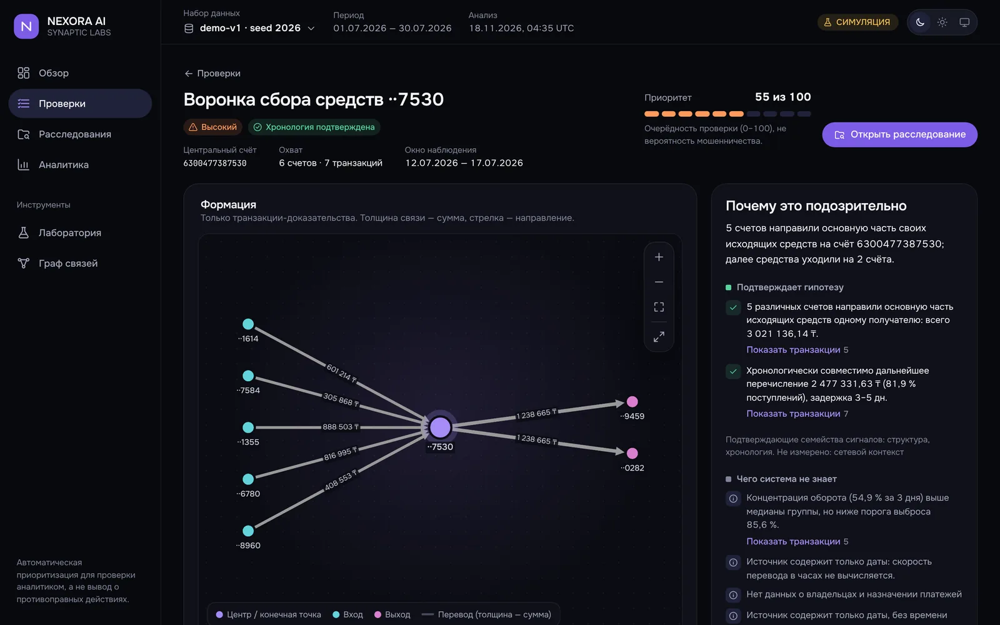
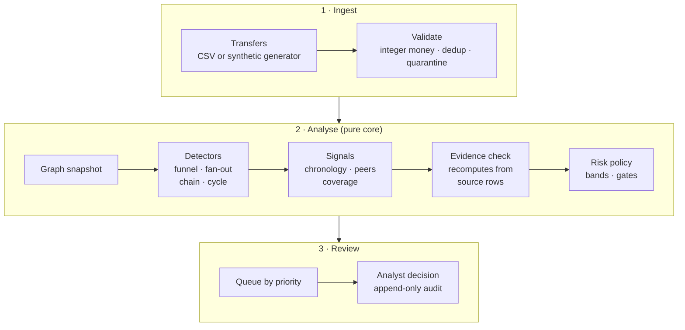
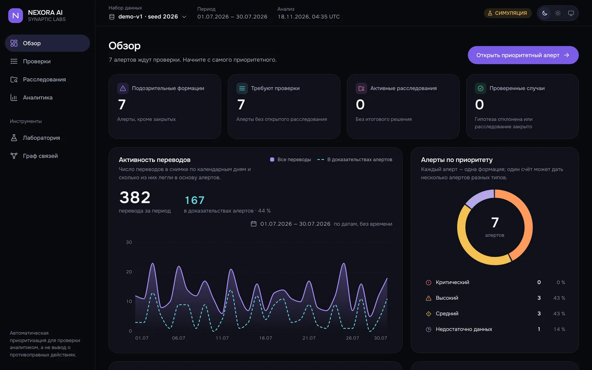
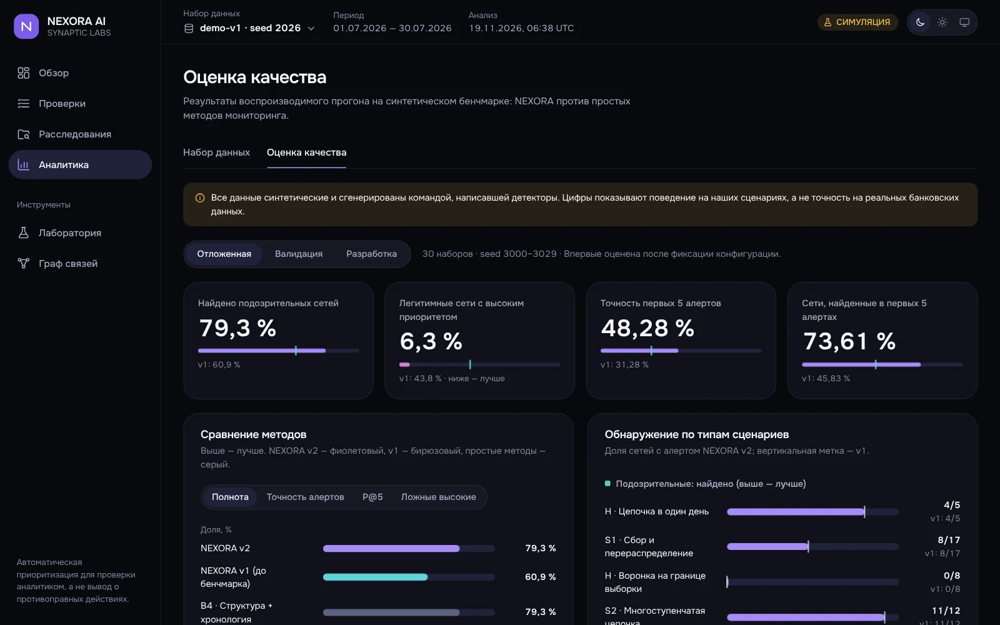
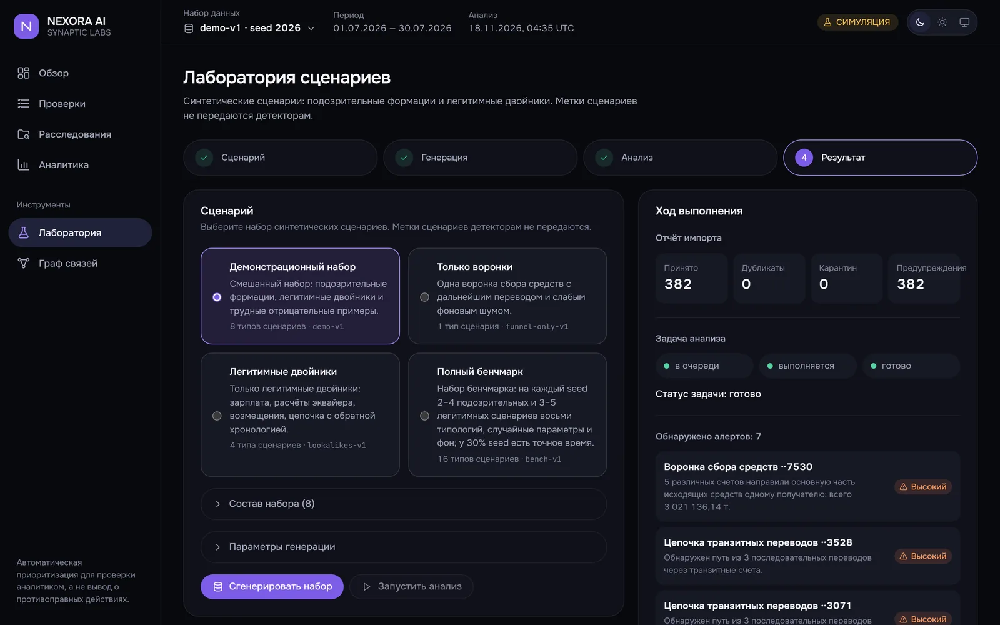
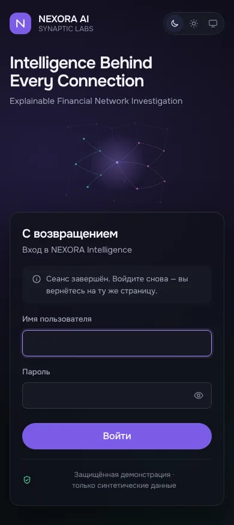
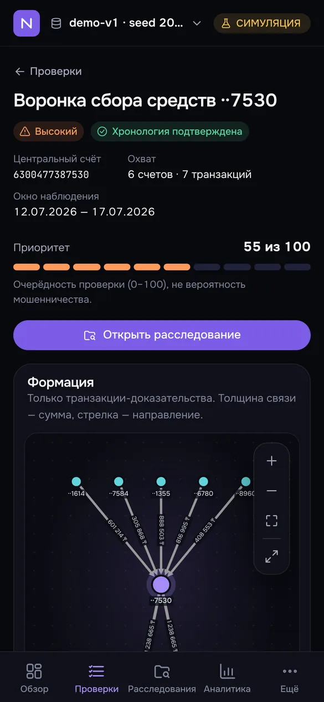
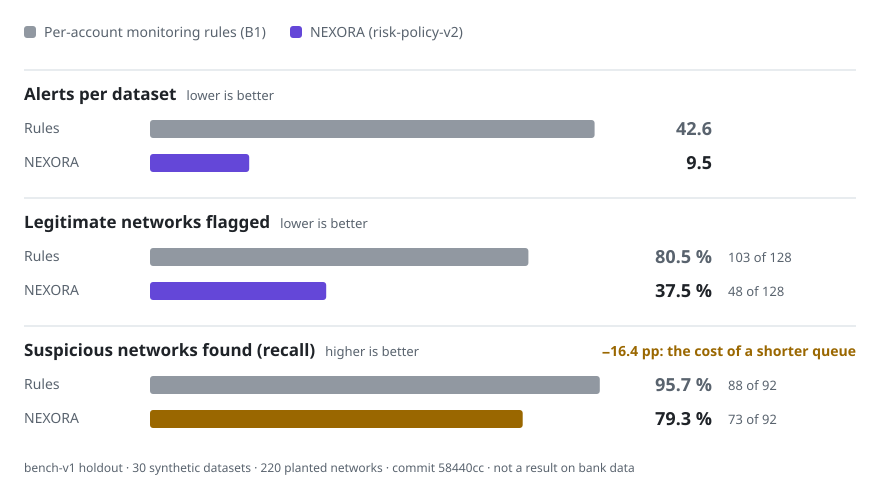
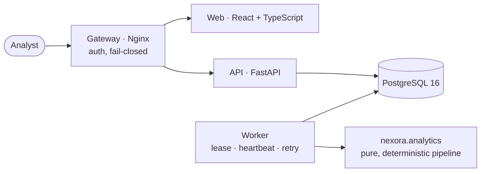
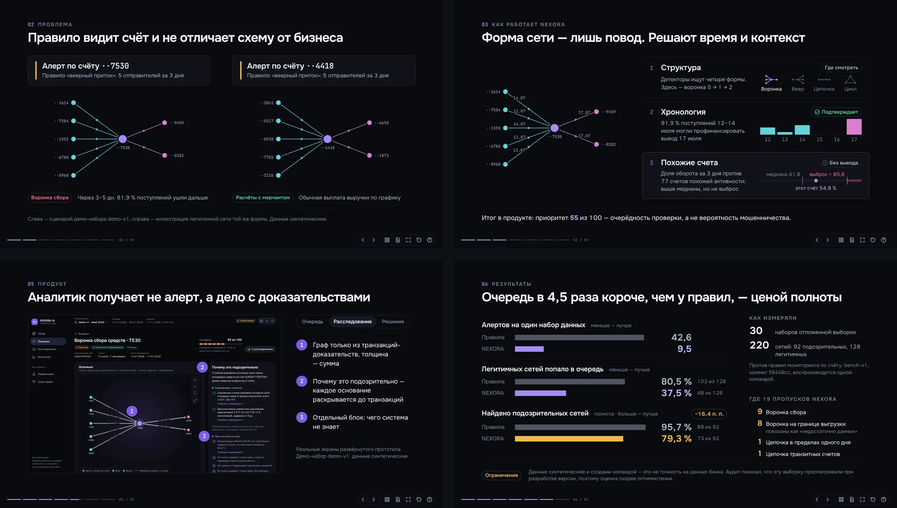

<div align="center">

# NEXORA

**Network investigation for bank anti-fraud and AML analysts.**<br>
NEXORA finds suspicious networks of transfers, checks whether time and context support them,<br>
and shows the analyst every source transaction behind each claim. The decision stays with a human.

[Live demo](https://web-production-4593b103.up.railway.app) ·
[Jury pitch](https://pitch-production-1554324d.up.railway.app) ·
[Benchmark](#evidence-a-reproducible-benchmark) ·
[Architecture](#architecture) ·
[Quick start](#quick-start) ·
[Docs](docs/README.md)

[](https://github.com/SaginbekDaniel/SYNAPTIC-LABS/actions/workflows/ci.yml)


<sub>SYNAPTIC LABS · ITU Hackathon 2026 (Bank CenterCredit case) · prototype on synthetic data, no bank integration</sub>

</div>

<br>



<p align="center"><sub>Investigation screen of the deployed prototype · synthetic <code>demo-v1</code> dataset</sub></p>

## The problem

Transaction monitoring rules score **one account at a time**: "five senders in three days", "pass-through
volume", "large amount". A money-mule collection funnel trips those rules — and so does a merchant receiving
card settlements, a payroll run or a treasury sweep, because at the account level they look the same.

So banks face a trade-off: tune rules to catch schemes and the queue fills with legitimate businesses; tune them
for a short queue and schemes slip through. Each alert reaches the analyst as an account, not as a story, and the
network around it has to be rebuilt by hand.

## How NEXORA works

NEXORA treats the **network**, not the account, as the unit of review, and asks three questions about it:

| | Question | Example from the screen above |
|---|---|---|
| **Structure** | Is there a funnel, fan-out, layering chain or cycle? This only says *where to look*. | 5 accounts → `··7530` → 2 accounts |
| **Chronology** | Could the money that came in have funded what went out, given dates and amounts? | 81.9 % of inflows are compatible with the outflow, 3–5 days later |
| **Peer context** | Is the account unusual against accounts with similar activity, or typical? | Above the median of 77 peers, but not an outlier — reported as a limit, not as evidence |

The result is a **priority for the review queue** (0–100), not a probability of fraud. When the data cannot
decide — dates without times, an account at the edge of the export — NEXORA says so and names the data that
would decide it.



The pipeline (`nexora.analytics`) is pure and deterministic: no web or database framework, content-derived ids,
**no language model anywhere in the evidence path**, and no automatic action against a customer.

## The product

| | |
|---|---|
|  |  |
| **Review queue** — networks in review order; search by any member account; preview before opening. | **Overview** — what needs attention, by priority band, with transfer activity. |
|  |  |
| **Evaluation** — the committed benchmark run, every split, against simple baselines. | **Fraud Lab** — generate a synthetic scenario suite and run the real worker on it. |

**Graph workspace** (*Граф связей*, on this branch) — explore an analysed snapshot as a network: a bounded overview ranked by
stored priority, a local view around any account, risk colours taken only from stored assessments, mouse and keyboard
controls, layout computed off the main thread. Optionally the analyst can steer it with hand gestures through the camera:
started only on request, processed on the device and never uploaded — **experimental, tested only with a simulated
camera so far**.

<details>
<summary>Light theme and 390 px mobile</summary>
<br>


<br>


</details>

**Try it.** The [live demo](https://web-production-4593b103.up.railway.app) opens on the NEXORA sign-in page.
Analysts sign in with a **named account**; there are no published or default credentials — accounts are created by an
operator (`python -m nexora.auth.cli create-user`, see [SECURITY.md](SECURITY.md)). Then open **Лаборатория** →
*Сгенерировать набор* → *Запустить анализ* → *Перейти к алертам*. The UI is in Russian, the jury's working language.
Everything is synthetic. The live demo runs the commit recorded in [docs/deployment/railway.md](docs/deployment/railway.md)
(named accounts, detection configuration v2); the work on this branch — the hypothesis engine (v3), roles and the graph
workspace — is not deployed yet.

## Evidence: two reproducible benchmarks

All data is **synthetic and generated by the same team that wrote the detectors**. The figures describe behaviour on our
own scenarios, not accuracy on bank data. Every percentage below is computed from the confusion counts in a committed
artifact, never typed by hand.

### What the live demo and the pitch show: configuration v2 on `bench-v1`

NEXORA's configuration v2 (`detectors-v2`, `risk-policy-v2`) against **per-account monitoring rules** (baseline B1:
fan-in/out velocity, large amount, pass-through) on the holdout split of `bench-v1` — 30 synthetic datasets with 220
planted networks (92 suspicious, 128 legitimate look-alikes such as payroll, merchant settlement and treasury sweeps).

<picture>
  <source media="(prefers-color-scheme: dark)" srcset="docs/assets/readme/benchmark-dark.svg">
  
</picture>

**The trade-off is real.** NEXORA's queue is 4.5× shorter and flags far fewer legitimate networks, but it finds
fewer planted schemes: 73 of 92 against the rules' 88 of 92. 17 of its 19 misses are collection funnels; 8 of
those sit at the edge of the export and are shown to the analyst as *insufficient evidence* — they are **not**
counted as found.

| Metric (holdout) | Definition | Rules | NEXORA v2 |
|---|---|---:|---:|
| Alerts per dataset | review items at band *medium* or above | 42.6 | 9.5 |
| Legitimate networks flagged | legitimate planted networks with ≥ 1 alert | 80.5 % (103/128) | 37.5 % (48/128) |
| Recall | suspicious planted networks flagged; abstentions excluded | 95.7 % (88/92) | 79.3 % (73/92) |

> [!WARNING]
> **This holdout is exposed.** An audit found that it had already been read during v2 development, that every
> boundary abstention in `bench-v1` is planted fraud (a label leak), and that P@K counts duplicate alerts on one
> network. The table therefore omits abstention-inclusive recall and P@K, and the figures are likely optimistic.
> Source: [`benchmarks/results/bench-v1.json`](benchmarks/results/bench-v1.json) (artifact commit `85f8b5e`; config
> hash and dataset hashes recorded).

### The configuration on this branch: v3 on the pre-registered `sealed-v2` split

The current configuration (`detectors-v3`, `risk-policy-v3`: competing-explanation engine) was evaluated **once** on
`sealed-v2` — 80 datasets from a separately written generator with new scenario families and label-blind boundaries,
under a protocol committed before the run ([protocol](docs/evaluation/EXPERIMENT_PROTOCOL_SEALED_V2.md),
[results](docs/evaluation/RESULTS.md#sealed-v2)). The pre-registered question — does v3's improvement over v2 replicate on
new data — was answered *yes*.

| Metric (`sealed-v2`, scenario level) | Rules (B1) | NEXORA v2 | NEXORA v3 |
|---|---:|---:|---:|
| Alerts per dataset | 71.34 | 8.62 | 6.42 |
| Legitimate networks flagged | 94.9 % (374/394) | 48.5 % (191/394) | 25.4 % (100/394) |
| Recall (abstentions excluded) | 98.1 % (257/262) | 72.9 % (191/262) | 75.2 % (197/262) |

Read it with its limits: legitimate look-alikes new to this split (payroll agencies, event ticketing, group gifts) still
reach the top bands, the `critical` band is not more reliable than `high` here, and adversarial families such as
salary-like pass-through were missed. Source: `benchmarks/results/sealed-v2-evaluation.json`. The two tables come from
different generators and must not be compared with each other.

Reproduce the runs and the chart. Re-running the committed configuration reproduces the artifacts (latency aside);
evaluating a *changed* configuration on `sealed-v2` spends one of the three uses its protocol allows, so develop on
`bench-v1` dev and freeze first.

```bash
uv run python scripts/run_benchmark.py
```

```bash
uv run python scripts/run_sealed_evaluation.py --split sealed_v2 --out /tmp/sealed-v2.json
```

```bash
python3 scripts/render_readme_figures.py
```

Full tables, ablations, negative results and error examples: [docs/EVALUATION.md](docs/EVALUATION.md).

## Architecture



A modular monolith with one durable, database-backed job queue. The API never runs analysis in a request; the
worker computes outside any transaction and publishes atomically after re-checking its lease.

| Layer | Technology |
|---|---|
| Web | React 18, TypeScript, Vite, Cytoscape.js; OpenAPI-generated client |
| API | FastAPI, Pydantic v2; typed DTOs and one error envelope |
| Analysis | Python 3.13, NetworkX, exact integer arithmetic |
| Jobs | PostgreSQL lease worker (`FOR UPDATE SKIP LOCKED`), at-least-once with idempotent publish |
| Storage | PostgreSQL 16, SQLAlchemy 2, Alembic; `NUMERIC(38,0)` money, FK-enforced evidence links |
| Delivery | Docker Compose, GitHub Actions, Railway as code |

**Engineering decisions that matter for a bank**

* **Money is integer minor units** end to end (`NUMERIC(38,0)`, decimal strings in JSON, `BigInt` in TypeScript) — never floats.
* **Account and transaction ids are opaque strings**, so ids longer than 2⁵³ survive the browser intact.
* **Day-precision records never get a clock time.** Two transfers on the same day have an unknown order, and the chronology check reports *ambiguous* rather than guessing.
* **Analysis ids are content-derived (UUIDv5).** Re-running an analysis on the same data changes nothing.
* **Evidence that does not recompute from its source rows is quarantined**, never shown.
* **The audit trail is append-only**, enforced by a PostgreSQL trigger, and written in the same transaction as the decision.
* **Synthetic ground truth never enters the runtime database** or the detectors' input.

More: [system diagrams](docs/architecture/system.md) · [architecture and invariants](docs/ARCHITECTURE.md) ·
[interfaces](docs/INTERFACES.md) · [decisions](docs/ADR/0001-decisions.md).

## Quick start

Requires Docker with Compose v2. Everything binds to `127.0.0.1`.

```bash
docker compose up --build -d --wait
```

Open http://127.0.0.1:8080 → **Лаборатория** → *Сгенерировать набор* → *Запустить анализ* → *Перейти к алертам*.

For development with hot reload (Python via `uv`, web via `npm`):

```bash
make setup
```

```bash
make check
```

`make help` lists every target; each runs exactly what CI runs. Local databases, environment variables and
troubleshooting: [docs/development/local-setup.md](docs/development/local-setup.md). Cloud deployment (one
public gateway, private API/worker/database, approval-gated deploys):
[docs/deployment/railway.md](docs/deployment/railway.md).

## Repository

```text
src/nexora/
  domain/        money, transfers, chronology, ids — stdlib only
  ingest/        CSV adapter, row validation, quarantine, dedup
  analytics/     graph snapshot, detectors, temporal flow, peers, risk — no web/DB framework
  evaluation/    synthetic generator (labels kept separate) and benchmark harness
  application/   use cases: ingest, analysis jobs and publish, cases, read models
  persistence/   SQLAlchemy models and sessions
  api/ worker/   HTTP layer and the lease-based job runner
apps/web/        analyst UI (React + TypeScript)
apps/pitch/      the jury presentation (static React site)
migrations/      Alembic schema history
benchmarks/      committed benchmark artifact
scripts/         benchmark runner, README figures, OpenAPI export, Railway tooling
docs/            architecture, evaluation, limitations, deployment, design, research
```

## Quality and testing

| Gate | Command |
|---|---|
| Python lint, types, tests (unit + PostgreSQL integration) | `uv run ruff check src tests migrations && uv run mypy && uv run pytest` |
| Web types, unit and end-to-end tests | `cd apps/web && npx tsc -b && npx vitest run && npx playwright test` |
| API contract stays in sync | `make openapi` regenerates `apps/web/openapi.json` and `apps/web/src/lib/api-types.ts` |
| Production images | CI builds the images and smoke-tests the running stack |

Strategy and what each layer covers: [docs/development/testing.md](docs/development/testing.md).

## Security and scope

* **Synthetic data only.** Not connected to Bank CenterCredit or any bank; holds no customer data.
* **Nothing is automated against customers.** NEXORA blocks nothing and sends nothing; it orders a review queue.
* **Named accounts.** Argon2id password hashes, server-side sessions in PostgreSQL, HttpOnly `SameSite=Strict` cookies,
  CSRF and origin checks, brute-force throttling. Roles `viewer` < `analyst` < `admin` are enforced on the server for
  every write; the API rejects every unauthenticated request except sign-in, and audit events carry the analyst's identity.
* **Not yet:** SSO or MFA, per-dataset isolation (roles are global), a penetration test. The cloud deployment keeps the
  API, worker and database on a private network behind a fail-closed gateway, but it is a hackathon deployment, not a
  bank-grade system.

Controls, known gaps and private vulnerability reporting: [SECURITY.md](SECURITY.md).

## Limitations of the current MVP

* **Legitimate hubs still alert.** On `sealed-v2`, payroll agencies, event ticketing, group gifts and property escrow reach the top bands; peer counter-evidence is not enough to clear them.
* **Family remittances look like distributions.** Nothing in transfer data alone separates them; KYC or MCC data would.
* **Slow funnels are missed.** Onward transfers later than the 7-day temporal window fall below the alert band.
* **Related alerts are linked, not merged.** Alerts whose networks share an account are shown as related (on this branch), so
  the analyst sees them together, but each is still decided on its own; one network can still open more than one alert.
* **Batch analysis** of a snapshot, not real-time scoring.
* **Camera gestures** have only been tested with a simulated camera in Chromium.

Full list: [docs/LIMITATIONS.md](docs/LIMITATIONS.md).

## Roadmap

| Status | Item |
|---|---|
| Done | Ingest, four structural detectors, temporal flow, peer statistics, coverage, risk policy v2, investigation UI, cases and audit, `bench-v1` |
| Done | Production images, fail-closed gateway, Railway as code, CI with a production-image smoke test |
| Done | Named analyst accounts, server-side sessions, CSRF, NEXORA sign-in page |
| Done (this branch) | Roles viewer < analyst < admin enforced on the server for every write; dependency-audit gate in CI |
| Done (this branch) | Competing-hypothesis engine (`risk-policy-v3`), leakage fixes, sealed evaluations (`sealed-v1` consumed, `sealed-v2` pre-registered and replicated) |
| Done (this branch) | Graph investigation workspace: bounded overview and local views from stored snapshots, layout off the main thread |
| Done (this branch) | Related alerts grouped on read: networks that share an account are linked in the queue and the investigation |
| Experimental | Opt-in camera gestures for the graph (on-device MediaPipe; mouse and keyboard always work) — **not yet verified on a real webcam** |
| In review | Merging this branch into the default branch (it supersedes PRs #3, #5 and #15) |
| Next | Offline replay on a bank's de-identified history and closed cases — the first honest measurement on real data |
| Planned | Per-dataset isolation; SSO with MFA; adversarial evaluation suite |

## The pitch

[](https://pitch-production-1554324d.up.railway.app)

A three-minute interactive deck for the jury (Russian), built as a static React site in
[`apps/pitch/`](apps/pitch/README.md). Every benchmark figure on it is read from the committed artifact and pinned
by tests.

## Contributing, license, acknowledgements

Issues and pull requests are welcome — read [CONTRIBUTING.md](CONTRIBUTING.md) first.

No license has been chosen yet, so default copyright applies: the code is published for review, not licensed for
reuse.

Built by SYNAPTIC LABS for the ITU Hackathon 2026 Bank CenterCredit case, on FastAPI, SQLAlchemy, Alembic,
NetworkX, React, Vite and Cytoscape.js; licences reviewed in
[docs/research/LICENSE_MATRIX.md](docs/research/LICENSE_MATRIX.md).
