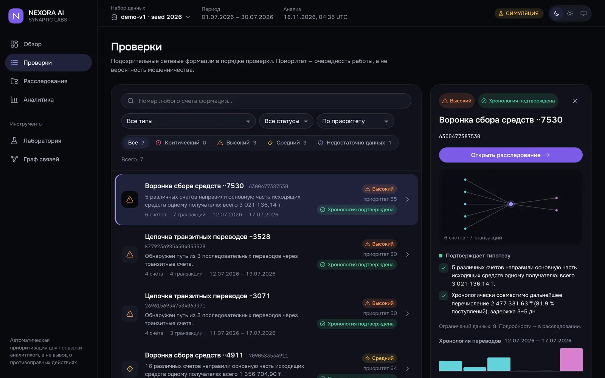
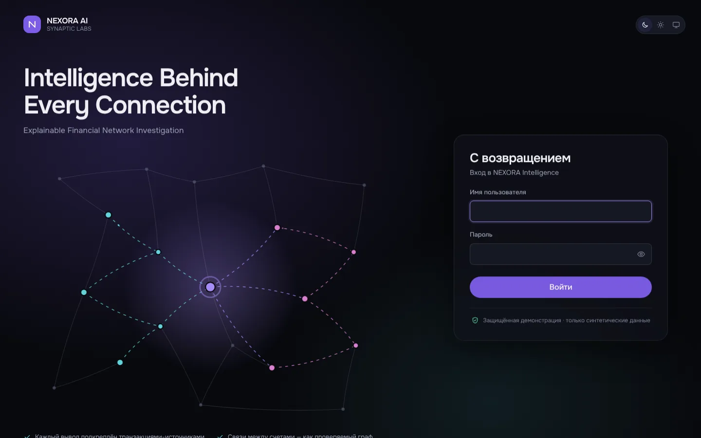
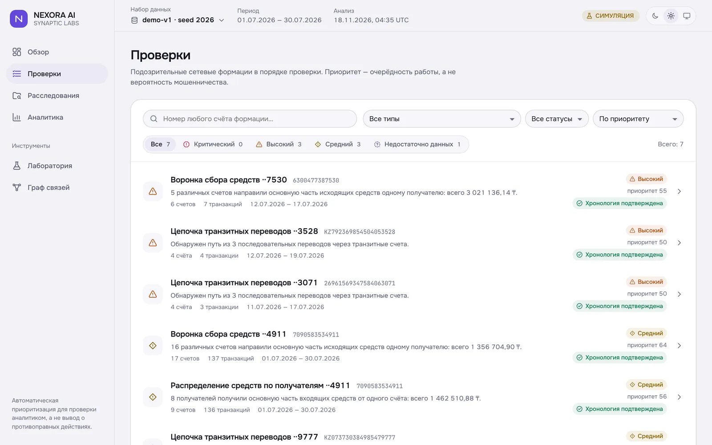
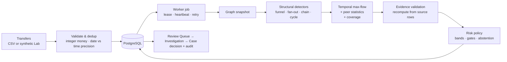

<div align="center">

# NEXORA AI

### Don't hunt suspicious transfers. Uncover the whole scheme.

**Explainable financial-network intelligence for fraud and AML investigation** — it turns raw
transfers into evidence-backed, time-consistent, coverage-aware network investigations, and leaves
the decision to a human analyst.

[](https://github.com/SaginbekDaniel/SYNAPTIC-LABS/actions/workflows/ci.yml)


**[▶ Live demo](https://web-production-4593b103.up.railway.app)** ·
**[🎤 3-minute interactive pitch](https://pitch-production-1554324d.up.railway.app)** ·
**[📐 Architecture](docs/architecture/system.md)** ·
**[📊 Evaluation](docs/EVALUATION.md)** ·
**[🇷🇺 По-русски](#по-русски)**

SYNAPTIC LABS · ITU Hackathon 2026 (Bank CenterCredit case) · prototype

</div>

> [!IMPORTANT]
> **Synthetic data only — no banking integration.** NEXORA is not connected to Bank CenterCredit or
> any bank, holds no customer data, and blocks nothing. A priority is a triage order, not a
> probability of fraud, and a detected pattern is not proof of wrongdoing.

**Interactive 3-minute pitch (React, static, synthetic data only): https://pitch-production-1554324d.up.railway.app** — source in [`apps/pitch/`](apps/pitch/README.md).


## Why NEXORA stands out

Most fraud demos show a graph and a score. NEXORA is built around the question an investigator
actually asks — *"can I defend this in front of a reviewer?"* — and that shapes everything:

|  | What makes it different | Why it matters |
|---|---|---|
| 🕸️ | **Schemes, not transactions.** Funnels, fan-out, layering chains and cycles are detected over a directed transfer graph. | Mule networks pass per-transfer rules by design; they only look wrong together. |
| ⏱️ | **Chronology is checked, not assumed.** A capacity-constrained max-flow over dated transfers returns *supported*, *ambiguous* or *contradicted*. | Cuts the false alarms where money "moves" before it ever arrived. |
| 🧾 | **Every claim recomputes from source rows.** Evidence that does not recompute is quarantined, never shown. | The analyst verifies instead of trusting a black box. |
| 🙈 | **It knows what it cannot see.** At data boundaries it abstains with `insufficient_evidence` and names the data that would decide it. | Honest uncertainty beats a confident wrong score. |
| ⚖️ | **Legitimate hubs are capped, not silently cleared.** Payroll, merchant settlement and treasury sweeps share the shapes of fraud. | Fewer false positives without hiding anything from the reviewer. |
| 🧑‍⚖️ | **A human decides.** No LLM in the evidence pipeline, no automatic action against customers, append-only audit trail enforced in PostgreSQL. | Safe to put in front of a compliance team. |
| 🔁 | **Reproducible end to end.** Deterministic, content-derived analysis ids; a frozen synthetic benchmark with baselines, ablations and published negative results. | Re-running changes nothing — and the limits are written down in [LIMITATIONS.md](docs/LIMITATIONS.md). |

Engineering depth to match: exact integer money (no floats, ids beyond 2⁵³ preserved), a
lease-based PostgreSQL worker with idempotent publish, an OpenAPI-generated typed client, named
analyst accounts with server-side sessions, a fail-closed gateway, and a Russian UI that works on a
390 px phone.

> [!NOTE]
> We say "strong" about the design and the engineering, not about accuracy on real bank data — there
> is none in this repository. Benchmark figures below are from synthetic data and carry their own
> caveats.

## Why NEXORA exists

Transaction monitoring rules look at one transfer or one account at a time. Money-mule and
layering schemes are built to pass those checks: many small, individually ordinary transfers that
only look wrong **together** — five accounts feeding one collector, a chain of pass-through hops,
a loop that returns to its start.

Graph tools find such shapes easily — and drown analysts in them, because payroll, merchant
settlement and treasury sweeps have the same shapes. NEXORA's job is the part between "a shape
exists" and "an analyst should look at this first":

* Is the **chronology** consistent — could money received actually have funded what was sent on,
  given the dates and amounts?
* Is the account **unusual against its peers**, or typical for its activity level?
* What **could the system not see** — dates without times, an account at the edge of the data?
* Which **source transactions** prove each claim, so the analyst can verify instead of trust?

## Product tour

| | |
|---|---|
|  |  |
| **Overview** — what needs attention, by priority band, with transfer activity. | **Review Queue** — server-side paging, search by any member account, preview before opening. |
|  |  |
| **Evaluation** — the committed benchmark run, every split, against simple baselines. | **Fraud Lab** — generate a synthetic scenario suite and run the real worker on it. |

<details>
<summary>Light theme and 390 px mobile</summary>

 

 

</details>

Screenshots are captured from the production build (`docker compose`) on a synthetic `demo-v1`
dataset (seed 2026). The UI is in Russian, the jury's working language.

## Live demo

**https://web-production-4593b103.up.railway.app** — *Synthetic Data Only — No Banking Integration*

The demo opens on the NEXORA sign-in page. Analysts sign in with a **named account**; there are
no published or default credentials — accounts are created by an operator
(`python -m nexora.auth.cli create-user`, see [SECURITY.md](SECURITY.md)). After signing in, open
**Лаборатория** → *Сгенерировать набор* → *Запустить анализ* → *Перейти к алертам*. Every case
decision is attributed to the signed-in analyst. Datasets created by earlier visitors stay in the
database.

Deployment record, what was verified and what was not:
[docs/deployment/railway.md](docs/deployment/railway.md#deployment-record).

## Key features

| | |
|---|---|
| **Network detection** | Collection funnels, coordinated fan-out, layering chains and time-checked cycles over a directed transfer graph with exact integer money and string account ids (including ids > 2⁵³). |
| **Temporal verification** | Capacity-constrained max-flow over dated transfers: *supported*, *possible but ambiguous* (same day), or *contradicted* (money sent before it arrived). |
| **Peer statistics** | Turnover concentration against an activity-matched cohort — corroboration **or** counter-evidence. |
| **Coverage awareness** | Abstains with `insufficient_evidence` at data boundaries and says which data would decide it. |
| **Risk prioritisation** | Versioned policy (`risk-policy-v2`): at most one credit per signal family, named evidence gates; legitimate-looking hubs are capped, never silently cleared. |
| **Evidence provenance** | Every claim links to the source transactions it recomputes from; evidence that does not recompute is quarantined, not shown. |
| **Investigation & cases** | Queue → hypothesis → reasons → highlighted transfers → formation graph → case decision with optimistic concurrency. |
| **Audit** | Append-only audit trail enforced by a PostgreSQL trigger. |
| **Reproducible evaluation** | Deterministic synthetic benchmark with frozen splits, baselines, ablations and robustness checks. |

## How it works



The analysis pipeline (`nexora.analytics`) is pure and deterministic: no web or database
framework, content-derived ids, so re-running an analysis changes nothing. The worker computes
outside any database transaction and publishes atomically after re-checking its lease.
No LLM is involved anywhere in the evidence pipeline.

More: [architecture diagrams](docs/architecture/system.md) · [architecture and invariants](docs/ARCHITECTURE.md) · [interfaces](docs/INTERFACES.md).

## Architecture

| Layer | Technology |
|---|---|
| Web | React 18, TypeScript, Vite, Cytoscape.js; served by an unprivileged Nginx gateway |
| API | FastAPI, Pydantic v2 — typed DTOs, uniform error envelope, OpenAPI-generated TypeScript client |
| Analysis | Python 3.13, NetworkX, exact integer arithmetic |
| Jobs | PostgreSQL-backed lease worker (`FOR UPDATE SKIP LOCKED`), at-least-once with idempotent publish |
| Storage | PostgreSQL 16 via SQLAlchemy 2 + Alembic; `NUMERIC(38,0)` money, FK-enforced evidence links |
| Delivery | Docker, Docker Compose, GitHub Actions, Railway (Infrastructure as Code) |

## Evaluation

All measurements are on **synthetic data generated by the same team that wrote the detectors**.
They show behaviour on our scenarios, not accuracy on real bank data.

Benchmark `bench-v1`, holdout split (30 datasets), from the committed artifact
[`benchmarks/results/bench-v1.json`](benchmarks/results/bench-v1.json):

| | NEXORA v1 | NEXORA v2 | Best simple baseline |
|---|---:|---:|---|
| Planted suspicious networks flagged (scenario recall) | 60.9 % | 79.4 % | monitoring rules: 95.7 %, at 42.6 alerts per dataset |
| Legitimate networks reaching *high* priority | 43.8 % | 6.3 % | — (baselines have no bands) |
| Planted fraud among the first 5 alerts (P@5) | 31.3 % | 48.3 % | turnover ranking: 34.0 % |
| Planted networks found in the first 5 alerts (Recall@5) | 45.8 % | 73.6 % | monitoring rules: 43.6 % |

> [!WARNING]
> A later audit (open [PR #3](https://github.com/SaginbekDaniel/SYNAPTIC-LABS/pull/3), not merged)
> found that these numbers are **optimistic**: the `bench-v1` holdout had been read during v2
> development; every boundary abstention in `bench-v1` was planted fraud (a label leak); and P@K
> counts duplicate alerts on one network. PR #3 adds a separately written, sealed evaluation with a
> pre-registered protocol. Its numbers come from a different generator and protocol and must not be
> compared with the table above.

Full tables, negative results and error examples: [docs/EVALUATION.md](docs/EVALUATION.md).
What does not work: [docs/LIMITATIONS.md](docs/LIMITATIONS.md). Reproduce:

```bash
uv run python scripts/run_benchmark.py
```

## Quick start

Requires Docker with Compose v2.

```bash
docker compose up --build -d --wait
```

Open http://127.0.0.1:8080 → **Лаборатория** → *Сгенерировать набор* → *Запустить анализ* →
*Перейти к алертам*. Everything binds to `127.0.0.1`.

Development servers with hot reload, test databases and troubleshooting:
[docs/development/local-setup.md](docs/development/local-setup.md).

## Cloud deployment

One public HTTPS entry point (the gateway); API, worker and PostgreSQL stay on Railway's private
network. Access control fails closed, migrations run once per deploy before the new API serves,
and deploys are manual, approval-gated and limited to commits with green CI.

```bash
scripts/railway/bootstrap.sh
```

Guide, security model, costs and rollback: [docs/deployment/railway.md](docs/deployment/railway.md).

## Development

```bash
make setup
```

```bash
make check
```

`make help` lists every target; each runs exactly the command CI runs. Testing strategy:
[docs/development/testing.md](docs/development/testing.md). Contribution rules:
[CONTRIBUTING.md](CONTRIBUTING.md).

## Documentation

| | |
|---|---|
| [docs/README.md](docs/README.md) | Index of all documentation |
| [Architecture diagrams](docs/architecture/system.md) · [ARCHITECTURE.md](docs/ARCHITECTURE.md) | Components, data flow, job processing, case lifecycle, invariants |
| [Railway deployment](docs/deployment/railway.md) | Topology, setup, variables, security, operations, cost |
| [EVALUATION.md](docs/EVALUATION.md) · [LIMITATIONS.md](docs/LIMITATIONS.md) | Benchmark results and honest scope |
| [Design](docs/design/DESIGN_DIRECTION.md) · [Research](docs/research/GITHUB_LANDSCAPE.md) · [ADRs](docs/ADR/0001-decisions.md) | Design system, prior-art research, decisions |

## Security

Analysts sign in with named accounts (Argon2id password hashes, server-side sessions in PostgreSQL,
HttpOnly `SameSite=Strict` cookies, CSRF and origin checks, brute-force throttling); the API rejects
every unauthenticated request and audit events carry the session's identity. There is no SSO, MFA or
role model, and it is a hackathon deployment, not a bank-grade system. See [SECURITY.md](SECURITY.md) for the controls
in place, the known gaps, and how to report a vulnerability privately.

## Roadmap

| Status | Item |
|---|---|
| Done | Ingest, four structural detectors, temporal flow, peer statistics, coverage, risk policy v2, investigation UI, cases and audit, `bench-v1` |
| Done | Production images, fail-closed gateway, Railway IaC, CI with production-image smoke test |
| Done | Named analyst accounts, server-side sessions, NEXORA sign-in page (replaces the shared Basic prompt) |
| In review | [PR #3](https://github.com/SaginbekDaniel/SYNAPTIC-LABS/pull/3): competing-hypothesis engine, evaluation leakage fixes, sealed evaluation |
| Done | Protected Railway demo (PostgreSQL, API, worker, gateway); see the deployment record |
| Planned | Correlate alerts sharing a subject account; bridge/coordinator detector; named users via an identity-aware proxy |

## Contributing

Issues and pull requests are welcome — read [CONTRIBUTING.md](CONTRIBUTING.md) first (money is
integer minor units, ids are opaque strings, no synthetic labels in the runtime path).

## License

No license has been chosen yet, so default copyright applies: the code is published for review,
not licensed for reuse. The maintainers will add a `LICENSE` file when they decide.

## По-русски

**NEXORA AI** — платформа для расследования мошеннических сетей. Она показывает не отдельные
подозрительные переводы, а целые схемы: кто, через какие счета и в каком порядке двигал деньги.

* **Графовый анализ** выявляет воронки сбора, веерные выплаты, цепочки прокладки и циклы.
* **Проверка хронологии** отсекает схемы, где деньги «уходят» раньше, чем поступили.
* **Сравнение со схожими счетами** подтверждает или опровергает подозрение.
* **Каждый вывод подкреплён транзакциями-источниками** — аналитик проверяет, а не верит на слово.
* **Решение остаётся за человеком**: LLM в цепочке доказательств нет, автоматических действий
  против клиентов нет.

Цель — помогать банкам сокращать потери, снижать число ложных тревог и быстрее проводить
расследования. Данные в проекте только синтетические; это прототип, а не банковская система.

## Acknowledgements

Built by SYNAPTIC LABS for the ITU Hackathon 2026 Bank CenterCredit case. Uses open-source work
including FastAPI, SQLAlchemy, Alembic, NetworkX, React, Vite and Cytoscape.js; third-party
licences are reviewed in [docs/research/LICENSE_MATRIX.md](docs/research/LICENSE_MATRIX.md).
