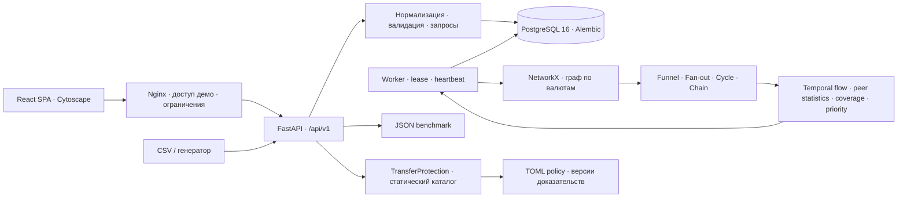
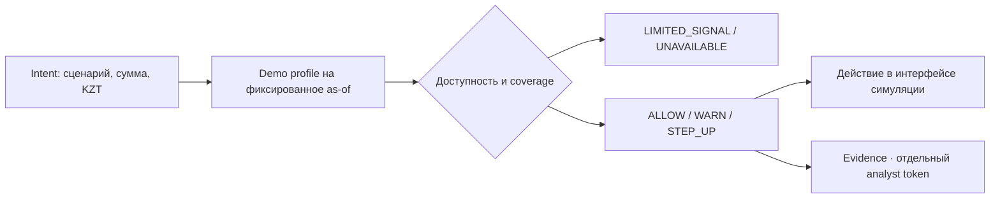

# NEXORA AI · полный технический аудит

**Дата аудита — 25 ноября 2026 года, Asia/Almaty.** Репозиторий SaginbekDaniel/SYNAPTIC-LABS, ветка `feat/transfer-protection`, commit `43368ff46b788568d34ceee5ac8ae9135728c373`. Публичный Git подтвердил тот же HEAD ветки. Ветка GitHub по умолчанию `claude/brave-dirac-c80nwq` указывала на `ea5ca9c120115e068ada90c508f2d078d6b512c3` и отставала на два коммита transfer-функциональности. Основной объект проверки — ветка с полным демо. В начале рабочая копия была чистой. Исходники, lockfiles и штатные тесты не правились. [GitHub](https://github.com/SaginbekDaniel/SYNAPTIC-LABS) · [Git refs](evidence/remote-refs.log) · [Инвентарь 251 tracked-файла](evidence/tracked-inventory.txt)

## Вывод

NEXORA — работоспособный хакатонный прототип расследований с отдельным симулятором защиты перевода. Проверены два сквозных пути. Первый берёт синтетический CSV, сохраняет строки, запускает worker, публикует граф, выдаёт evidence, открывает case и сохраняет решение. Второй проверяет локально подготовленный transfer intent и показывает клиентское действие и служебное объяснение. Для банка отсутствуют источники point-in-time профилей, исполнение решения в платёжном контуре, индивидуальные роли и проверенная точность на банковских данных. Подтверждены дефекты CSV, readiness и восстановления worker. При одинаковом наблюдаемом ledger детектор присваивает одинаковый риск законной и подозрительной активности.

## Архитектура и данные

| Компонент | Устройство и зависимости | Интеграция, зрелость и доказательства |
|---|---|---|
| Domain и ingestion | `domain/money.py`, `transfers.py`, `ids.py`, `ingest/validation.py`, `csv_adapter.py`. Целые minor units, UTC, явная точность времени, хеши и UUID. | CSV и генератор используют общий слой. Строковые идентификаторы и суммы проходят round-trip. Дубли заголовка и повторы HTTP не обработаны. |
| Хранилище | SQLAlchemy, psycopg 3, PostgreSQL, JSONB, UUID, exact numeric, транзакции и Alembic 0001/0002. `persistence/orm.py:43–344`. | Проверены FK, CHECK, rollback, unique/idempotent effects, append-only trigger, миграции вверх и запрет потери результатов при downgrade. Отдельные production-роли БД не подтверждены. |
| API | FastAPI/Pydantic, OpenAPI, dependency-scoped commit, versioned routes, request ID, типизированный envelope. `api/main.py:45–169`, `api/deps.py:13–47`. | API, Vite и native Nginx проверены на loopback. Формат 405 и readiness имеют дефекты. |
| Job и publish | `application/analysis_service.py:23–103,138–288`, `worker/runner.py:33–143`. PostgreSQL queue, watermark, двухфазная работа без удержания DB-lock на compute, lease, heartbeat, атомарный publish. | Повтор job и конкурентные запросы проверены. Hard-stop recovery превышает max attempts. Конфигурация при rolling deploy не закреплена в job. |
| Graph и detection | `analytics/graph_builder.py:84–184`, `analytics/pipeline.py:139–732`. NetworkX directed graph, агрегирование отдельно по валютам, четыре типологии, max-flow с ёмкостями, Tukey IQR для peer. | Worker публикует formations, evidence, signals, assessments, alerts. Параллельные валюты разделены. На плотном графе срабатывают бюджеты. Нет обучаемой модели или LLM. |
| Risk и evidence | `analytics/risk.py:23–121`, `analytics/evidence_validation.py`, `configs/risk_policy.yaml`. Весовой приоритет, caps, abstention, provenance и evidence refs. | Ускоряет triage и показывает ограничения. Есть штатные risk tests и отдельная проверка ссылок и стабильности для 31 сценария. Калибровки вероятности и банковской стоимости FP нет. |
| Case и queries | `application/case_service.py`, `application/queries.py:146–274,488–556,599–710`. Note, version, transition, audit. | Полностью пройден synthetic case, в том числе reload и конфликт версии. Передача disposition в scoring отсутствует. Поиск/graph используют SQL, есть повторные запросы. |
| Web | React 18, TypeScript, Vite, React Router, Cytoscape, Onest. `apps/web/src/app/App.tsx`, `features/`, `lib/api.ts`. | Overview, очередь, Analytics, Network, Investigation, Cases, Fraud Lab, Evaluation и Transfer. KPI получены из overview/alerts, граф и evidence из API. Файловая форма отсутствует. Transfer-подтверждение — локальное состояние UI. |
| Transfer Protection | `application/transfer_snapshot.py`, `transfer_demo.py:17–89`, `transfer_protection.py:175–246`. Server-owned demo profiles, bitemporal доступность, contextual evidence, TOML policy. | Весь сценарий demo проверен в API и браузере. Реального платежа, SCA/step-up-интеграции, потока жалоб или получения произвольного beneficiary profile нет. |
| Evaluation | `evaluation/generator.py`, `benchmark.py`, `transfer_protection.py`, два CLI и versioned JSON. | API отдаёт сохранённый bench-v1. Веб отображает сохранённые числа. Transfer holdout — отдельный CLI и JSON. Воспроизведены классификации обеих оценок. |
| Инфраструктура | Backend Dockerfile, web Dockerfile, Nginx gateway, Compose, Railway TypeScript IaC, GitHub Actions CI/CodeQL/Deploy/Dependabot. | Проверены lock install, static gates, build, Compose validation, native smoke. Сборка контейнеров и live Railway остаются непроверенными. |
| Документация | README, ADR, интерфейсы, benchmark provenance, test/setup/deploy/security/transfer docs и master spec. | Master spec содержит цели за пределами реализации. Данные старого TEST_REPORT относятся к предыдущей ревизии. HTTP CSV идемпотентность из документации перепроверена и не соблюдается. |

### Инвентарь возможностей

| Статус | Возможности и границы |
|---|---|
| Реализовано и проверено | Синтетические наборы, корректный CSV, проверка суммы и строковых IDs, транзакционное хранилище, durable job, snapshot, четыре графовых детектора, evidence и объяснения, alert queue, обзор, поиск, graph, case, версия и audit, оценка bench-v1, health live, maintenance restart. |
| Реализовано частично | Дедупликация строк внутри dataset, восстановление worker, CSV-валидация, health ready, качество risk bands, analyst investigation transfer, проверка auth gateway, массовый импорт, отображение частичного анализа. |
| Реализовано, runtime не проверен | Docker image entrypoint и Linux runtime, Railway private routing/actual grants, CI deploy и CodeQL в GitHub, rate-limit и forwarded-header trust на внешнем edge. |
| Прототип или симуляция | Восемь transfer presets, заранее подготовленные profiles, сообщения `WARN`/`STEP_UP`, экран кнопок продолжения/отмены, искусственные reporting/context facts, отдельный кейс преднамеренного timeout. |
| Сломано в проверенном сценарии | Два заголовка суммы допускаются, повтор CSV создаёт новый dataset, готовность на 0001 ложноположительна, повторный crash превышает бюджет, 405 теряет Allow. |
| Отсутствует | Browser CSV upload, поток банковских платежей, customer-specific eligibility, исполнение hold и step-up, per-user RBAC, tenant authorization, persistent transfer assessment, риск на login/device/consent, импорт outcome labels, банковский holdout, обучение модели. |
| Неприменимо | Live LLM provider, prompt injection и проверка hallucination, password reset/user sessions самого приложения, экспорт CSV и встроенные spreadsheet formulas. |

### Поверхность API и проверка

Общий префикс в таблице — `/api/v1`. Обычные маршруты проходят middleware gateway token, когда он настроен. Границы принадлежности пользователя отсутствуют во всём analyst API. Запросы ниже выполнялись с синтетическими записями или в рамках штатных проверок.

| Methods и routes | Доказательство и закрытый сценарий |
|---|---|
| GET `/health/live`, `/health/ready` без API-префикса | 200 live, 503 при остановке БД, 200 на head, выявлен ошибочный 200 на 0001. PATCH live → 405, Allow отсутствует. |
| GET `/docs`, `/redoc`, `/openapi.json` без API-префикса | Все три дали 200 при включении и 404 при отключении. HTTP JSON OpenAPI совпал с tracked схемой. [Контракт](evidence/api-contract.log) |
| GET `/datasets`, `/datasets/{id}`, `/datasets/{id}/overview` | Dataset selector, SQL totals и dashboard. Неверные ID → 422, чтение при outage → 503. |
| POST `/datasets/import` | Multipart 201, malformed/unknown columns 422, 413 на размер. CSV → case проверен. Повторы request и duplicate header — дефекты. |
| GET `/lab/suites`, POST `/lab/datasets` | 200 список, 201 synthetic import, неверный тип 422. UI smoke и штатные suites. |
| POST `/analysis/jobs`, GET `/analysis/jobs/{id}`, GET `/analysis/snapshots/{id}` | 202 с Location, шесть параллельных повторов → один job, 200 status/snapshot, malformed 422, пустой dataset → 422. |
| GET `/snapshots/{id}/neighborhood`, `/activity`, `/accounts/{account_id}`, `/transactions` | Bounds/clamping, суммы и источники, 200 и 422, latency для списка и depth 1/2. |
| GET `/transactions/{id}` | Возвращает ту же запись, что snapshot listing, invalid UUID → 422. |
| GET `/alerts`, `/alerts/{id}`, `/alerts/{id}/evidence` | Список и facets, pagination и sorting, evidence IDs существуют, invalid UUID → 422. |
| GET/POST `/cases`, GET `/cases/{id}`, POST `/cases/{id}/decisions`, POST `/cases/{id}/notes`, GET `/cases/{id}/audit` | Полный case lifecycle, reload, 200/201, 409 stale version, validation 422, audit. |
| GET `/evaluation` | 200 из versioned JSON, 404 отсутствующий artifact, malformed artifact в штатном тесте. |
| GET `/demo/transfer-checks/scenarios`, POST `/demo/transfer-checks`, POST `/demo/transfer-checks/evidence` | 200 каталог и check, 422 схема, 403 analyst scope, 404 mismatch. Point-in-time replay, предупреждение, step-up, abstention, retry, отсутствие БД-зависимости при check. |

По каждому основному endpoint проверен как минимум один runtime путь. Полный Cartesian product route × method × payload × outage × identity не выполнялся. За периметром gateway проверка scoped analyst реализована только для transfer evidence. Доказательство обычной выдачи 200/201 из штатного E2E дополняется негативными API-assertions и source review, а не имитирует банковскую авторизацию. [Прогоны](TEST_RESULTS.md) · [Security](SECURITY_REPORT.md)

## Разбор значимых дефектов и пробелов P1

P0 в проверенных сценариях не подтверждён. Severity относится к бизнес-последствиям и условиям в таблице. Все оценки трудозатрат ориентировочные.

| ID | Дефект, доказательство и ожидаемый результат | Последствия, исправление и критерий приёмки | Оценка, уверенность |
|---|---|---|---|
| D01 | `csv_adapter.py:40–63`. Синтетическая строка с двумя одинаковыми amount headers читалась обычным импортным парсером. Ожидалось отклонение файла. Фактически `DictReader` свёл одноимённые поля к одному значению. [Тест](tests/test_audit.py) | Могут измениться суммы и риски без карантина. Проверять уникальность headers после нормализации до чтения строк. Точные и trim-коллизии дают 422 и без записи набора. | 2–4 ч, высокая |
| D02 | `datasets.py:44–75`, `ingest_service.py:22–45,95–134`. Два одинаковых синтетических multipart-запроса дали два 201 и разные dataset IDs. Ожидался один результат при повторной доставке по контракту проекта. `create_dataset` с новым UUID вызывается до dataset-scoped дедупликации. [JUnit](evidence/pytest-audit.xml) | Повторный клиентский запрос умножает наборы и анализ. Установить idempotency по ключу, scope и digest, предусмотреть явный clone. При параллельном повторе один набор/одна запись на источник, digest mismatch получает явный conflict. | 0,5–1 день, высокая |
| D03 | `api/main.py:144–165`. Изолированная БД мигрирована до 0001 и штатный readiness дал 200. Ожидался 503 для версии ниже требуемой 0002. Проверяется truthiness, а совместимость не сравнивается. [Lifecycle](evidence/lifecycle.json) | Оркестратор может пропустить трафик в схему до расширения constraints fan_out/cycle. Сравнить требуемую revision/head, отдельно возвращать DB reachability. 0001 → 503, 0002 → 200, недоступная БД → 503. | 2–4 ч, высокая |
| D04 | `worker/runner.py:35–48,121–135`. Три раза остановлен отдельный worker после подтверждённого claim в synthetic job. При max attempts 3 четвёртый worker опубликовал результат с attempt_count=4. Ожидался terminal failure после исчерпания бюджета. Gate есть лишь в exception path. [Lifecycle](evidence/lifecycle.json) | Повторяющийся crash может занять очередь. Учитывать expired jobs в cap и атомарно маркировать failed с понятным кодом. Crash после третьей попытки оставляет failed, повторных claim нет, ранний crash восстанавливается. | 0,5–1 день, высокая |
| F01 | `pipeline.py:319–401`, `statistical/peer.py:109–155`. Парные синтетические записи с бизнес-разметкой вне входа дали одинаковые high, например mule/settlement 58. Ожидание для банковской применимости — различать случаи при наличии наблюдаемых деловых подтверждений. Ledger-схема их не передаёт. [31 сценарий](evidence/independent-fraud.json) | Даже высокая приоритетность создаёт риск ложного расследования и потери доверия. Добавить подтверждённый контекст с provenance и negative evidence, зафиксировать допустимый FP до out-of-time оценки. Приёмка требует улучшения FP с заранее ограниченным падением recall и целевым объёмом alert review. | 3–7 дней для demo, pilot дольше, высокая для tested slice |
| F02 | `transfer_demo.py:17–51,74–89`, `transfer_checks.py:109–137`. Штатный flow меняет рекомендацию early/late и возвращает `simulation=true`. Курируемый recipient выбирается из каталога. Для банковского сценария ожидался вызов на произвольный перевод и подтверждение выполненного действия. Платёжного и профильного адаптеров нет. [E2E](evidence/playwright-e2e.log) | Влияние на фактический перевод отсутствует. Интегрировать sandbox preflight с trusted profile, decision ID, таймаутом, SCA/hold lifecycle и acknowledgement. Один намеренный sandbox intent приводит к одному проверяемому действию, включая отказ зависимостей. | 3–7 дней sandbox, высокая |
| S01 | `deps.py:32–36`, `api/main.py:73–93`, `routes/cases.py:16–75`. Source trace и штатные тесты проверяют общий gateway token. Case actor берётся из settings. Ожидание для пилота — индивидуальный субъект, scope и ownership. В демо общего пользователя достаточно, полноценная модель не реализована. [Security](SECURITY_REPORT.md) | Нет назначения прав и убедительной атрибуции доступа к банковским данным. Добавить OIDC/SSO, scoped authorization, проверку принадлежности, аудит actor claim. Приёмка на тестовых ролях проверяет права чтения, изменения и служебной эскалации. | 3–7+ дней, высокая |

## Надёжность, качество кода и ограничения проверки

- Выдача snapshot и аудита атомарна в проверенных тестах. При остановке PostgreSQL API live остался 200, readiness и чтение вернули 503, затем три строки и snapshot сохранились. Конкурентная нагрузка измерялась на уже опубликованном dataset. Длительные multi-worker soak, failover, backup/restore и авария диска не проверялись. [Lifecycle](evidence/lifecycle.json) · [Performance](PERFORMANCE_REPORT.md)
- `analysis_service.py:33–63` привязывает watermark и config к стандартному ключу, а `runner.py:85–112` загружает config рабочего процесса. При развёртывании разных версий config в API и worker возможна смена policy между запросом и обработкой. Непосредственный rolling-deploy эксперимент не проводился.
- `pipeline.py:319–401,404–713` объединяет orchestration, evidence assembly и четыре преобразования детекторов. Модули structural выделены, однако шаблон сборки метаданных и поддерживающих доказательств повторяется. Этот долг влияет на согласованность и стоимость изменений, существующие модели и тесты стоит сохранить.
- Источник не выдаёт `NETWORK_CONTEXT` в batch pipeline. Произвольный профиль клиента, event-stream ingestion, банковский feature store, alert feedback и API удержания не реализованы. Сгенерированные TS-типизации и локальный transfer contract дублируют несколько enum/shape. Старые master-spec и benchmark-артефакты представляют разные этапы, artifact выдается API с версией.
- Штатные unit, integration, browser и smoke suites выполнены. Пробелы подкреплены новыми тестами. Отдельная deployed-security suite и банковские credentials в проверке не использовались. [Тесты](TEST_RESULTS.md)
- Подробные результаты по 14 фазам распределены между настоящим отчётом, [fraud](FRAUD_DETECTION_REPORT.md), [security](SECURITY_REPORT.md), [performance](PERFORMANCE_REPORT.md), [readiness](HACKATHON_READINESS.md), [реестром](ISSUE_REGISTER.csv) и [roadmap](IMPROVEMENT_ROADMAP.md).

## Ответы на 20 итоговых вопросов

1. **Стадия.** Проверяемый хакатонный прототип e2e расследования и предплатёжного симулятора.
2. **Что работает.** CSV API, валидация корректного формата, сохранение, очередь, графовые сигналы, alert/graph/case и audit, браузерный transfer demo.
3. **Что сломано.** Обработка неоднозначных колонок CSV и повторов импорта, readiness при старой миграции, cap при hard-stop и заголовок Allow.
4. **Что симулируется.** Beneficiary profiles, клиентский контекст, reports, point-in-time transfer action и fixture timeout. Браузерный transport retry отдельно проверялся.
5. **Чего нет.** Связи с платёжным процессингом, действующих вмешательств, tenant/RBAC, live signals, банковской калибровки и feedback loop.
6. **Пять крупнейших технических проблем.** Неоднозначный CSV, дублирование повторных запросов, ложная readiness, превышение max attempts, отсутствие индивидуальной authorization.
7. **Пять крупнейших продуктовых проблем.** Смешение похожих типологий, пропуски вне графа, демонстрационный beneficiary scope, отсутствие платёжного исполнения, отсутствие подтверждённого банковского эффекта.
8. **Крупнейшие риски безопасности.** Shared identity, отсутствие object ownership, ошибочная внешняя экспозиция, чувствительные тексты failed jobs, зависимости dev-chain.
9. **Воспроизводимость опубликованных чисел.** Да для двух собственных синтетических протоколов. Классификации, версии policy и provenance совпали, время зависит от окружения.
10. **Надёжность детектора.** Воспроизводимый сигнал для ограниченного набора графовых форм. При высокой доле легитимных lookalikes качество резко снижается.
11. **Предотвращение.** Реальная функция обнаружения работает после ingest. Перед переводом действует демонстрационная рекомендация.
12. **Готовность к live demo.** Условная. На поднятом локальном стенде сценарий пройден, облачная ревизия и analyst token требуют проверки команды.
13. **Что может сорваться.** Несовместимая схема при старте, отсутствие worker или analyst token, крупный импорт, несовпадение данных и сценария.
14. **Что чинить первым.** Readiness и deployment preflight, CSV integrity/retry, и lease retry cap. Оставить время на повтор тестов.
15. **Наибольшее конкурентное преимущество.** Показать point-in-time переход от данных к объяснимому предупреждению, подтвердить низкий FP на трудных негативных сценариях.
16. **Что требует упрощения.** Дубли TS-контракта, неактивный вес context и единый объёмный pipeline evidence сборки. Ограниченный max-flow вносит содержательную хронологическую проверку.
17. **Для pilot.** Trusted signals, sandbox/shadow integration, роль и tenant isolation, approval/review, достоверный holdout, latency/error budgets, PI handling и контроль действий.
18. **Для production.** Высокая доступность и DR, непрерывный мониторинг и rollback policy, нагрузочные SLO, least privilege, секреты, внешняя валидация и согласованные банковские процессы.
19. **Конкурентный потенциал.** Хороший demonstrator расследования и ответственного предупреждения. Для уверенной оценки позиции среди команд требуется сравнение с другими решениями и шкалой жюри.
20. **Что неизвестно.** Банковские precision/recall/FP, влияние на предотвращённые потери, физические SLA и HA, состояние cloud deployment, сравнение с другими командами и юридические условия пилота.
