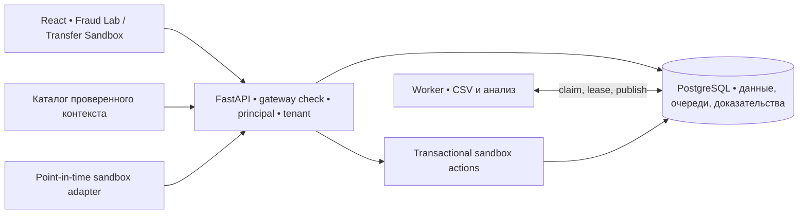
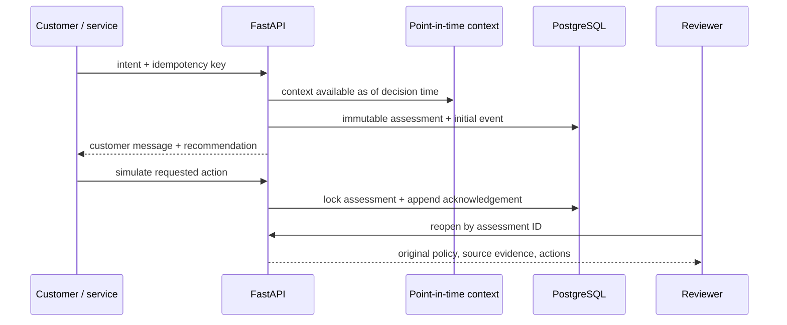

# Архитектура NEXORA AI после ремедиации

## Импорт и fraud analysis

1. API ограничивает размер файла и привязывает ключ запроса к субъекту и payload digest. Синхронный маршрут записывает оригинальный результат в той же транзакции. Асинхронный маршрут сохраняет ограниченный по размеру файл и задание.
2. Worker забирает задание с блокировкой, проверяет CSV и записывает новый batch через PostgreSQL COPY. Валидные строки публикуются одной транзакцией с отчётом. На терминальной стадии bytes очищаются. Размер upload/число строк технически ограничены, валидируемые строки ограниченно материализуются в памяти.
3. Задание анализа закрепляет detector config, policy и доверенный контекст с digest. Worker повторно проверяет хеши. Stable V2 остаётся стандартным профилем, V3 выбирается явно. Legacy job без новой записи пользуется прежним контрактом.
4. Анализ строит граф по валютам, определяет funnel, fan-out, chain и cycle, рассчитывает целочисленную временную пропускную способность, сохраняет evidence, counterevidence, coverage и атрибуцию риска. Клиент читает опубликованный snapshot. Graph запросы используют пакетную выборку frontier.

## Transfer assessment

Principal приходит из интерфейса IdentityVerifier. В development и deployed_demo есть изолированные opaque credentials. Аналитика может требовать проверенную идентичность и tenant scope. Отдельное локальное demo-пространство видит только данные с NULL tenant. Сервисные роли PostgreSQL ограничивают команды и таблицы поверх прикладной изоляции.

| Alembic | Ответственность |
|---|---|
| 0003 | CSV replay reservation и составной foreign key batch/dataset |
| 0004 | Неизменяемые assessments и append-only action events |
| 0005 | Dataset tenant и индексы доступа |
| 0006 | Versioned analysis configuration и проверенный context manifest |
| 0007 | Устойчивая очередь CSV и состояние импорта |

API liveness доступен при остановке БД. Readiness требует подключение и точный набор Alembic heads релиза. Worker восстанавливает просроченные lease, завершает исчерпанный retry budget и отбрасывает публикацию устаревшей попытки. Для новой конфигурации разворачивайте миграции и оба процесса согласованно. Compatibility сведена к текущему head для предсказуемого fail-closed поведения.

[API](../../docs/INTERFACES.md) · [Миграции](../../migrations/versions/) · [Регрессии](FINAL_TEST_REPORT.md)
