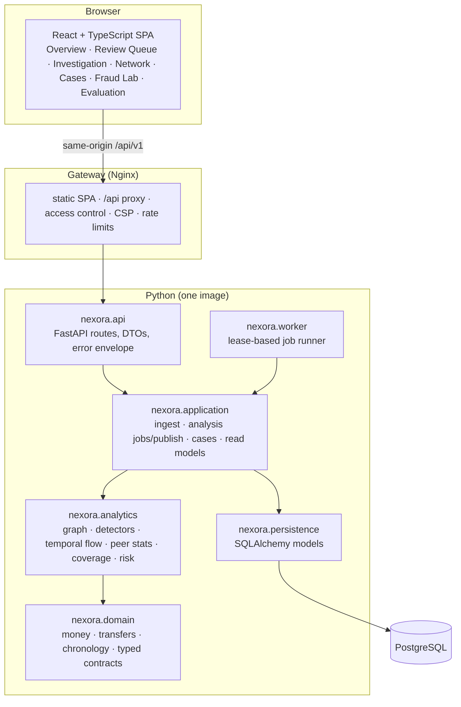
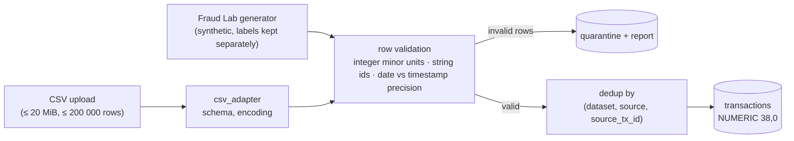
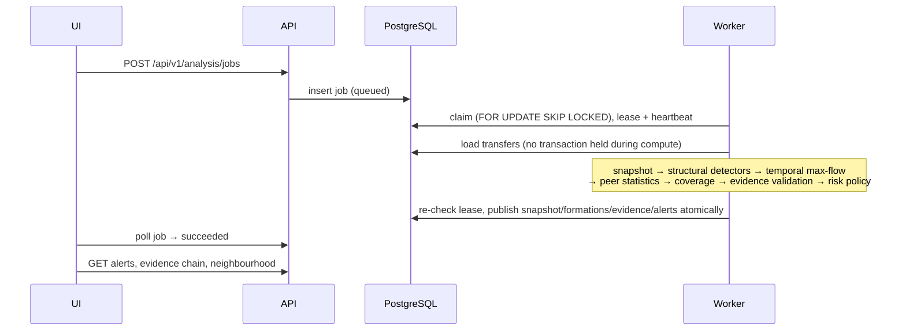
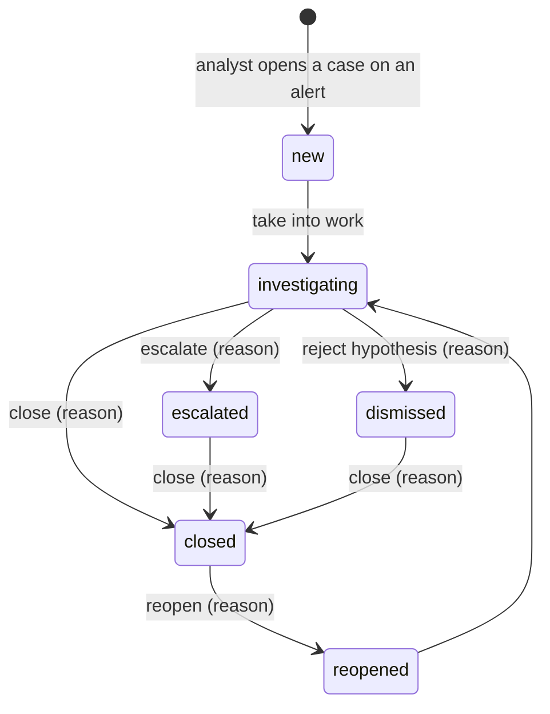

# System architecture (diagrams)

Diagrams of the code on the default branch. Component details and invariants:
[ARCHITECTURE.md](../ARCHITECTURE.md). Deployment: [deployment/railway.md](../deployment/railway.md).

## Components and boundaries

`nexora.domain` and `nexora.analytics` import no web or database framework, so the analysis
pipeline is pure and deterministic and the benchmark runs it without a database.

## Data ingestion

Re-importing the same file is idempotent. Synthetic ground-truth labels never enter the
runtime database or detector input.

## Analysis job and evidence pipeline

Ids are content-derived (UUIDv5), so re-running a job publishes nothing new. Evidence that does
not recompute from its cited transactions is quarantined, never published. Failures retry up to
`NEXORA_JOB_MAX_ATTEMPTS`, then the job is `failed` with an error code.

## Investigation lifecycle

Every transition and note is an append-only audit event in the same SQL transaction (a database
trigger rejects UPDATE/DELETE on `audit_events`), with optimistic concurrency on the case version.

Decisions are recorded for a human analyst; NEXORA takes no action against customers.
Exact state names and allowed transitions: `src/nexora/application/case_service.py`.
