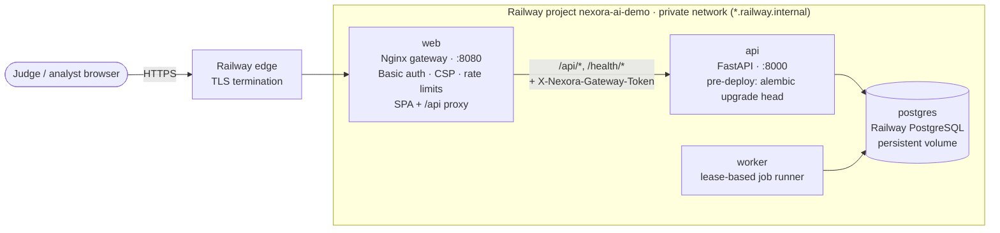
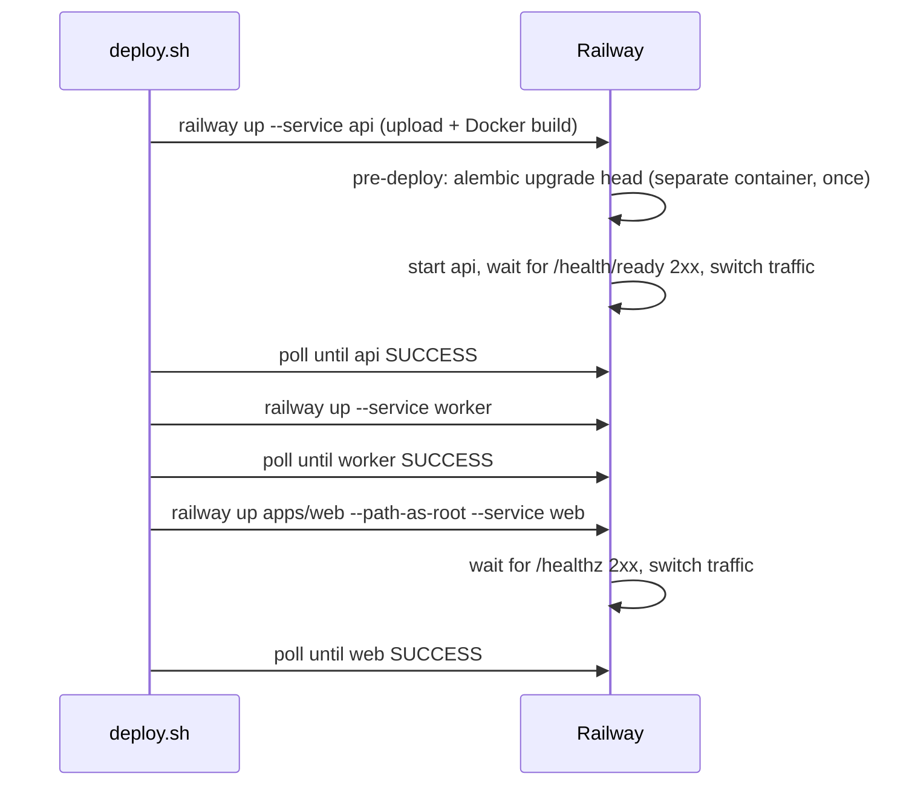

# Deploying NEXORA to Railway

> **Status (2026-11-18): not deployed yet.** Everything below is implemented and verified locally
> with the same images and topology (`docker compose`, CI job `containers`). The first real deploy
> is blocked on the Railway account: creating the project failed with *"Your trial has expired.
> Please select a plan to continue using Railway."* — see [Status and blockers](#status-and-blockers).

The demo is **synthetic data only, with no banking integration**, behind a shared demo credential.
It is a protected hackathon deployment, not bank-grade production (see [Security model](#security-model)).

## Architecture



| Service | Image | Public | Health check | Restart | Limits |
|---|---|---|---|---|---|
| `web` | `apps/web/Dockerfile` | **yes** (generated `*.up.railway.app` domain) | `/healthz` | on failure ×5 | 0.5 vCPU / 256 MiB |
| `api` | `Dockerfile` | no | `/health/ready` (DB + migration) | on failure ×5 | 1 vCPU / 512 MiB |
| `worker` | `Dockerfile`, start `python -m nexora.worker.runner` | no | — (no HTTP) | on failure ×10 | 1 vCPU / 1 GiB |
| `postgres` | Railway PostgreSQL | no | managed | managed | managed |

Only `web` gets a domain. The API, worker and database have **no public domain or TCP proxy**;
they talk over Railway's private WireGuard network. Browser code only ever calls same-origin
`/api/v1/...`; private hostnames never reach the client.

The whole project is declared in [`.railway/railway.ts`](../../.railway/railway.ts) using Railway
[Infrastructure as Code](https://docs.railway.com/infrastructure-as-code). (Railway's older
`railway.json` "Config as Code" is deprecated and stops being read on 2026-12-01, so it is not used.)

## Prerequisites

* A Railway account with an **active plan** (Hobby or higher). The trial/free tiers cap services
  and resources; a lapsed trial cannot create projects at all.
* Railway CLI ≥ 5.63 (`npm install -g @railway/cli`; verified with 5.75.0), Node 22, `openssl`, `git`.
* Signed in: `railway login` (browser or device code). For automation use an account/workspace
  token in `RAILWAY_API_TOKEN`, or a project token in `RAILWAY_TOKEN` for deploys.

## First deployment (once)

```bash
railway login
```

```bash
scripts/railway/bootstrap.sh
```

The script, from a clean checkout:

1. creates the project `nexora-ai-demo` (or reuses the linked one);
2. runs `npm run check` on `.railway/railway.ts`, then `railway config plan` and
   `railway config apply --yes` — creates PostgreSQL, `api`, `worker`, `web`
   (it never deletes anything non-interactively without `--confirm-destructive`);
3. generates secrets locally and sends them **over stdin** (never on a command line):
   `NEXORA_GATEWAY_TOKEN` on `api` (once), `NEXORA_GATEWAY_USER` / `NEXORA_GATEWAY_PASSWORD` on `web`.
   The gateway credentials are kept in `~/.config/nexora/railway-demo.env` (mode 0600) for you to
   share through a password manager;
4. deploys the checked-out commit (`scripts/railway/deploy.sh`);
5. generates the public `*.up.railway.app` domain for `web`.

Then run the smoke test against the URL (see [Verification](#verification)).

## Deploying a new version

Locally, from a clean tree at the commit you want:

```bash
scripts/railway/deploy.sh
```

Or from GitHub: **Actions → deploy-railway → Run workflow** with a SHA or branch. The workflow
refuses commits without a successful `ci` run, waits for approval on the `railway-demo`
environment, deploys, and runs the smoke test against `NEXORA_DEMO_URL`.

Order and gating, per deploy:



* **Migrations run exactly once per API deploy**, in Railway's pre-deploy step, before the new API
  serves traffic. The worker and the gateway never migrate, so there is no race. A failing migration
  stops the deploy and the previous version keeps serving. Migrations are forward-only; downgrades
  of migration 0002 refuse to drop published analyses by design.
* The worker is deployed after the API so it never runs against an older schema. On redeploy it
  receives SIGTERM, finishes the job in progress, and exits (`drainingSeconds: 60`). A job
  interrupted anyway is reclaimed when its lease expires (at-least-once, idempotent publish).

## Environment variables

Set by `.railway/railway.ts` (non-secret) or by `bootstrap.sh` (secret, via stdin):

| Variable | Service | Value | Notes |
|---|---|---|---|
| `NEXORA_DATABASE_URL` | api, worker | `${{postgres.DATABASE_URL}}` | Private URL. `postgresql://` is mapped to psycopg 3 by the app. |
| `NEXORA_GATEWAY_TOKEN` | api | secret, 64 hex | Required on every `/api` request. |
| `NEXORA_GATEWAY_TOKEN` | web | `${{api.NEXORA_GATEWAY_TOKEN}}` | Reference: one value, one place. |
| `NEXORA_EXPOSE_API_DOCS` | api | `false` | No `/docs`, `/redoc`, `/openapi.json`. |
| `NEXORA_CORS_ORIGINS` | api | empty | Same-origin only. |
| `NEXORA_BIND_HOST` / `PORT` | api | `0.0.0.0` / `8000` | IPv4. Binding `::` made Railway's health probe fail (first deploy). |
| `NEXORA_DB_POOL_SIZE` / `_MAX_OVERFLOW` | api, worker | `3` / `2` | ≤ 10 connections total. |
| `NEXORA_WORKER_POLL_SECONDS` | worker | `2` | Idle polling interval. |
| `NEXORA_API_UPSTREAM` | web | `${{api.RAILWAY_PRIVATE_DOMAIN}}:8000` | Re-resolved at runtime. |
| `NEXORA_GATEWAY_AUTH` | web | `basic` | The gateway refuses to start without credentials. |
| `NEXORA_GATEWAY_USER` / `_PASSWORD` | web | secrets | Password ≥ 16 characters. |
| `PORT` | web | `8080` | Railway health checks use it. |

All variables are documented in [`.env.example`](../../.env.example).

## Security model

**Protected hackathon deployment — not bank-grade production.**

Implemented and tested (unit, integration, `smoke/deployed.spec.ts`, CI `containers` job):

* One public entry point; API/worker/DB private. TLS at Railway's edge; HSTS when served over HTTPS.
* HTTP Basic access control on every path except `/healthz` — HTML, assets, every API route
  including writes, and `/health/ready`. The gateway **fails closed**: it exits at start if
  credentials are missing, shorter than 16 characters, or the mode is unknown.
* The API rejects `/api` requests without the gateway token (constant-time compare); a client
  cannot supply its own token because the gateway overwrites the header.
* No API documentation is served; error envelopes carry a request id, never stack traces.
* CSP `script-src 'self'` plus the SHA-256 of the single inline script (computed at build),
  `frame-ancestors 'none'`, `nosniff`, Referrer-Policy, Permissions-Policy, COOP/CORP.
* Rate limits per client: reads 20 r/s (burst 40), writes 30/min (burst 10); 21 MiB request bodies;
  CSV row limit; client address taken from `X-Forwarded-For` only when the hop is private.
* Non-root containers; no secrets in images, repository or command lines.

Remaining risks (documented, not solved):

* **One shared credential and one demo identity.** Every audit event is attributed to
  `demo-analyst`. Anyone with the password can generate datasets and record case decisions.
  For named users, put an identity-aware proxy in front (e.g. Cloudflare Access with a custom
  domain) — the gateway's Basic layer can then be kept as a second factor or replaced.
* Basic auth has no lockout; brute force is bounded only by rate limits and password entropy
  (bootstrap generates ~260 bits).
* Writes are rate-limited but not quota-limited; a credential holder could fill the database
  slowly. Monitor volume usage.
* No WAF, intrusion detection, backup-restore drill, penetration test or compliance review.

## Health checks and verification

| Check | How |
|---|---|
| Gateway live | `curl -fsS https://<domain>/healthz` → `ok` |
| Access denied | `curl -o /dev/null -w '%{http_code}' https://<domain>/api/v1/datasets` → `401` |
| DB + migration | `curl -fsS -u "$USER:$PASS" https://<domain>/health/ready` → `"status":"ok"` |
| End to end | smoke test below |

```bash
cd apps/web && NEXORA_SMOKE_URL=https://<domain> NEXORA_SMOKE_USER=analyst NEXORA_SMOKE_PASSWORD='<from credentials file>' npx playwright test -c playwright.smoke.config.ts
```

It verifies anonymous denial (including a spoofed gateway token), readiness, the full journey
(Lab → worker analysis → queue → investigation → evidence → case decision → audit after reload),
light theme, 390 px layout, and zero console errors or CSP violations. It only adds synthetic data
and never resets the database.

## Operations

* **Logs:** `railway logs --service api` (or `worker`, `web`). The worker logs JSON lines per job.
* **Status:** `railway deployment list --service api --json`.
* **Rollback:** in the dashboard, *Deployments → ⋯ → Redeploy* on the last good deployment, or
  check out the last good commit and run `scripts/railway/deploy.sh`. Code rolls back; the schema
  does not (migrations are forward-only and additive — new columns are nullable), so an older
  API keeps working against a newer schema within this project's migration history.
* **Backups:** enable scheduled backups on the PostgreSQL volume in the dashboard
  (*postgres → Backups*), or take a logical dump through a temporary TCP proxy:
  `pg_dump --format=custom` — remove the proxy afterwards. All data is synthetic and can be
  regenerated from the Lab with the same seeds.
* **Rotate the gateway password:** edit `~/.config/nexora/railway-demo.env`, re-run the two
  `NEXORA_GATEWAY_*` lines of `bootstrap.sh` (or `railway variable set NEXORA_GATEWAY_PASSWORD --stdin --service web`), redeploy `web`.
* **Never** run `scripts/reset_disposable_db.py` against the Railway database; it drops the schema.

## Cost

Measured idle footprint of the four containers locally (`docker stats`, same images):
web ≈ 5 MiB, api ≈ 89 MiB, worker ≈ 67 MiB, PostgreSQL ≈ 50 MiB, all < 0.5 % of one core.

At Railway's published rates (checked 2026-11-18: RAM $10/GB-month, CPU $20/vCPU-month,
volume $0.15/GB-month, egress $0.05/GB):

| Item | Assumption | ≈ per month |
|---|---|---|
| RAM | 0.25–0.4 GB average (Railway's PostgreSQL uses more than the local alpine image) | $2.5–4 |
| CPU | idle polling plus occasional analyses, ~0.02–0.05 vCPU average | $0.4–1 |
| Volume | < 1 GB | < $0.15 |
| Egress | demo traffic, < 2 GB | < $0.10 |

So **roughly $3–5 of usage per month**, which the Hobby plan's included $5 usage covers; the bill
would then be the $5 subscription. Builds are free. This is an estimate, not a quote: set a usage
limit in *Workspace → Usage* (e.g. $10) so a runaway job cannot exceed it. Serverless sleep is
deliberately off: the polling worker would keep the project awake anyway, and judges should not
hit cold starts.

## Troubleshooting

| Symptom | Cause / fix |
|---|---|
| `web` crash-loops, log says `refusing to start` | Gateway credentials missing or too short. Set them with `--stdin`, redeploy `web`. |
| Every `/api` call returns `401 GATEWAY_TOKEN_REQUIRED` | `web` and `api` disagree on the token. `web` must reference `${{api.NEXORA_GATEWAY_TOKEN}}`; redeploy `web` after rotating. |
| `502` from the gateway | API not up or not reachable: check `NEXORA_BIND_HOST=0.0.0.0`, `PORT=8000`, `railway logs --service api`. |
| API deploy fails in pre-deploy | Migration error; the old version keeps serving. Read the pre-deploy log, fix forward. |
| `/health/ready` returns 503 `degraded` | Database unreachable or not migrated. Check `NEXORA_DATABASE_URL` reference and the pre-deploy log. |
| Jobs stay `queued` | Worker not running: `railway logs --service worker`. |
| `Your trial has expired` from the CLI | Activate a plan for the workspace. |

## Status and blockers

| Step | State |
|---|---|
| Images, gateway, IaC, scripts, CI, smoke test | Done, verified locally and in CI |
| Railway CLI authenticated (CLI 5.75.0) | Done |
| Create project | **Blocked:** `Your trial has expired. Please select a plan to continue using Railway.`. No Railway resources were created. |
| GitHub source deploys | Not used: Railway's GitHub app has no access to this repository; code is uploaded with `railway up` instead. |

**Smallest action to unblock:** activate a Railway plan for the workspace in the Railway dashboard
(Workspace settings → Plans), then run `scripts/railway/bootstrap.sh` and the smoke test above.
