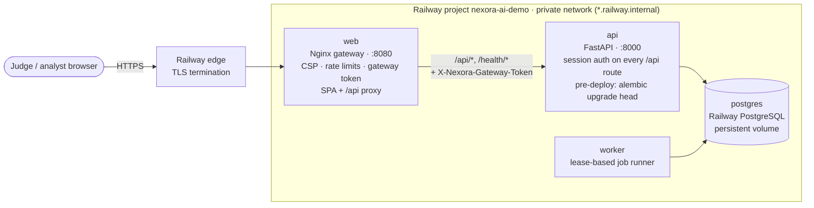
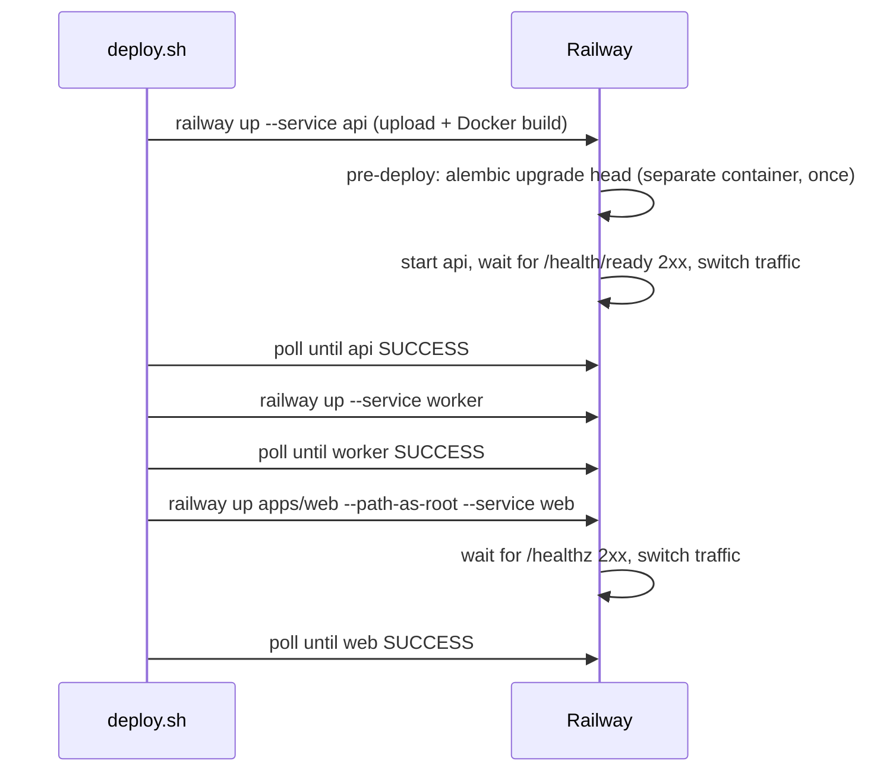

# Deploying NEXORA to Railway

> **Status (2026-11-18): deployed** to Railway project `nexora-ai-demo` (environment `production`)
> at commit `f29ae56` with named-account sign-in (`NEXORA_GATEWAY_AUTH=session`). What was verified
> on the live URL, and what was not, is in the [deployment record](#deployment-record).

The demo is **synthetic data only, with no banking integration**. Analysts sign in with named
accounts on the NEXORA sign-in page; the API enforces a server-side session on every request.
It is a protected hackathon deployment, not bank-grade production (see [Security model](#security-model)).

## Architecture



| Service | Image | Public | Health check | Restart | Limits |
|---|---|---|---|---|---|
| `web` | `apps/web/Dockerfile` | **yes** (generated `*.up.railway.app` domain) | `/healthz` | on failure ×5 | 0.5 vCPU / 256 MiB |
| `api` | `Dockerfile` | no | `/health/ready` (DB + migration) | on failure ×5 | 1 vCPU / 512 MiB |
| `worker` | `Dockerfile`, start `python -m nexora.worker.runner` | no | — (no HTTP) | on failure ×10 | 1 vCPU / 1 GiB |
| `postgres` | Railway PostgreSQL | no | managed | managed | managed |

Only `web` gets a domain. The API, worker and database have **no public domain or TCP proxy**;
they talk over Railway's private WireGuard network. Browser code only ever calls same-origin
`/api/v1/...`; private hostnames never reach the client.

The whole project is declared in [`.railway/railway.ts`](../../.railway/railway.ts) using Railway
[Infrastructure as Code](https://docs.railway.com/infrastructure-as-code). (Railway's older
`railway.json` "Config as Code" is deprecated and stops being read on 2026-12-01, so it is not used.)

## Prerequisites

* A Railway account with an **active plan** (Hobby or higher). The trial/free tiers cap services
  and resources; a lapsed trial cannot create projects at all.
* Railway CLI ≥ 5.63 (`npm install -g @railway/cli`; verified with 5.75.0), Node 22, `openssl`, `git`.
* Signed in: `railway login` (browser or device code). For automation use an account/workspace
  token in `RAILWAY_API_TOKEN`, or a project token in `RAILWAY_TOKEN` for deploys.

## First deployment (once)

```bash
railway login
```

```bash
scripts/railway/bootstrap.sh
```

The script, from a clean checkout:

1. creates the project `nexora-ai-demo` (or reuses the linked one);
2. runs `npm run check` on `.railway/railway.ts`, then `railway config plan` and
   `railway config apply --yes` — creates PostgreSQL, `api`, `worker`, `web`
   (it never deletes anything non-interactively without `--confirm-destructive`);
3. generates secrets locally and sends them **over stdin** (never on a command line):
   `NEXORA_GATEWAY_TOKEN` on `api` (once); the first analyst's **Argon2id hash** as
   `NEXORA_BOOTSTRAP_USERNAME` / `NEXORA_BOOTSTRAP_PASSWORD_HASH` on `api` (the API creates the
   account at start-up if it does not exist); the legacy `NEXORA_GATEWAY_USER` /
   `NEXORA_GATEWAY_PASSWORD` on `web` (only used in `basic` mode). The generated passwords are kept in
   `~/.config/nexora/railway-demo.env` (mode 0600) for you to share through a password manager;
4. deploys the checked-out commit (`scripts/railway/deploy.sh`);
5. generates the public `*.up.railway.app` domain for `web`.

Then run the smoke test against the URL (see [Verification](#verification)).

## Deploying a new version

Locally, from a clean tree at the commit you want:

```bash
scripts/railway/deploy.sh
```

Or from GitHub: **Actions → deploy-railway → Run workflow** with a SHA or branch. The workflow
refuses commits without a successful `ci` run, waits for approval on the `railway-demo`
environment, deploys, and runs the smoke test against `NEXORA_DEMO_URL`.

Order and gating, per deploy:



* **Migrations run exactly once per API deploy**, in Railway's pre-deploy step, before the new API
  serves traffic. The worker and the gateway never migrate, so there is no race. A failing migration
  stops the deploy and the previous version keeps serving. Migrations are forward-only; downgrades
  of migration 0002 refuse to drop published analyses by design.
* The worker is deployed after the API so it never runs against an older schema. On redeploy it
  receives SIGTERM, finishes the job in progress, and exits (`drainingSeconds: 60`). A job
  interrupted anyway is reclaimed when its lease expires (at-least-once, idempotent publish).

## Environment variables

Set by `.railway/railway.ts` (non-secret) or by `bootstrap.sh` (secret, via stdin):

| Variable | Service | Value | Notes |
|---|---|---|---|
| `NEXORA_DATABASE_URL` | api, worker | `${{postgres.DATABASE_URL}}` | Private URL. `postgresql://` is mapped to psycopg 3 by the app. |
| `NEXORA_GATEWAY_TOKEN` | api | secret, 64 hex | Required on every `/api` request. |
| `NEXORA_BOOTSTRAP_USERNAME` / `_PASSWORD_HASH` | api | secret (Argon2id hash) | Optional one-time first analyst; remove once the account exists. |
| `NEXORA_SESSION_IDLE_MINUTES` / `_ABSOLUTE_HOURS` | api | defaults `120` / `12` | Session lifetime. `NEXORA_SESSION_COOKIE_SECURE` stays at its default `true` (checked by `.railway/check.ts`). |
| `NEXORA_GATEWAY_TOKEN` | web | `${{api.NEXORA_GATEWAY_TOKEN}}` | Reference: one value, one place. |
| `NEXORA_EXPOSE_API_DOCS` | api | `false` | No `/docs`, `/redoc`, `/openapi.json`. |
| `NEXORA_CORS_ORIGINS` | api | empty | Same-origin only. |
| `NEXORA_BIND_HOST` / `PORT` | api | `0.0.0.0` / `8000` | IPv4. Binding `::` made Railway's health probe fail (first deploy). |
| `NEXORA_DB_POOL_SIZE` / `_MAX_OVERFLOW` | api, worker | `3` / `2` | ≤ 10 connections total. |
| `NEXORA_WORKER_POLL_SECONDS` | worker | `2` | Idle polling interval. |
| `NEXORA_API_UPSTREAM` | web | `${{api.RAILWAY_PRIVATE_DOMAIN}}:8000` | Re-resolved at runtime. |
| `NEXORA_GATEWAY_AUTH` | web | `session` (or `basic` for rollback) | `session` refuses to start without the gateway token; `basic` without credentials. |
| `NEXORA_GATEWAY_USER` / `_PASSWORD` | web | secrets | Only read in `basic` mode. Password ≥ 16 characters. |
| `PORT` | web | `8080` | Railway health checks use it. |

All variables are documented in [`.env.example`](../../.env.example).

## Security model

**Protected hackathon deployment — not bank-grade production.**

Implemented and tested (unit, integration, `smoke/deployed.spec.ts`, CI `containers` job):

* One public entry point; API/worker/DB private. TLS at Railway's edge; HSTS when served over HTTPS.
* **Named accounts and server-side sessions.** Every `/api` route except `POST /auth/login` and
  `GET /auth/session` requires a valid session cookie (`HttpOnly`, `Secure`, `SameSite=Strict`,
  `__Host-` prefix; only its SHA-256 is stored), plus the session's CSRF token and a trusted origin on
  writes. Sessions expire after 2 h idle / 12 h absolute and are revoked by sign-out. Sign-in is
  throttled per name and per client, and rate-limited at the gateway. Details: [SECURITY.md](../../SECURITY.md).
* The SPA's static files are public (they contain no data or secrets); all data comes from the API.
* The API rejects `/api` requests without the gateway token (constant-time compare); a client
  cannot supply its own token because the gateway overwrites the header. The gateway **fails
  closed**: in `session` mode it exits at start without a ≥ 32-character token; in `basic` mode
  without credentials.
* Readiness (`/health/ready`) is not proxied publicly; Railway probes the API on the private network.
* No API documentation is served; error envelopes carry a request id, never stack traces.
* CSP `script-src 'self'` plus the SHA-256 of the single inline script (computed at build),
  `frame-ancestors 'none'`, `nosniff`, Referrer-Policy, Permissions-Policy, COOP/CORP.
* Rate limits per client: reads 20 r/s (burst 40), writes 30/min (burst 10); 21 MiB request bodies;
  CSV row limit; client address taken from `X-Forwarded-For` only when the hop is private.
* Non-root containers; no secrets in images, repository or command lines.

Remaining risks (documented, not solved):

* **Local passwords, no MFA or roles.** Every analyst can do everything; there is no SSO. An
  identity provider (OIDC) with MFA is the next step for anything beyond a demo (ADR 020).
* Writes are rate-limited but not quota-limited; a credential holder could fill the database
  slowly. Monitor volume usage.
* No WAF, intrusion detection, backup-restore drill, penetration test or compliance review.

## Health checks and verification

| Check | How |
|---|---|
| Gateway live | `curl -fsS https://<domain>/healthz` → `ok` |
| No Basic prompt | `curl -sI https://<domain>/ \| grep -i www-authenticate` → nothing (`session` mode) |
| Access denied | `curl https://<domain>/api/v1/datasets` → `401 AUTH_REQUIRED` |
| DB + migration | Railway deployment status of `api` (its health check is `/health/ready` on the private network) |
| End to end | smoke test below |

```bash
cd apps/web && NEXORA_SMOKE_URL=https://<domain> NEXORA_SMOKE_USER=<analyst> NEXORA_SMOKE_PASSWORD='<its password>' npx playwright test -c playwright.smoke.config.ts
```

It verifies the sign-in page instead of a Basic prompt, anonymous denial (including a spoofed
gateway token), sign-in through the form, the full journey (Lab → worker analysis → queue →
investigation → evidence → case decision → audit attributed to the analyst → reload), sign-out and
replay of the revoked cookie, light theme, 390 px layout, and zero console errors or CSP violations.
While the gateway still runs in `basic` mode, also pass `NEXORA_SMOKE_BASIC_USER` /
`NEXORA_SMOKE_BASIC_PASSWORD`. It only adds synthetic data and never resets the database.

## Authentication rollout and rollback

Basic access control was replaced in two stages so the deployment was never unprotected:

1. **Stage 1 — sessions behind Basic.** Deploy the API (migration `0003` runs in pre-deploy; the
   first analyst is bootstrapped from its hash), the worker and the gateway in `basic` mode. Verify
   with the smoke test plus `NEXORA_SMOKE_BASIC_*`: every API request now needs *both* layers.
2. **Stage 2 — sessions only.** Set `NEXORA_GATEWAY_AUTH=session` on `web` and redeploy `web`
   only. Verify with the smoke test (no Basic variables).

**Rollback** of stage 2: set `NEXORA_GATEWAY_AUTH=basic` on `web` and redeploy `web` (the shared
credential is still stored). Code rollback of stage 1 works too: migration `0003` only adds tables.

## Analyst accounts

There are no default accounts. Use the operator CLI inside the `api` service (`railway ssh --service api`)
or locally against the database; passwords come from a prompt, stdin or `--generate`, never argv:

```bash
python -m nexora.auth.cli create-user alice --display-name "Alice A." --generate
```

```bash
python -m nexora.auth.cli set-password alice --generate
```

`set-password`, `disable` and `revoke-sessions` end the user's sessions immediately. Without shell
access, provision one account through `NEXORA_BOOTSTRAP_USERNAME` + `NEXORA_BOOTSTRAP_PASSWORD_HASH`
(from `python -m nexora.auth.cli hash-password --generate`) and redeploy `api`; remove both variables
afterwards.

## Operations

* **Logs:** `railway logs --service api` (or `worker`, `web`). The API (including uvicorn's access and
  startup lines) and the worker write one JSON object per line on stderr: `ts` (UTC), `level`, `logger`,
  `msg`, `exc` (traceback, when there is one) and, for anything written while serving a request,
  `request_id`. That is the id an error envelope and the `X-Request-ID` header show the user, so a quoted id
  finds its lines: `railway logs --service api | grep '"request_id": "req-…"'`. Configuration:
  `configs/logging.json` = `nexora.logging_config.LOGGING_CONFIG` (a test keeps them identical). The gateway
  (`web`) keeps Nginx's own log format.
* **Status:** `railway deployment list --service api --json`.
* **Rollback:** in the dashboard, *Deployments → ⋯ → Redeploy* on the last good deployment, or
  check out the last good commit and run `scripts/railway/deploy.sh`. Code rolls back; the schema
  does not (migrations are forward-only and additive — new columns are nullable), so an older
  API keeps working against a newer schema within this project's migration history.
* **Backups:** enable scheduled backups on the PostgreSQL volume in the dashboard
  (*postgres → Backups*), or take a logical dump through a temporary TCP proxy:
  `pg_dump --format=custom` — remove the proxy afterwards. All data is synthetic and can be
  regenerated from the Lab with the same seeds.
* **Rotate an analyst password:** `python -m nexora.auth.cli set-password <user> --generate`
  (ends that user's sessions). The legacy Basic password (only used in `basic` mode):
  `railway variable set NEXORA_GATEWAY_PASSWORD --stdin --service web`, redeploy `web`.
* **Never** run `scripts/reset_disposable_db.py` against the Railway database; it drops the schema.

## Cost

Measured idle footprint of the four containers locally (`docker stats`, same images):
web ≈ 5 MiB, api ≈ 89 MiB, worker ≈ 67 MiB, PostgreSQL ≈ 50 MiB, all < 0.5 % of one core.

At Railway's published rates (checked 2026-11-18: RAM $10/GB-month, CPU $20/vCPU-month,
volume $0.15/GB-month, egress $0.05/GB):

| Item | Assumption | ≈ per month |
|---|---|---|
| RAM | 0.25–0.4 GB average (Railway's PostgreSQL uses more than the local alpine image) | $2.5–4 |
| CPU | idle polling plus occasional analyses, ~0.02–0.05 vCPU average | $0.4–1 |
| Volume | < 1 GB | < $0.15 |
| Egress | demo traffic, < 2 GB | < $0.10 |

So **roughly $3–5 of usage per month**, which the Hobby plan's included $5 usage covers; the bill
would then be the $5 subscription. Builds are free. This is an estimate, not a quote: set a usage
limit in *Workspace → Usage* (e.g. $10) so a runaway job cannot exceed it. Serverless sleep is
deliberately off: the polling worker would keep the project awake anyway, and judges should not
hit cold starts.

## Troubleshooting

| Symptom | Cause / fix |
|---|---|
| `web` crash-loops, log says `refusing to start` | `session` mode: gateway token missing/short (check the `${{api.NEXORA_GATEWAY_TOKEN}}` reference). `basic` mode: credentials missing or too short. |
| Sign-in always says "Неверное имя пользователя или пароль" | No account yet: create one (Analyst accounts). Five failures lock that name for 15 minutes (`429`). |
| Signed in, but every request returns `401 AUTH_REQUIRED` | The cookie is `Secure`: the site must be served over HTTPS (Railway domain). |
| Every `/api` call returns `401 GATEWAY_TOKEN_REQUIRED` | `web` and `api` disagree on the token. `web` must reference `${{api.NEXORA_GATEWAY_TOKEN}}`; redeploy `web` after rotating. |
| `502` from the gateway | API not up or not reachable: check `NEXORA_BIND_HOST=0.0.0.0`, `PORT=8000`, `railway logs --service api`. |
| API deploy: build and migrations succeed, then "never became healthy", no requests in the access log | Bind address: use `NEXORA_BIND_HOST=0.0.0.0`, not `::`. |
| API deploy fails in pre-deploy | Migration error; the old version keeps serving. Read the pre-deploy log, fix forward. |
| `/health/ready` returns 503 `degraded` | Database unreachable or not migrated. Check `NEXORA_DATABASE_URL` reference and the pre-deploy log. |
| Jobs stay `queued` | Worker not running: `railway logs --service worker`. |
| `Your trial has expired` from the CLI | Activate a plan for the workspace (the workspace id changes; re-run `railway link`). |

## Deployment record

### 2026-11-18 — named accounts and the NEXORA sign-in page (commit `f29ae56`)

Rolled out in the two stages described in [Authentication rollout and rollback](#authentication-rollout-and-rollback),
after a green CI run on the commit (unit, integration, browser E2E, production images + gateway smoke).

| Step | Observed |
|---|---|
| First analyst | Password generated locally; only its Argon2id hash set as `NEXORA_BOOTSTRAP_*` on `api` over stdin |
| Stage 1 deploy (`deploy.sh`) | `api`, `worker`, `web` all SUCCESS at `f29ae56` (checked through the Railway API); gateway still `basic` |
| Stage 1 boundary | Anonymous `/` and `/api/*` → `401`; **with** the Basic credential but no session: `/api/v1/datasets` → `401 AUTH_REQUIRED`, `/api/v1/auth/session` → `authenticated: false`, `/health/ready` → `404` |
| Stage 1 smoke (with Basic) | 4/4 passed: sign-in through the form (so migration `0003` and the bootstrap ran), worker analysis, case decision, audit attributed to the analyst, reload, sign-out, revoked-cookie replay refused, light theme, 390 px |
| Clean-up | `NEXORA_BOOTSTRAP_*` and the obsolete `NEXORA_DEMO_ANALYST` deleted from `api`/`worker` (each delete redeployed the same image) |
| Stage 2 | `NEXORA_GATEWAY_AUTH=session` on `web`; `web` redeployed SUCCESS |
| Stage 2 boundary | `/` → `200` with **no `WWW-Authenticate` header** (no browser Basic prompt), CSP + HSTS present; anonymous `/api/v1/datasets` and writes → `401`; spoofed gateway token → `401`; `/docs`, `/openapi.json`, `/health/ready` → `404`; cross-site sign-in (`Origin: https://evil.example`) → `403` |
| Stage 2 smoke | 4/4 passed against `https://web-production-4593b103.up.railway.app`, including `Secure` + `__Host-` + `HttpOnly` + `SameSite=Strict` cookie checks over HTTPS and zero console errors / CSP violations |

Not verified on the live URL: idle/absolute expiry and brute-force lockout (covered by integration
tests, not exercised against production to avoid locking out the demo account); `deploy-railway.yml`
has still not been run. During stage 1, between the `api` and `web` deploys (about one minute), the
previous SPA could not load data because it had no sign-in page.

The analyst credential is not stored in the repository; the operator holds it. Rotate it with
`python -m nexora.auth.cli set-password nexora.analyst --generate`.

### 2026-11-18 — first deployment (commit `dd4ab58`)

Deployed 2026-11-18 from commit `dd4ab58` with `scripts/railway/bootstrap.sh` and `deploy.sh`.
Public entry point: `https://web-production-4593b103.up.railway.app` (the only domain in the project;
verified through the Railway API that `api`, `worker` and `postgres` have no domain and no TCP proxy).

| Check | Result |
|---|---|
| Services | `api`, `worker`, `web` deployed SUCCESS; PostgreSQL with a volume at `/var/lib/postgresql/data` |
| Migrations | `0001 → 0002` applied by the `api` pre-deploy step on first deploy; `/health/ready` reports `migration: 0002` |
| Anonymous access | `401` on `/`, `/alerts`, `/api/v1/datasets`, `/health/ready`, assets and a write (`POST /api/v1/lab/datasets`); a spoofed gateway token and wrong credentials also `401`; `/docs` and `/openapi.json` `404`; only `/healthz` is public |
| Headers over HTTPS | HSTS, CSP, `X-Frame-Options: DENY` present |
| Browser journey (`smoke/deployed.spec.ts`) | **Passed:** Lab → generate → worker analysis → Review Queue → investigation with evidence → case decision → audit after reload; light theme; 390 px; no console or CSP errors |
| Worker | Claimed and published the job (worker log); job `succeeded` |
| Persistence | Dataset, job and case readable through the API. After a redeploy of `api` (zero-downtime, both deployments SUCCESS) they were unchanged, readiness stayed `ok`, anonymous access stayed `401`, and the browser journey passed again |
| Not covered by that run | The two `fetch`-based smoke checks (anonymous denial, readiness) could not run from the build sandbox because Node's HTTP client does not use its egress proxy (`getaddrinfo ENOTFOUND`); the same checks were done with `curl` and are listed above. `deploy-railway.yml` has not been run. |

**Defect found on the first real deploy.** With `NEXORA_BIND_HOST=::` the build and migrations
succeeded and uvicorn reported listening on `[::]:8000`, but Railway's health probe never reached
it (no request in the access log, six failed attempts, "never became healthy"). Fixed in `dd4ab58`
by binding `0.0.0.0`; this environment resolves private names over IPv4 as well as IPv6.

**Notes for operators.**

* The CLI cannot stream build or deploy logs from sandboxed networks (GraphQL subscriptions are
  refused with `400`); `deploy.sh` falls back to polling, and logs can be read with
  `railway logs --service <name>` or the `deploymentLogs` GraphQL query.
* Gateway credentials are generated by `bootstrap.sh` into `~/.config/nexora/railway-demo.env` on the
  machine that ran it and set as `NEXORA_GATEWAY_USER` / `NEXORA_GATEWAY_PASSWORD` on `web`. If the
  script ran on an ephemeral machine, read or reset them in the Railway dashboard (*web → Variables*).
* Railway GitHub source deploys are not used (the Railway GitHub app has no access to this repository);
  code is uploaded with `railway up`.
