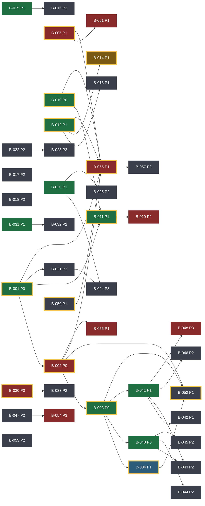

# Dependency map

Task dependencies for [`EXECUTION_BACKLOG.md`](EXECUTION_BACKLOG.md). The diagram is **generated** from each task's
`Depends on` and `Status` lines — regenerate it, never edit it by hand:

```bash
python3 docs/handoff/probes/progress.py --mermaid   # paste between the markers below
```

`tests/unit/test_progress_probe.py` fails when the block below differs from the generated one. Arrows point from
prerequisite to dependent task. Colours: green DONE, red BLOCKED (owner, hardware or decision), grey TODO, amber in
progress / implemented, blue verified. A thick yellow border marks the critical path.

<!-- generated:mermaid:start -->

<!-- generated:mermaid:end -->

## Critical path to a release

A release (RELEASE_CHECKLIST.md) needs B-055, and B-055 needs B-001, B-002, B-005, B-010, B-012, B-050. Of those,
**B-002 and B-005 are owner-gated**, so the release is gated on the owner, not on engineering effort. The longest chain
of autonomous work on the path is **B-003 → B-004 → B-052** (documentation consolidation needs the reconciled numbers
and, by its own rule, the PR decision B-002). B-014 (dependency-audit gate) and B-050 (camera path through the real
gateway image) are independent of every other open task and can run now. B-030 (real webcam) blocks only the gesture claim
and B-033.

| Path segment | State (2026-11-25) | What unblocks it |
|---|---|---|
| B-001, B-003, B-010, B-011, B-012 | DONE | — |
| B-004 | ready | autonomous; merges `admiring-fermat` + `great-lovelace` |
| B-014, B-050 | ready | autonomous |
| B-002 | blocked | owner approves the integration PR and branch disposal (D-1, D-2) |
| B-005 | blocked | owner grants Railway workspace access |
| B-052 | waits | B-002, B-004 |
| B-055 | waits | owner approval after B-002, B-005, B-050 |
| B-030 | blocked | a person with a webcam runs `docs/implementation/GRAPH_GESTURE_VERIFICATION.md` |

## Independent streams (safe to run in parallel)

| Stream | Ready tasks | Shared files to watch |
|---|---|---|
| Platform / supply chain | B-013, B-014, B-053 | `apps/web/package.json`, lockfile, `.github/workflows/ci.yml` — one upgrade per branch |
| Observability / reliability | B-016, B-017, B-047 | `src/nexora/worker/`, `src/nexora/api/deps.py` |
| Graph workspace | B-021, B-022, B-025 | `apps/web/src/features/graph/`, `src/nexora/application/graph_view.py` — serialise B-022/B-025 (same canvas) |
| Detection / evaluation | B-042, B-043, B-044, B-045, B-046 | `src/nexora/analytics/`; protocol rules §12 — never tune on sealed splits |
| Account self-service | B-018 | `src/nexora/auth/`, migrations (take the next free revision) |

**Integration order** when streams meet: migrations first (single head, B-001 guard), then API schema (regenerate the client
once), then UI. Two tasks that both add a migration must not land in the same CI window without a rebase.
