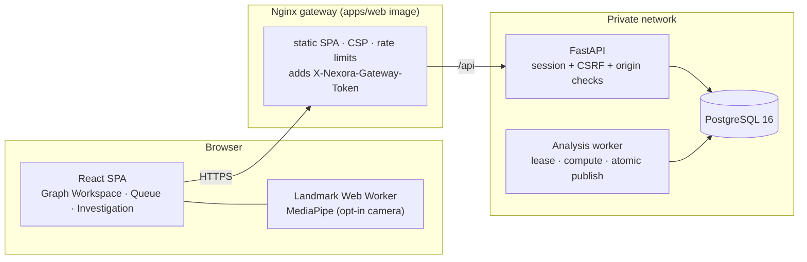

# NEXORA AI / SYNAPTIC-LABS — master handoff

Written 2026-11-22 by an engineering review that re-ran every check it reports and read the code it
describes. It consolidates and supersedes the earlier `ZENCODER_*` documents (kept for history, each
now carries a banner pointing here). Companion files: [`EXECUTION_BACKLOG.md`](EXECUTION_BACKLOG.md) (the
work queue), [`NEXT_SESSION_PROMPT.md`](NEXT_SESSION_PROMPT.md) (paste to start a session),
[`EXECUTION_STATE.md`](EXECUTION_STATE.md) (live state), [`EXECUTION_LEDGER.md`](EXECUTION_LEDGER.md)
(append-only run log), [`probes/`](probes/README.md) (measurement scripts).

**Evidence legend** — every claim carries one of these:
`[local]` a command was run in this session and its literal output read ·
`[CI]` a GitHub Actions run was read through the API (not re-run here) ·
`[probe]` measured by a script in `docs/handoff/probes/` ·
`[git]` read from git history/merge-tree ·
`[code]` read in the source, not executed ·
`[doc]` stated in a repository document, **not** re-verified ·
`[unverified]` could not be checked. Nothing is claimed as verified without one of these tags; an untagged sentence
is background description drawn from the repository's own documents or code, not a verification claim.

---

## 1. Executive summary

NEXORA AI is an explainable fraud/AML **triage** tool for a human analyst: it turns transfers into
evidence-backed network "formations" (funnel, fan-out, chain, cycle), checks chronology, compares peers,
abstains at data boundaries, ranks the result and records analyst case decisions with an audit trail.
Everything runs on **synthetic data**; there is no bank integration, no LLM in the evidence pipeline and no
automatic action against anyone.

**Where it stands.** A complete, CI-green vertical slice: ingest → graph → detectors → temporal
verification → risk policy → hypotheses → queue/investigation/cases → graph workspace → opt-in camera
gestures, behind named-account authentication, with Docker, Railway IaC and a three-job CI. Backend:
190 tests; frontend: 99 unit and 34 browser tests; all re-verified green today `[local]`; the same commit is
green on GitHub `[CI]`.

**What it is not.** It is not safe for real data (no authorization or tenancy; an ungated CSV import
endpoint — H-02, H-09), its fraud numbers are synthetic and come from scenarios written by the same team as
the detectors (H-14), the camera mode has never seen a real hand (H-17), and the live demo predates all of
the graph/gesture work and is unverified from here (H-22).
*Update 2026-11-23*: the CSV import is off by default (B-010) and needs the `admin` role when on; writes need the
`analyst` role (B-011). Still not safe for real data: every account reads every dataset (H-09 → B-019).

**Most serious engineering risks** (detail in §16): H-01 two open PRs each define migration `0003` (merged
separately → two Alembic heads; production is reportedly at `0003`); H-02/H-09 no authorization and an open
import route; H-08 published benchmark ratios derived from rounded values (README says 79.4 %, counts give
79.3 %) with the fix stranded on an unmerged branch; H-14 `sealed-v1` is consumed, so further tuning against
it would be selection on the test set; H-04 a 1–3 s main-thread freeze when the graph lays out.

**First moves for the next session** (all autonomous, in order): B-001 migration-chain guard → B-010 gate the
import route → B-003 port the benchmark-arithmetic fixes → B-015 structured logging → B-012 react-router v7 →
B-031 model-before-camera → B-020 layout off the main thread → B-040/B-041 sealed-v2 and entity-level metrics.
Human-gated: B-002 (merge approval), B-005 (live state), B-030 (real webcam), B-055 (deploy).

---

## 2. Verified project state

Base commit: `7abd9a549629338c710d69403fbce2c019bee285` on `graph-workspace-wip` (identical on
`claude/peaceful-darwin-nrquu9`) `[git]`. Environment: Linux container, Python 3.13.18, Node 22.23.5, uv 0.11.32,
PostgreSQL 16 (started locally), Chromium via Playwright.

### 2.1 Re-run in this session `[local]` (literal results from the saved logs)

| Check | Command | Observed |
|---|---|---|
| Ruff lint | `uv run ruff check src tests migrations` | All checks passed |
| Ruff format | `uv run ruff format --check src tests migrations` | 87 files already formatted |
| mypy | `uv run mypy` | no issues in 61 source files |
| pytest (unit + integration, live PostgreSQL) | `uv run pytest -p no:cacheprovider -rs` | **190 passed**, 0 skipped, 1 deprecation warning |
| Migrations | `uv run alembic upgrade head` then `uv run alembic check` | head `0004`; "No new upgrade operations detected" |
| OpenAPI client | `cd apps/web && npm run gen:api && git -C "$(git rev-parse --show-toplevel)" diff --exit-code -- apps/web/openapi.json apps/web/src/lib/api-types.ts` | no diff |
| TypeScript | `cd apps/web && npx tsc -b` | clean |
| Vitest | `cd apps/web && npx vitest run` | **99 passed** (12 files) |
| Production build | `cd apps/web && npx vite build` | built; MediaPipe assets verified by SHA-256 |
| Playwright, full suite, cold Vite cache | `rm -rf node_modules/.vite && npx playwright test --trace off` | **34 passed** (graph-workspace 5, gestures 4) |
| Playwright against the **production bundle** with the exact gateway headers | same suite via `playwright.config.ts` + `docs/handoff/probes/gateway_sim.mjs` (Node stand-in, not Nginx) | **34 passed**, no CSP violation (tests assert an empty console-error list) |
| Railway IaC | `cd .railway && npm run check` | 3 services + database, all invariants hold |
| Pitch app | `cd apps/pitch && npm run lint && npx tsc -b && npx vitest run && npm run build`, smoke, Playwright | lint clean; 17 unit; build ok; smoke "all checks passed"; **29 E2E passed** |
| npm audit (web) | `cd apps/web && npm audit` | 8 advisories: 2 critical, 1 high, 5 moderate; the only one reaching production is `react-router` (see H-07) |

### 2.2 Read from GitHub Actions `[CI]` — run 64 on `7abd9a5`, conclusion **success**

Jobs, all success: *Lint, types, tests, E2E* (migrations + `alembic check`, pytest, web build, OpenAPI sync,
Playwright); *Production images + gateway smoke test* (both Docker images build, run as non-root, gateway
fails closed in four misconfigurations, Basic rollback mode works, compose stack starts, smoke test through
the gateway incl. cookie flags and a `/network` deep-link reload with no console/CSP errors, worker stops
gracefully); *Deployment config (Railway IaC, shell)* (IaC invariants, ShellCheck). The earlier checkpoint
`b9943f0` (run 61) concluded **failure**; its logs were not read here (cause not diagnosed). Run 65 on the docs-only handoff commit `da681c2` failed once in *Browser E2E* on an intermittent auth test race (not a product defect; fixed in the next commit — see `EXECUTION_LEDGER.md` L-0003).

### 2.3 Not executed here — and why

| Not executed | Reason | Where it is covered |
|---|---|---|
| Docker image build and compose stack locally | no Docker daemon in this container (`docker info` shows only the client) | `[CI]` run 64 |
| ShellCheck locally | not installed; fetching it through `uvx` was refused by the sandbox policy and not worked around | `[CI]` run 64 |
| `pip-audit` (Python dependencies) | tool unavailable here; same sandbox constraint | **uncovered** → B-014 |
| Real webcam | no hardware | **uncovered** → B-030 |
| Live Railway state | the connected token authenticates but lists no projects at account level; I did not enumerate the owner's workspaces | **uncovered** → B-005 |
| Gesture camera path through the real Nginx image | CI smoke never starts the camera or fetches `/vendor/mediapipe/*` | **uncovered** → B-050 |
| ORM load and publish at 200k rows | probe covers the pure pipeline only | **uncovered** → B-047 |

---

## 3. Maturity and readiness

| Area | Stage | Basis |
|---|---|---|
| Detection pipeline + risk policy | Working prototype with a disciplined (synthetic) evaluation | 190 tests `[local]`, sealed evaluation `[doc]`; no real-data validation, no calibration (H-12, H-14) |
| Hypothesis engine (competing explanations) | Working, narrow | covers funnel and fan-out only (H-15) |
| Authentication | Solid primitives | reviewed `[code]`: uniform failure path, throttling, session fixation, CSRF, fail-closed gateway; route-enumeration test passes `[local]` |
| Authorization / tenancy | **Absent** | H-09 |
| Graph Workspace | Feature-complete beta | 5 E2E + 7 API tests green `[local]`; performance risks H-04, H-06 |
| Camera gestures | Technically complete, **hardware-unverified** (alpha) | 4 E2E on a synthetic camera `[local]`; never run on a hand (H-17) |
| Delivery (CI, images, IaC) | Mature for a prototype | three CI jobs green `[CI]`; deploy is manual and approval-gated `[doc]` |
| Operations | Minimal | no metrics, error tracking, backup drill or retention policy (H-03, H-20) |

**Overall: a pre-release demo candidate** — complete and verified enough to demonstrate end to end, not
enough to hold real customer data. "Production" in this document means *real data, multiple analysts*, which
is blocked by §17.

---

## 4. Architecture and component map



| Layer | Package / path | Responsibility | Must not |
|---|---|---|---|
| Domain | `src/nexora/domain/` | transfers, precision-aware chronology, money, ids, typed analysis objects | import FastAPI or SQLAlchemy |
| Analytics | `src/nexora/analytics/` | graph snapshot, structural detectors (`structural/` funnel, fan-out, chain, cycle), temporal max-flow, peer statistics, coverage, hypotheses, risk, pipeline | import FastAPI or SQLAlchemy |
| Application | `src/nexora/application/` | ingest, analysis jobs and atomic publish, queries, cases, graph read model, evaluation | know HTTP |
| API | `src/nexora/api/` | routes, schemas, auth dependency, error envelope | contain business logic |
| Auth | `src/nexora/auth/` | Argon2id passwords, sessions, tokens, operator CLI | — |
| Persistence | `src/nexora/persistence/` | SQLAlchemy models, engine/session factory | — |
| Worker | `src/nexora/worker/runner.py` | lease → compute outside a transaction → publish atomically | hold a transaction while computing |
| Evaluation | `src/nexora/evaluation/` | synthetic generators, benchmark harness | feed truth labels to the runtime DB or detectors |

**Dependency direction**: `api → application → analytics → domain`; `persistence` is used by application and
auth only. **Transaction ownership**: the API session is function-scoped and commits *before* the response is
sent (audit F-14 `[doc]`, `get_session` `[code]`); authentication opens a *separate* short session per request
(H-10); the worker computes with no open transaction and publishes atomically after re-checking its lease
`[doc]`; analysis ids are content-derived (uuid5), so a re-run changes nothing.

---

## 5. Repository structure

```
CLAUDE.md                         binding agent rules (read first)
NEXORA_AI_MASTER_SPEC_CLAUDE_CODE.md   team-supplied spec; P0 gates binding
src/nexora/…                      backend (see §4)
migrations/versions/              Alembic chain 0001 … 0004 (head 0004)
configs/{detectors,risk_policy}.yaml   versioned detector/policy configuration (hash → snapshot identity)
tests/{unit,integration}/         190 collected tests; integration needs PostgreSQL
scripts/                          export_openapi, reset_disposable_db, run_benchmark, run_sealed_evaluation,
                                  e2e_stack.sh, railway/{bootstrap,deploy}.sh
benchmarks/results/               bench-v1.json, dev-evaluation.json, sealed-evaluation.json (committed artifacts)
apps/web/                         React SPA + gateway image (paths below are repository-relative)
  apps/web/src/app/               routing, auth guard, theme, dataset context
  apps/web/src/lib/               i18n.ts (ALL UI copy), api.ts, generated api-types.ts, format helpers
  apps/web/src/styles/            tokens.css (ALL colours/spacing), components/layout/features/auth css
  apps/web/src/components/graph/  GraphCanvas, controller (typed command port), canvasColor
  apps/web/src/features/graph/    GraphWorkspace, graphModel
  apps/web/src/features/gestures/ camera -> engine -> worker -> recogniser -> adapter -> controller
  apps/web/src/features/          also: alerts, cases, command-center, evaluation, fraud-lab, investigation, auth, analytics
  apps/web/e2e/, apps/web/smoke/  Playwright (dev server) and deployed smoke tests
  apps/web/docker/                CSP generator (csp.mjs), Nginx template, gateway entrypoint
  apps/web/scripts/gesture-assets.mjs   hash-pinned MediaPipe asset plugin
apps/pitch/                       separate static 6-slide pitch with its own CI workflow
.railway/                         Railway definition + offline invariant check
docs/                             ARCHITECTURE, EVALUATION, LIMITATIONS, INTERFACES, deployment/, design/,
                                  architecture/ (audit), evaluation/ (protocol, results), research/, handoff/
.github/workflows/                ci.yml, codeql.yml, deploy-railway.yml, pitch.yml
```

Entry points: `make api` · `make worker` · `make web` · `docker compose up --build -d --wait` ·
`uv run python -m nexora.auth.cli create-user <name> --generate`.

---

## 6. Branch and PR integration status `[git]` (fetched 2026-11-22)

**Default branch: `claude/brave-dirac-c80nwq`** at `ea5ca9c` (there is no `main`). One worktree, no stashes.

| Ref | Position vs default | Content | Merge into `graph-workspace-wip` (`git merge-tree`) |
|---|---|---|---|
| `graph-workspace-wip` (= `claude/peaceful-darwin-nrquu9`) | 25 ahead, 0 behind | integration line: PR #15 + PR #3 + PR #5 + graph read model + graph workspace + gestures + fixes | — |
| PR #15 `stoic-dijkstra-y9o5bm` | 6 ahead | named-account sign-in, sessions, CSRF; migration `0003` (auth) | already merged into wip |
| PR #3 `quirky-ride-v565zk` | 12 ahead, 9 behind | leakage fixes, hypothesis engine, sealed evaluation; migration **`0003`** (hypotheses) | already merged into wip, **renumbered to `0004`** |
| PR #5 `kind-lamport-uym9zx` | 1 ahead, 9 behind | first `apps/pitch` | already merged into wip |
| `eloquent-planck-pwnbd8` (no PR, 2026-11-21) | 4 ahead | benchmark F1-from-counts, numerators, dirty-tree fix, regenerated `bench-v1.json`; includes `sharp-cannon` | **conflicts**: `Evaluation.tsx`, `bench-v1.json`, `docs/EVALUATION.md`, `tests/unit/test_benchmark.py` |
| `sharp-cannon-xkrybs` (no PR) | 1 ahead | Evaluation-screen rounding fix (⊂ eloquent-planck) | conflicts: `Evaluation.tsx` |
| `admiring-fermat-9fc4nx` (no PR) | 3 ahead | redesigned pitch ("jury narrative") | merges **cleanly** |
| `great-lovelace-0gmpmi` (no PR) | 5 ahead | README redesign + pitch (⊃ admiring-fermat) | conflicts: `README.md` only |
| `peaceful-babbage-cyqrox` (no PR) | 10 ahead, 23 behind | older Detection v2 / evaluation lineage | massive conflicts (11+ files); treat as superseded |
| Dependabot PRs #6–#14 | — | react-router 7, vite 8, vitest 5, psycopg, types/node, typescript 7 (.railway), actions | not merged; majors need work (B-012, B-013) |

**The integration hazard.** PR #15 and PR #3 each declare `revision = "0003"`, `down_revision = "0002"` with
different content `[git]`. Merging both as they stand yields two heads and a failing `alembic upgrade head`.
The integration branch resolved it by renumbering PR #3's migration to `0004` (`down_revision = "0003"`).
**Never renumber the auth migration**: the deployment record says production ran `0003` = auth `[doc]`.

**The stranded fixes.** The benchmark-arithmetic and Evaluation-screen fixes (H-08) and the redesigned
README/pitch live only on branches with no PR. They are not in the integration line.

**Update 2026-11-25 (L-0020)** `[git]`: `graph-workspace-wip` was fast-forwarded from `0c8d21b` to `bd3868f`, so it is again
identical to `claude/peaceful-darwin-nrquu9` and carries all B-001…B-041 work (54 commits ahead of the default branch at `bd3868f`, 0 behind);
it is the working branch from this session on. B-003 ported `eloquent-planck`/`sharp-cannon` (their changes are in the line under
new SHAs). New since the table above: **`feat/transfer-protection`** (2 commits on `ea5ca9c` by a collaborator, CI green on its
branch, no PR) — not integrated, conflicts in 7 files and adds a second auth mechanism (H-26, B-056, decision D-12). Open PRs now
also include Dependabot #16 (python minor/patch group).

**Recommended path** (needs the owner, B-002): one PR from `graph-workspace-wip` to the default branch
superseding #3/#5/#15, then port `eloquent-planck` (B-003) and `great-lovelace`/`admiring-fermat` (B-004);
treat `peaceful-babbage` as dead. Do not merge, close or delete anything without approval.

---

## 7. Database and migration state

Chain `0001_initial_schema` → `0002_formation_kinds_v2` → `0003_auth_users_sessions` →
`0004_hypothesis_assessments` (head) `[local]`. `alembic check` reports the ORM and migrations agree `[local]`.
Tables: datasets, import_batches, transactions, graph_snapshots, formations, evidence, evidence_transactions,
fraud_signals, risk_assessments, hypothesis_assessments, alerts, cases, case_notes, audit_events,
analysis_jobs, users, auth_sessions, login_attempts `[code]`.

* Money is `NUMERIC(38,0)` in minor units; ids are text; `transactions` has CHECK constraints for positive
  amount, precision consistency and status; unique source key; indexes on `(dataset_id, observed_date)`,
  `(dataset_id, sender_account_id)`, `(dataset_id, receiver_account_id)` `[code]`.
* The audit log is append-only via a PostgreSQL trigger `[doc]`.
* Snapshot identity = `UNIQUE(dataset_id, input_manifest_sha256, config_sha256)` `[code]`; publish is idempotent.
* Production DB revision: **`0003` per the deployment record `[doc]`; live state `[unverified]`** (B-005).
* Migrations run once per API deploy in Railway's pre-deploy step; forward-only and additive `[doc]`.
  `0002`'s downgrade refuses to discard published analyses by design (ADR-019). Tests reset disposable DBs
  by schema drop (`scripts/reset_disposable_db.py`, refuses names not ending `_test`/`_e2e`).
* **Rules**: never edit or renumber `0001`–`0004`; new migrations take the next free revision and must be
  additive; B-001 adds a test that enforces a single head.

---

## 8. Fraud detection pipeline

`ingest/validation.py` (quarantines contradictory date/timestamp rows, dedups) → `analytics/graph_builder.py`
(one aggregate edge per sender/receiver/currency over posted, non-self transfers) → structural detectors
(`funnel-v3`, `fanout-v1`, `chain-v1`, `cycle-v1`; budgets for paths/cycles/flow fail closed and mark the snapshot
partial) → temporal max-flow (`flow-v1`, 7-day hop lag, `max_transfers: 600`) → peer concentration
(`peer-concentration-v1`) → coverage (boundary accounts → abstention) → evidence recomputation from source rows →
hypotheses (`hypotheses-v1`, funnel/fan-out only) → risk (`risk-policy-v3`) → alerts. Config files:
`configs/detectors.yaml` (`detectors-v3`), `configs/risk_policy.yaml`. Everything in `analytics/` is pure
and deterministic. Priority is a triage ranking 0–100, **not a probability** (ADR-005).

**Risk policy** `[code]`: family weights STRUCTURE 0.35, TEMPORAL 0.30, PEER_STATISTICS 0.20, NETWORK_CONTEXT 0.15;
at most one credited signal per family; bands by priority and number of supported families (critical ≥ 80 and
3 families; high ≥ 45 and 2; medium ≥ 30); evidence gates cap the band (contradicted/ambiguous/unavailable
chronology, peer counter-evidence, a favoured benign hypothesis → low); a subject at a collection boundary
abstains (`insufficient_evidence`, no priority) and still opens an alert. Alert identity is a per-pattern fingerprint.

**What the pipeline costs** `[probe]` (synthetic skewed random graph, one core): 2k transfers 0.1 s / 37 MiB,
10k 0.6 s / 51, 50k 5.9 s / 120, 100k 10.4 s / 208, **200k (the documented cap) 22.5 s / 381 MiB** — within the
worker's 1,024 MiB limit; growth is roughly linear above 50k. This is compute only; the ORM load of the rows
and the publish transaction are unmeasured (B-047).

**Known weaknesses** (all in §16): permanently-zero `NETWORK_CONTEXT` weight (H-13); no grouping of related
alerts (H-11); hypotheses cover two kinds (H-15); slow accumulation and recurring-mule collection are missed
(sealed 1/8 and 9/12) and legitimate one-off collections still alert (ticketing 22/23, charity 13/36),
remittance 5/20, payroll-with-spending 4/43 (H-16, `docs/LIMITATIONS.md`).

---

## 9. Graph Workspace implementation

* **API** (`src/nexora/api/routes/analysis.py`, `src/nexora/application/graph_view.py`, view `graph-view-v1`):
  `GET /api/v1/snapshots/{id}/graph` (modes `overview`/`local`, filters band/kind, budgets clamped to server caps
  `graph_max_nodes` 300, `graph_max_edges` 1500, `graph_max_formations` 40, `graph_max_depth` 3; `limits`
  report effective budgets and why a view was truncated; every response carries snapshot, dataset, policy, config and
  input hashes) and `GET /api/v1/snapshots/{id}/edge-transactions` (exactly the transfers aggregated into one edge).
  Node band/priority = the strongest **stored** assessment; edges are observed transfers only; an edge is evidence
  iff a formation's evidence cites a transaction on it. Nothing is scored at read time. 7 integration tests pass `[local]`.
* **UI** (`apps/web/src/features/graph/GraphWorkspace.tsx`, `graphModel.ts`, `components/graph/GraphCanvas.tsx`,
  `controller.ts`): overview/local modes, URL-backed server filters, client edge filters, bounded race-safe
  expansion (refuses to splice another snapshot; `MAX_WORKSPACE_NODES = 400`), table fallback with exact edge
  drill-down, formation highlighting, keyboard navigation with a live region, seeded deterministic `cose`
  layout, band colours from tokens.
* **`GraphController`** is the only way anything moves the graph (mouse, keyboard, gestures). Its command union
  — `pan, zoomAt, zoomStep, resetView, focusNode, selectNode, selectEdge, hover, hoverEnd, dragStart, dragMove,
  dragEnd, cancel, expandNeighborhood` — is pinned by a unit test so a write command cannot be added silently.
* **Verified behaviour** `[local]`: 5 graph-workspace E2E (overview, table fallback, URL filters, determinism,
  light theme/narrow widths) pass, also against the production bundle.
* **Measured limits** `[probe]`: layout blocks the main thread — 50 nodes 109 ms, 100 → 355 ms, **200 → 1,150 ms,
  300 → 2,791 ms** (H-04; flawed probe, corrected in H-04; resolved by B-020); with a 20,000-peer hub in 200k rows the local view takes 215 ms (depth 1) to 640 ms
  (depth 2) but the database returns 40,000 aggregate rows to keep 398 edges, and depth 2 issues one query per
  depth-1 neighbour (H-06). Fixed this project: edge colours (CSS Color 4 tokens were rejected by Cytoscape,
  now `canvasColor.ts`).

---

## 10. Gesture recognition architecture

```
GestureToggle → consent dialog (no camera request yet) → GestureSession.start()
 CameraSession (getUserMedia, video only, 640×480≤30 fps, generation counter for races)
 → HandLandmarkEngine (≤1 frame in flight, frames dropped not queued, 480 px, ≤30/s)
 → landmarkWorker.ts (module worker: same-origin guard + stderr routing, then MediaPipe Tasks 1.2.2, CPU delegate)
 → GestureRecognizer (pure state machine: holds, hysteresis, pinch-reach vs fist, cooldown, cancel on loss; One Euro)
 → GestureAdapter ("navigate" never moves nodes; "arrange" allows drag) → GraphController
```

* **Lifecycle**: every exit — button, Esc, hidden tab, unmount/route change, camera loss, engine failure — goes
  through `GestureSession.stop()` (cancel gesture, stop tracks, dispose worker); restart always needs a click.
* **Privacy layers** `[code]` + E2E `[local]`: consent before the browser prompt; processing in the worker; nothing
  stored or sent; the worker's guard allows only same-origin fetch/XHR/WebSocket/EventSource (MediaPipe 1.2.x uploads
  usage metrics by design); gateway CSP `connect-src 'self'`; `Permissions-Policy: camera=(self)`. E2E asserts zero
  foreign requests including after stop.
* **Assets**: MediaPipe WASM + `hand_landmarker.task` self-hosted under `/vendor/mediapipe/`, SHA-256-pinned in
  `apps/web/scripts/gesture-assets.mjs`; production builds fail closed; the build host needs egress to
  `storage.googleapis.com` once. Payload ≈ 22.8 MB uncompressed (model 7.8, WASM 14.6, loader 0.33). CSP:
  `script-src 'self' 'wasm-unsafe-eval' <hash>`, `worker-src 'self'`.
* **Fixed this project**: full-page reload on first MediaPipe use in dev (`optimizeDeps.include` in `vite.config.ts`
  — **do not remove**); `WebSocket` deleted in the worker (now guarded); healthy `INFO:` stderr logged as an error
  (`workerConsole.ts`).
* **Open**: camera starts before the model loads (H-05); only Chromium exercised, MediaPipe-in-worker needs
  WebGL2/OffscreenCanvas (H-17); thresholds untuned on real hands (H-17); the camera path is not exercised
  through the real gateway image in CI (H-19). **Real-device verification has not been done** — the checklist is
  `docs/implementation/GRAPH_GESTURE_VERIFICATION.md`.

---

## 11. Authentication and security

**Trust boundaries**: browser ⇄ (TLS at the platform edge) gateway ⇄ API ⇄ PostgreSQL; the worker talks only to
PostgreSQL; the camera never crosses the browser boundary.

| Control | Where | Status |
|---|---|---|
| Named accounts, Argon2id (RFC 9106 low-memory), ≥ 12 chars, NFKC; ≤ 2 concurrent hashes | `auth/passwords.py` | reviewed `[code]` |
| Server-side sessions: 256-bit opaque token, only SHA-256 stored, idle 2 h / absolute 12 h, `HttpOnly` `Secure` `SameSite=Strict` `__Host-` cookie | `auth/service.py`, `api/routes/auth.py` | reviewed `[code]`; cookie flags checked by CI smoke `[CI]` |
| Every `/api` route needs a session; only `login` and `session` are public; a test enumerates every OpenAPI route | `api/deps.py`, `tests/integration/test_auth.py` | pytest passes `[local]` |
| CSRF: session-bound HMAC token on every write + trusted-origin / `Sec-Fetch-Site` check | `api/deps.py`, `auth/tokens.py` | reviewed `[code]` |
| Uniform failures (no account enumeration), per-name and per-client throttling, gateway rate limits | `auth/service.py`, gateway template | reviewed `[code]` |
| Gateway token on every non-health request; gateway fails closed | `api/main.py`, `docker/10-nexora-gateway.envsh` | `[CI]` fail-closed checks |
| CSP (hash-pinned inline script), `X-Frame-Options`, `nosniff`, HSTS over HTTPS, `no-store` on API | `docker/csp.mjs`, API middleware | `[local]` generated headers, `[CI]` smoke |
| Global roles `viewer` < `analyst` < `admin` (B-011): per-route `requires(...)`, app refuses to build if a write route declares none; role read from the user row per request; CLI-only role changes end the user's sessions and are audited | `auth/roles.py`, `api/deps.py`, migration `0005` | `[local]` matrix test over every OpenAPI operation × role |

**Authorization matrix** (B-011; `tests/integration/test_authorization.py` pins it). Every `GET` under `/api` is open to
every role. Writes: `POST /auth/logout` viewer · `POST /lab/datasets`, `/analysis/jobs`, `/cases`, `/cases/{id}/decisions`,
`/cases/{id}/notes` analyst · `POST /datasets/import` admin (and only when `allow_csv_import` is on; decision D-11).
User and role management: operator CLI only, no HTTP surface. Refusal: `403 FORBIDDEN_ROLE`, the same message for every
route, after authentication, origin and CSRF checks and — for the import — before the upload is read. Roles are global:
which datasets an account may see is B-019 (D-3); there is no tenant model to isolate yet.

**Reviewed and found sound** (negative result N-4): constant-work failure paths, session fixation handling, token
digests, CSRF derivation, route protection by default. No defect found in the authentication primitives.

**Gaps** (§16): no tenancy — every account reads every dataset (H-09, B-019); CSV import gated by flag and role (H-02); two DB sessions per request (H-10);
no self-service password change, MFA or session list (H-21); no metrics/error tracking/backup drill/retention
(H-20); Python dependencies never audited (H-07); no penetration test or threat-model review (`SECURITY.md`).

**Threat model, condensed** — *Asset*: investigation data and case decisions. *Actors*: anonymous internet,
signed-in analyst (over-privileged today), malicious page (CSRF), supply chain (npm/PyPI/model asset), a user's
own camera. *Top threats and state*: anonymous access → mitigated (default-deny, gateway token); CSRF → mitigated;
brute force → mitigated (approximate under bursts, per `SECURITY.md`); writes by read-only reviewers → mitigated
by roles (B-011); cross-dataset reading by any account → **unmitigated** (H-09, B-019); real data in a demo → **unmitigated** (H-02); open redirect via router → **open** (H-07);
camera exfiltration → mitigated by two independent layers (guard + CSP), verified by E2E; poisoned model/WASM →
mitigated by SHA-256 pins; denial of service via large graph/import → bounded by caps (probe: 200k rows in 22.5 s).

---

## 12. Benchmark methodology and limitations

**Data**: all synthetic. `bench-v1` (dev/val/holdout, generator `evaluation/generator.py`) is historical; its holdout
was read during v2 development and its boundary list contains only planted centres, so every abstention is fraud by
construction (L-01). `sealed-v1` (60 datasets, seeds 9000–9059, `sealed_generator.py`) is a separately written
generator evaluated **once** under a protocol locked before the engine existed (`docs/evaluation/EXPERIMENT_PROTOCOL.md`,
amendment A1) `[doc]`.

**Sealed-v1 result** (`benchmarks/results/sealed-evaluation.json`, candidate vs `baseline_v2`) `[doc]`: scenario FPR
0.159 vs 0.507; recall 0.748 vs 0.733; high-band FPR 0.098 vs 0.177; distinct P@5 0.593 vs 0.465 (paired bootstrap
intervals exclude zero); simple baselines: rules recall 0.937 at FPR 1.000 and 56 alerts per dataset. Abstentions that are
planted fraud: 0.314, i.e. ~69 % of abstention alerts are not fraud (analyst load, H-14).

**What these numbers show and do not show.**
* They describe behaviour on scenarios written by the team that wrote the detectors; typologies, parameter ranges and
  hard negatives encode its assumptions. The hypothesis gate was designed against legitimate archetypes (rent,
  marketplace, cash pooling, wholesale) that the sealed generator also contains; out-of-taxonomy and adversarial
  behaviour is **not** measured (H-14, H-16). Families hold tens of scenarios (differences of 1–2 are noise).
* There is no entity-level metric, no precision–recall curve over priority and no calibration (H-12). The README and UI
  must keep saying "synthetic" and "triage order, not probability".
* **`sealed-v1` is consumed.** Any further detector/policy change judged on it is selection on the test set. Create
  `sealed-v2` (B-040) and lock its protocol *before* running any candidate.
* **Published arithmetic is not yet right** (H-08): F1 derived from rounded precision/recall; README `79.4 %` vs
  `73/92 = 79.348 %` → `79.3 %`. Fixes are on `eloquent-planck-pwnbd8` (B-003).

**Rules for the next session**: never quote a metric not produced by an executed run; regenerate artifacts with the
scripts (never hand-edit JSON); keep protocol commits before artifact commits; report distinct-network P@K, not raw.

---

## 13. Frontend and UX status

Routes `[code]`: `/login`, `/` (overview), `/alerts`, `/alerts/:id` (investigation), `/cases`, `/analytics`,
`/analytics/benchmark`, `/network` (Graph Workspace), `/lab`. Russian-only copy via `apps/web/src/lib/i18n.ts` (no hard-coded
UI strings found in graph/gesture components — N-3); styling only via `apps/web/src/styles/tokens.css`; generated API types
(`npm run gen:api`). Responsive: a 390 px mobile E2E, light/dark themes, reduced-motion handling; phones keep the touch
interface (gestures need a fine pointer). **Open**: graph stage below the fold at 1440 × 900 (H-23); no automated
accessibility scan (B-023); no ESLint for `apps/web` (H-24); layout freeze (H-04); the camera icon is the only
entry to gestures and unsupported browsers get no explanation (H-17).

---

## 14. Infrastructure and deployment

* **Railway** (`.railway/railway.ts`, offline invariant check passes `[local]`): `web` gateway (256 MiB, public),
  `api` (1 vCPU / 512 MiB, pre-deploy `alembic upgrade head`, health `/health/ready`), `worker` (1 vCPU / 1,024 MiB,
  drains 60 s), PostgreSQL with a volume. Only the gateway has a domain `[doc]`. Deploys are manual and approval-gated
  (`.github/workflows/deploy-railway.yml`); the workflow has never been run `[doc]`.
* **Docker/compose**: multi-stage Python image, unprivileged Nginx gateway, `docker compose up --build -d --wait`.
* **CI** (`.github/workflows/`): `ci.yml` (3 jobs, green `[CI]`), `codeql.yml`, `pitch.yml`, `deploy-railway.yml`.
* **Environment variables (names only)**: `NEXORA_DATABASE_URL`, `NEXORA_CORS_ORIGINS`, `NEXORA_TRUSTED_ORIGINS`,
  `NEXORA_SESSION_{IDLE_MINUTES,ABSOLUTE_HOURS,COOKIE_SECURE}`, `NEXORA_LOGIN_{WINDOW_MINUTES,MAX_FAILURES_PER_USER,
  MAX_FAILURES_PER_CLIENT}`, `NEXORA_BOOTSTRAP_{USERNAME,PASSWORD_HASH}`, `NEXORA_EXPOSE_API_DOCS`,
  `NEXORA_GATEWAY_{TOKEN,AUTH,USER,PASSWORD}`, `NEXORA_API_UPSTREAM`, `NEXORA_DB_{POOL_SIZE,MAX_OVERFLOW}`,
  `NEXORA_MAX_{UPLOAD_BYTES,CSV_ROWS}`, `NEXORA_JOB_{LEASE_SECONDS,MAX_ATTEMPTS}`, `NEXORA_WORKER_POLL_SECONDS`,
  `NEXORA_BIND_HOST`, `PORT`, `POSTGRES_PASSWORD`; tests: `NEXORA_TEST_DATABASE_URL`, `NEXORA_E2E_DATABASE_URL`,
  `NEXORA_E2E_PASSWORD`, `NEXORA_API_URL`; smoke: `NEXORA_SMOKE_{USER,PASSWORD}`; probe: `NEXORA_PROBE_DATABASE_URL`.
  Planned: `NEXORA_ALLOW_CSV_IMPORT` (B-010). External runtime dependencies: none from the browser; build-time model
  download from `storage.googleapis.com`.
* **Live state `[unverified]`**: the deployment record says the demo runs older commits (auth rollout `f29ae56`) at
  migration `0003`, without the graph workspace or gestures (B-005, B-055).

---

## 15. Exact test commands and outcomes

Prerequisites: PostgreSQL 16 with role `nexora`/`nexora` and databases `nexora`, `nexora_test`, `nexora_e2e`
(`docs/development/local-setup.md`); `uv sync --frozen`; `cd apps/web && npm ci`.

**The full gate** (Definition of Done §23) and its results today `[local]`:

```bash
uv run ruff check src tests migrations && uv run ruff format --check src tests migrations && uv run mypy   # clean
uv run pytest                                                                                              # 190 passed
uv run alembic upgrade head && uv run alembic check                                                        # head 0004, no drift
cd apps/web && npx tsc -b && npx vitest run                                                                # 99 passed
npx vite build && npm run gen:api && git -C "$(git rev-parse --show-toplevel)" diff --exit-code -- apps/web/openapi.json apps/web/src/lib/api-types.ts             # built; no diff
rm -rf node_modules/.vite && npx playwright test --trace off                                               # 34 passed
cd ../../.railway && npm run check                                                                         # invariants hold
```

Additional: pitch (`cd apps/pitch && npm run lint && npx tsc -b && npm test && npm run build`, smoke, Playwright:
29 passed); production-bundle E2E and probes (`docs/handoff/probes/README.md`); `npm audit` (8 advisories). Always
start the Playwright run from a cold `node_modules/.vite`.

---

## 16. Findings register

Severity: P0 blocks release/claims · P1 major · P2 moderate · P3 minor. Cost: S < ½ day, M 1–2 days, L several days.
**Confirmed defect** = reproduced or directly observed. **Design risk** = supported by code, not shown to fail.
Earlier audit IDs (`F-nn`, `L-nn`, `RC-nn`) are in `docs/architecture/DEEP_AUDIT.md` and are not repeated.

### 16.1 Confirmed defects

**H-01 · P1 · Duplicate migration revision across open PRs.** *Evidence* `[git]`: `origin/claude/stoic-dijkstra-y9o5bm`
has `0003_auth_users_sessions.py` (`revision "0003"`, `down_revision "0002"`); `origin/claude/quirky-ride-v565zk` has
`0003_hypothesis_assessments.py` (also `"0003"`/`"0002"`); the integration branch has `0003` auth + `0004` hypotheses.
*Reproduce*: `git ls-tree`/`git show` per branch; merging both PRs gives two heads. *Root cause*: two PRs branched from
the same base and both took the next number. *Impact*: `alembic upgrade head` fails at deploy; the wrong "fix"
(renumbering auth) would leave the revision id production recorded as `0003` pointing at different content. *Fix*: B-001 (guard), B-002 (resolve).
*Test*: single-head unit test; stepwise `0002→0003→0004` upgrade test. *Cost* S + owner decision.

**H-02 · P1 · CSV import accepts any file from any signed-in user.** *Evidence* `[code]`:
`src/nexora/api/routes/datasets.py` `import_csv` stores rows with `is_synthetic=False` and the note "operator is
responsible for authorised use"; no flag, role or tenancy gate. *Repro*: authenticated `POST /api/v1/datasets/import`
with a CSV. *Root cause*: the endpoint predates the "synthetic only" claim being enforced anywhere. *Impact*: real data
can enter a system with no isolation, retention or backup drill. *Fix*: B-010. *Test*: integration both modes.
*Cost* S.

**H-03 · P2 · Worker logs are not valid JSON; API errors cannot be traced.** *Evidence* `[local]`: with the worker's
format string a message containing a double quote produces `…"msg":"job failed: relation "transactions" does not exist"}`
which `json.loads` rejects (reproduced); `[code]` the API writes no `request_id` to logs although every error envelope
returns one. *Impact*: error lines — the ones needed — break log pipelines; a user quoting a `request_id` finds nothing.
*Fix*: B-015. *Test*: hostile-message parse test; request-id round trip. *Cost* S–M.

**H-04 · P2 · Graph layout freezes the main thread.** *Evidence* `[probe]` `cose_layout.mjs`: 200 nodes 1,150 ms, 300 nodes
2,791 ms (headless Node; browser same order). `[code]` UI requests 200 nodes, expansions cap at 400, each change rebuilds
the instance; the gesture frame loop shares the thread. *Root cause*: synchronous force layout, no caching. *Impact*: UI
stalls 1–3 s per filter change/expansion; 400-node extrapolation > 5 s (not measured). *Fix*: B-020. *Test*: long-task
assertion at 300 nodes. *Cost* M.
*Correction 2026-11-23 (L-0016)*: the `cose_layout.mjs` figures above came from a probe whose instance had no `layout` option
and no style — every node started at (0, 0) at 1 px and cose broke the ties with `Math.random()` (89,700 draws at 300 nodes).
Corrected probe: 200 nodes 779 ms, 300 → 1,948 ms, 400 → 3,138 ms. The conclusion stands (seconds of blocking at the
workspace's sizes; the browser measurements in L-0011 confirm it); H-04 is resolved by B-020.

**H-05 · P2 · Camera is turned on before the model is loaded.** *Evidence* `[code]` `gestureSession.ts` `start()` awaits
`camera.start` then `engine.start`; observed status sequence starting → loading → calibrating with the camera live from
`loading` (debug trace this project). Payload ≈ 22.8 MB; init timeout 30 s. *Impact*: camera light on while nothing can
be recognised; poor privacy posture on slow links. *Fix*: B-031. *Test*: delayed-asset E2E asserts zero live tracks while
loading. *Cost* S–M.

**H-06 · P2 · Graph read model over-fetches and issues N+1 queries.** *Evidence* `[probe]` `scale_graph.py`: hub with 20,000
peers in 200k rows → depth 1 215 ms, depth 2 437–640 ms, one expansion returns 40,000 aggregate rows to Python to keep 398;
on 5k rows depth 2 costs 204 ms vs 11 ms depth 1 (one query per depth-1 node). `[code]` `_formations()` loads and sorts every
formation of the snapshot per call, also in local mode (unmeasured). *Impact*: latent — fine at 200k rows today, degrades
with hub size and snapshot size. *Fix*: B-021. *Test*: equivalence property test + probe before/after. *Cost* M.

**H-07 · P2 · Dependency advisories; Python never audited.** *Evidence* `[local]` `npm audit` (web): 8 advisories (2 critical,
1 high, 5 moderate). Production: `react-router`/`react-router-dom` 6.30.6 — open redirect via backslash (GHSA-wrjc-x8rr-h8h6),
SSR deserialisation (GHSA-337j-9hxr-rhxg, SSR unused); fix only in v7. Dev/test only: vite ≤ 6.4.3 (high), esbuild ≤ 0.24.2,
vitest ≤ 4.1.10 and tinypool (critical when the Vitest UI/API server listens), `@vitest/mocker`. Python: **not executed**.
*Fix*: B-012, B-013, B-014. *Cost* M each (majors).

**H-08 · P2 · Published benchmark ratios derived from rounded values; fixes stranded.** *Evidence* `[local]`: `benchmark.py::_f1`
computes F1 from rounded precision/recall — holdout v2 stored `0.6855`, exact `2·73/(2·73+48+19)=0.68545`; README line 137 states
`79.4 %` while `73/92 = 0.79348` → `79.3 %`. `[git]` fixes on `eloquent-planck-pwnbd8` (`8c7f2ff`, `1867d01`, `d084a97`) and
`sharp-cannon-xkrybs` (`65e3894`), conflicting in four files. *Impact*: a published number is off by 0.1 pp; the screen
double-rounds; CLAUDE.md forbids quoting unproduced metrics. *Fix*: B-003 (regenerate, never hand-edit) then B-004. *Test*:
recompute every summary from counts. *Cost* M.

**H-23 · P3 · Graph stage below the fold at 1440 × 900** (stage starts ≈ y 580 of 900; observed in a screenshot this
project) → B-022. **H-24 · P3 · `apps/web` has no ESLint** (`apps/pitch` does) `[code]` → B-053.

**H-25 · P3 · Ground-truth lists name accounts that never transact** (found 2026-11-23 by the `sealed-gen-v2` data
checks, L-0015; scope re-measured in L-0017). *Evidence* `[local]`, summed over each split's datasets, accounts absent
from every row / listed: `sealed-gen-v1` (`sealed`) suspicious 4/1,740 (`SX8_mule_distribution`), legitimate-only
45/5,099 (mostly `LX2_marketplace_with_refunds`), declared boundary 9/872; development generator (suite `bench-v1`,
behind `bench-v1.json` and the dev evaluation) holdout suspicious 1/735 (`S3_coordinated_distribution`), legitimate-only
dev 25/1,809, validation 10/1,202, holdout 17/1,810 (`N2`/`N3`/`N4`/`N7` families), suspicious and boundary 0 elsewhere;
`sealed-gen-v2` 0 everywhere. *Reproduce*: `tests/unit/test_truth_account_presence.py` (pins these counts).
*Root cause*: some builders allocate accounts and list them before a random draw decides whether any transfer uses
them (e.g. `sx_distribution`: each mule pays an exit with probability 0.85); v2's builders were fixed before its lock,
v1 and the development generator are frozen. *Impact*: only **account-level
recall** — an absent suspicious account is a positive no method can flag. Published: `bench-v1` holdout account
recall is understated by at most 0.0013 (B3 686/735 = 0.9333 vs 686/734 = 0.9346; nexora_v2 0.7401 vs 0.7411), the
method ordering is unchanged, dev and validation are unaffected, and no README or pitch figure uses account metrics.
`sealed-evaluation.json` (sealed-v1) carries no account-level metrics. Unaffected by construction: network/scenario
metrics (absent accounts never enter a review item and every scenario keeps ≥ 2 transacting accounts, asserted by the
same test), false-positive counts and account precision (an absent account is never flagged), sealed-v2 results.
*Fix*: B-048 — never by editing frozen generators or hand-editing artifacts. *Cost* S + protocol amendment.

**H-26 · P1 · Unintegrated collaborator feature with a second authentication mechanism** (found 2026-11-25, L-0020).
*Evidence* `[git]`: `origin/feat/transfer-protection` (`1652880`, `43368ff`, author outside the agent sessions, CI run 85
green on that branch) branches from `ea5ca9c`, not from the integration line; it adds `POST /api/v1/demo/transfer-checks`
(no authentication) and `POST /api/v1/demo/transfer-checks/evidence` guarded by a static header
`X-Nexora-Transfer-Analyst-Token` compared with an environment variable. *Reproduce*: `git show origin/feat/transfer-protection:<path>` for
`src/nexora/api/routes/transfer_checks.py` (new, on that branch only); a trial `git merge --no-commit` onto the
integration line in a scratch worktree conflicts in 7 files. *Root cause*: parallel development from the default branch
while the integration line was never merged (see §6, B-002). *Impact*: merging as-is either stops the app at build (B-011's
deny-by-default check refuses a write route without a role) or, if forced, adds unauthenticated writes and a shared static
secret beside named-account sessions and CSRF. *Fix*: B-056 after decision D-12. *Cost* M.

**H-27 · P2 · Headline figures describe an older configuration than this branch ships** (found 2026-11-25, L-0021).
*Evidence* `[code]`: `benchmarks/results/bench-v1.json` records `"policy_version": "risk-policy-v2"` (config sha
`489b477a…`), while `configs/risk_policy.yaml` is `risk-policy-v3`; the redesigned README and pitch presented the
`bench-v1` table as "NEXORA" without the version. The live demo runs `f29ae56` (v2), so the pitch matches what is
deployed, but not this branch. *Fix (partial, B-004)*: every such figure is now labelled v2, the README adds the
pre-registered `sealed-v2` result of v3, and `tests/unit/test_readme_numbers.py` recomputes every quoted figure from
its artifact. *Remaining*: B-057 after deployment (B-055). *Cost* S.

**H-28 · P2 · A session that ended while a screen was loading lost the return target** (found 2026-11-25, CI run 88,
L-0023; **fixed** in `db19947`). *Evidence* `[CI]` `[local]`: `auth.spec.ts` "an ended session…" received
`/login?reason=expired` instead of `/login?next=%2Flab&reason=expired`. *Reproduce*: hold the `/lab` chunk, clear the cookies,
click, dispatch `visibilitychange` — fails on every run before the fix. *Root cause*: since B-012 (react-router v7) navigations
run in a transition; while a lazy screen loads, `useLocation()` still reports the previous location, and the urgent expiry
update made `RequireAuth` build the return target from it. *Impact*: after expiry the analyst was returned to the previous
screen, not the one they had opened; an intermittent CI failure. *Fix*: the guard reads `window.location`; regression test
"a session that ends while the next screen is still loading…" (fails 3/3 without the fix). *Cost* S.

### 16.2 Design risks

| ID | Sev | Risk and evidence | Impact | Fix / verify |
|---|---|---|---|---|
| H-09 | P1 | No authorization or tenancy: `Dataset` and other tables have no owner; no route uses the principal for *authorization* (case and analysis routes use it only to attribute audit events via `actor`) `[code]`; audit F-05 still open | any analyst reads/changes everything; blocks multi-user and real data | B-011 roles (done 2026-11-23: writes need `analyst`, import `admin`), B-019 isolation (decision D-3) — reading is still unrestricted |
| H-10 | P2 | `enforce_authentication` opens its own DB session and `SessionDep` another → up to 2 connections per request, pool 5 + 5 `[code]`, unmeasured | latency cliff under concurrent dashboards | B-017: measure first |
| H-11 | P1 | No cross-view alert grouping: a funnel and a fan-out on one hub open separate alerts `[code]`; sealed alerts per flagged network 1.232 (candidate) vs 1.667 `[doc]` | repeated review of one hub | B-042 (query-time grouping) — **addressed** L-0025: groups shown in queue and investigation; bench-v1 dev 1.39 → 1.02 review units per flagged network, validation 1.19 → 1.00, 0 wrong merges (probe `alert_grouping.py`) |
| H-12 | P1 | No entity-level, PR-curve or calibration metrics (grep: none); priority uncalibrated | cannot compare fairly with account-level baselines or state what a band means | B-041 |
| H-13 | P2 | `NETWORK_CONTEXT` weight 0.15 is never produced (only a `Literal` and the policy mention it) → priority ceiling 85; `critical` (≥ 80) needs 94 % of it `[code]` | scale whose top is barely reachable | B-046: measure band distribution, decide |
| H-14 | P1 | Benchmark validity: `sealed-v1` consumed; hypothesis gate designed against archetypes the generator contains; all synthetic; families of tens; abstention alerts ~69 % non-fraud `[doc]` | tuning on it is test-set selection; gains may not transfer | B-040 sealed-v2, B-045 adversarial suite |
| H-15 | P2 | Hypothesis engine covers `funnel`/`fan_out` only (`configs/detectors.yaml hypotheses.kinds`) | chains/loops have no benign-explanation test | B-044 |
| H-16 | P2 | Recall gaps: recurring-mule collection 1/8, slow collection 9/12; known evasions (F-02, F-07); one-off collections flagged `[doc]` | missed fraud / analyst noise | B-043, B-045 |
| H-17 | P2 | Only Chromium tested; MediaPipe in a worker needs WebGL2/OffscreenCanvas, `createImageBitmap` resize support varies; thresholds untuned on real hands `[unverified]` | silent failure or poor recognition elsewhere | B-030, B-032, B-033 |
| H-18 | P3 | Batch full-recompute by design (ADR-011): 22.5 s / 381 MiB at 200k `[probe]` | no near-real-time path | B-054 (ADR with a stated latency need) |
| H-19 | P1 | CI gateway smoke never starts the camera or fetches `/vendor/mediapipe/*`; the production-CSP gesture run used a Node stand-in `[CI]` | the real Nginx camera path is unguarded | B-050 |
| H-20 | P1 | No metrics/error tracking/CSP reporting, no backup-restore drill, no retention policy (grep; `SECURITY.md`) | incidents and data loss are unmanaged | B-016, B-051 |
| H-21 | P2 | No self-service password change, MFA or own-session list (`docs/LIMITATIONS.md`) | operator bottleneck; weakest factor | B-018 (MFA/OIDC: ADR-020, decision D-6) |
| H-22 | P1 | Four unmerged branches without PRs; README/pitch diverged across three versions; live deployment `[unverified]` | lost work; inconsistent jury story | B-002, B-004, B-005 |

Design risks have no failing reproduction by definition: the "Fix / verify" column names the measurement that would
turn each into a confirmed defect or close it, and the backlog task gives cost, tests and rollback.

### 16.3 Negative results (hypotheses I tested and refuted)

* **N-1** The documented 200,000-row cap does **not** overwhelm the worker: 22.5 s, 381 MiB `[probe]` (< 1,024 MiB). Unmeasured: ORM load/publish.
* **N-2** The graph read model is **not** currently slow at 200k rows with a 20k-peer hub (≤ 0.64 s) `[probe]`; H-06 is latent.
* **N-3** No hard-coded Russian UI strings in graph/gesture/component code (Cyrillic grep, only the middle-dot id helper matched).
* **N-4** Authentication primitives: no defect found on review (see §11).
* **N-5** Every `/api` route requires a session — enforced by an OpenAPI-enumerating test `[local]`; the new graph routes are covered.

### 16.4 Hypothetical improvements (not defects; do only if wanted)

Path-between-accounts (B-024); streaming/incremental ingestion (B-054); OIDC/MFA; a GNN (rejected, ADR-018); an LLM
narrator (ADR-014 forbids it in the evidence pipeline).

---

## 17. Production blockers

**To keep demonstrating the product**: none that stop a demo — the verified line works end to end `[local]`. To *show the
latest work live*: deploy approval (B-055) after B-001/B-002/B-005/B-010/B-012/B-050.

**Before any real data or multiple analysts**: H-09 authorization/tenancy; H-02 import gate; H-20 backups, retention and
observability; H-21 MFA/OIDC decision; a penetration test and threat-model review (never done); real-data validation and
calibration of priority (H-12, H-14) — none of the evaluation numbers transfer.

**Before claiming the gesture feature works**: B-030 real-webcam verification.

---

## 18. Architecture invariants (do not break)

From `CLAUDE.md` and the ADRs `[doc]`: money is integer minor units (`int`/`NUMERIC(38,0)`, decimal strings in JSON,
`BigInt` in TS), never floats; account and transaction ids are opaque strings end to end; day-precision records never get a
clock time and same-day order is ambiguous; `nexora.domain` and `nexora.analytics` import neither FastAPI nor SQLAlchemy;
analysis ids are content-derived and publish is idempotent; synthetic ground truth never enters the runtime DB or detector
input; no LLM in the evidence pipeline; no automatic action against customers; UI copy only through `i18n.ts`, styling only
through `tokens.css`; after an API schema change run `npm run gen:api` and commit both generated files; never quote a
metric an executed run did not produce.

Added by this program: migrations `0001`–`0004` are immutable and production's `0003` is the auth migration; every `/api`
route is protected by default and the public set is exactly `login` + `session`; `GraphController` has no write commands;
graph views show stored assessments only and nothing is scored at read time; the camera is off by default, consent comes
before the browser prompt, the camera is released on every exit path, and the browser makes no cross-origin request;
MediaPipe assets stay self-hosted and hash-pinned and `optimizeDeps.include` for MediaPipe stays; colours passed to
Cytoscape go through `toCanvasColor()`; benchmark artifacts are regenerated by scripts, never hand-edited; `sealed-v1`
is never used for tuning; new migrations are additive.

---

## 19. Decisions already made (with rationale)

ADR-001…020 (`docs/ADR/0001-decisions.md`): modular monolith; Postgres as system of record; integer money and string ids; one
typed evidence contract; priority is triage not probability; coarsest-precision chronology; coverage limitations
propagate/abstain; immutable deterministic snapshots; synthetic labels never in the runtime DB; human decisions only; batch
snapshots; one OpenAPI-generated type file; no unlicensed third-party code; no LLM in evidence; peer statistics as counter-
evidence that caps but never clears; two-way relationships are not consolidation; committed benchmark artifacts; no GNN;
disposable DBs reset by schema drop; named accounts + server sessions instead of OIDC (no IdP available).
Decided in this program: **hypothesis migration is `0004`** (production is at `0003` = auth); gestures are opt-in with consent
first and a worker-isolated, self-hosted, hash-pinned engine (privacy over convenience); `GraphController` is the single,
read-only command port; layout is seeded and deterministic; the Railway token is used read-only and only for checks.

## 20. Unresolved decisions (owner input needed)

| ID | Decision | Options / my recommendation | Blocks |
|---|---|---|---|
| D-1 | How to integrate the stack | A one PR superseding #3/#5/#15 (recommended) · B merge in order with renumbering | B-002, B-055 |
| D-2 | Fate of `peaceful-babbage` | delete after approval (recommended) · keep | — |
| D-3 | Data-isolation model | private-per-user · shared with owner-only writes · explicit membership | B-019 |
| D-4 | CSV import default | off everywhere except local dev (recommended) · on with roles | B-010 |
| D-5 | Retention for datasets/audit/sessions | owner-defined periods | B-051 |
| D-6 | MFA / identity provider | OIDC with MFA (ADR-020's successor) · keep local passwords for the demo | H-21 |
| D-7 | Layout engine | worker + cache (recommended) · faster layout library · reduce node caps | B-020 |
| D-8 | Browser support policy for gestures | Chromium-only with explicit messaging (recommended until B-032) · broader | B-032 |
| D-9 | CSP violation reporting | skip (keeps the public surface at two routes) · add an unauthenticated report endpoint | B-016 |
| D-10 | Near-real-time requirement | owner states a latency target · otherwise stay batch | B-054 |
| D-11 | Minimum role for CSV import (when enabled) | `admin` (assumed by B-011: real data enters a system without per-dataset isolation) · `analyst` (one line in `routes/datasets.py` plus the matrix test) | — |
| D-12 | Authentication model for the transfer-protection demo (H-26) | client check as a signed-in `viewer` route and evidence as `analyst`, both on sessions + CSRF (recommended) · a deliberately public client-check route with rate limiting and its own threat-model entry; never a static shared header | B-056 |

---

## 21. Prioritised roadmap

Details, acceptance criteria and tests are in `EXECUTION_BACKLOG.md`.

| Wave | Goal | Tasks |
|---|---|---|
| 0 | One trustworthy mainline and correct published numbers | B-001, B-002*, B-003, B-004, B-005* |
| 1 | Close the security and observability gaps | B-010, B-011, B-012, B-013, B-014, B-015, B-016, B-017, B-018, B-019 |
| 2 | Make the graph fast and usable | B-020, B-021, B-022, B-023, B-024 (optional) |
| 3 | Gestures: hardware truth and hardening | B-030*, B-031, B-032, B-033 |
| 4 | Defensible fraud intelligence | B-040, B-041, B-042, B-043, B-044, B-045, B-046, B-047 |
| 5 | Platform and release | B-050, B-051*, B-052, B-053, B-054 (optional), B-055* |

`*` human-gated. Fraud-intelligence rule: B-040 (sealed-v2) and B-041 (metrics) come **before** B-043/B-044/B-046.

## 22. Risks and mitigations

Superseded by the live register [`RISK_REGISTER.md`](RISK_REGISTER.md) (L-0020); the table below is kept for history.

| Risk | Likelihood / impact | Mitigation |
|---|---|---|
| Migration collision breaks a deploy | medium / high | B-001 guard; B-002 resolution; never renumber `0003` |
| Tuning on a consumed test set produces false confidence | high if unmanaged / high | B-040; protocol-first discipline; §12 rules |
| Real data enters an unprotected system | low–medium / severe | B-010 now; B-011/B-019 before any real use |
| Camera feature disappoints on real hands | medium / medium | B-030 early, B-033 fixtures; do not claim it works until done |
| Major dependency upgrades break routing/tooling | medium / medium | one upgrade per branch, full gate, cold cache |
| Unmerged branches lose work | medium / medium | B-002/B-003/B-004; do not delete branches without approval |
| Performance regressions go unnoticed | medium / medium | B-047 budgets, probes before/after |
| Published numbers drift from artifacts | medium / medium | B-003 consistency tests; B-004 traceability test |

## 23. Definition of Done

A task is done only when, with output observed (not assumed): (1) the full gate in §15 passes from a cold
`node_modules/.vite` with **0 skipped** Python tests; (2) the task's own acceptance criteria and required tests pass, and each
new test fails on the old behaviour; (3) no new console errors on any page and no CSP violation against the production bundle;
(4) UI copy via `i18n.ts`, styling via tokens, colours into Cytoscape via `toCanvasColor`; (5) camera invariants hold (§18);
(6) an API schema change ⇒ regenerated and committed `openapi.json` + `api-types.ts`; (7) docs updated for user-visible or
security-relevant change, metrics only from executed runs; (8) no test weakened or deleted to get green; (9) a feature branch
commit with the ledger entry written; (10) no force-push, no merge to the default branch, no deployment, no secret in Git.

## 24. Instructions for a fresh coding session

1. Open the repo, check out `claude/peaceful-darwin-nrquu9` — it holds the verified base `7abd9a5` plus these handoff documents; `graph-workspace-wip`
   on GitHub stays at `7abd9a5` until someone fast-forwards it (`git push origin claude/peaceful-darwin-nrquu9:graph-workspace-wip`, no force) — or the
   newer branch named in `EXECUTION_STATE.md`, and paste [`NEXT_SESSION_PROMPT.md`](NEXT_SESSION_PROMPT.md).
2. Read `CLAUDE.md`, this file (§1, §6, §16, §18, §23), `EXECUTION_STATE.md` and the first tasks in `EXECUTION_BACKLOG.md`.
3. Recover state (`git fetch`, `git status`, branch list, open PRs); start PostgreSQL; run the §15 gate yourself and compare to §2.
4. Work the autonomous queue in order: B-001, B-010, B-003, B-015, B-012, B-031, B-020, B-040/B-041. Commit verified checkpoints to a
   feature branch, update `EXECUTION_STATE.md` and append to `EXECUTION_LEDGER.md` after each task.
5. Stop and ask for: merging or closing PRs/branches (B-002), live Railway access (B-005), a person with a webcam (B-030),
   deployment (B-055), and the decisions in §20.
